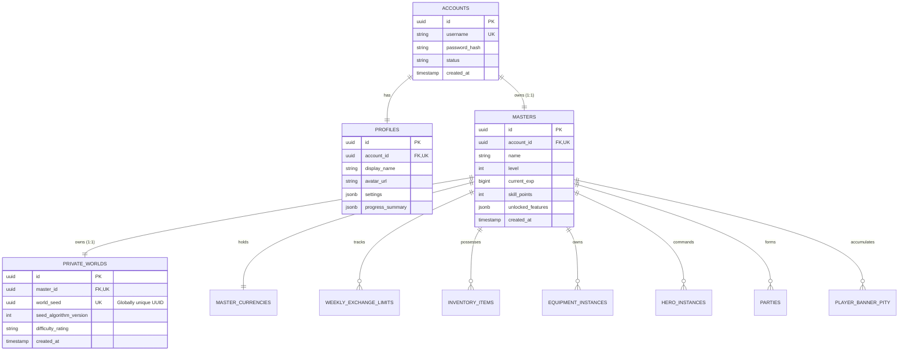
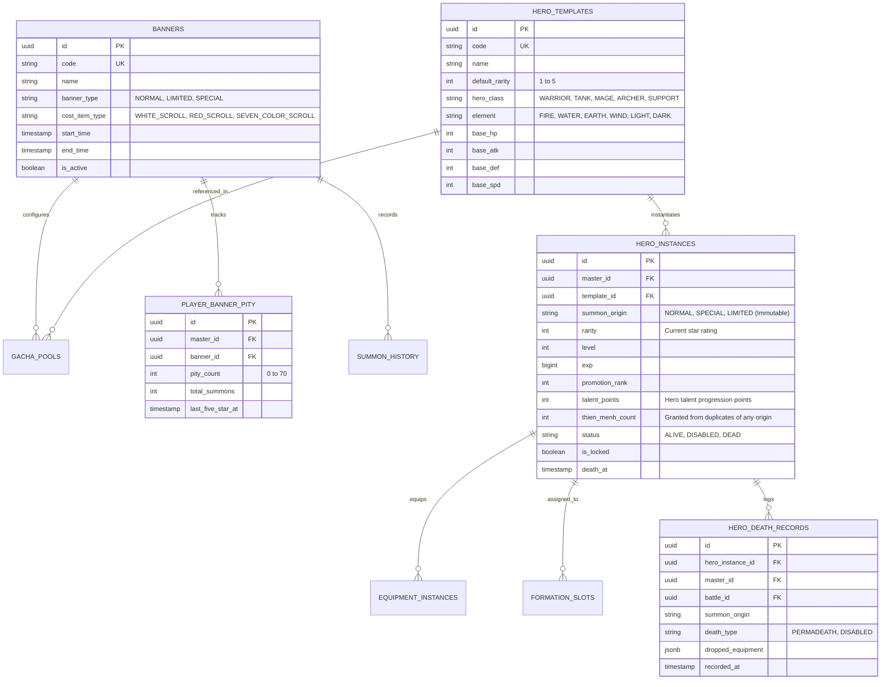
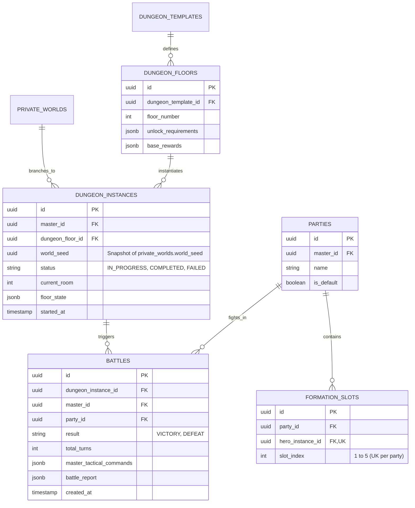

# P0 Data Model & Entity-Relationship Specification

| Field | Value |
|---|---|
| Document ID | IG-TECH-ERD-P0-001 |
| Version | 1.0 Draft |
| Project | Infinite Gacha (Hero Management & Survival Strategy RPG) |
| Source of Truth | BRD_P0_Draft.md, Phase_Scope_Matrix_P0.csv, MBFL.docx |
| Status | Approved Baseline Design |

---

## 1. Executive Summary & Core Modeling Principles

The P0 Data Model defines all database entities, relationships, constraints, and data dictionaries required to support the 164 functional requirements and 21 Use Cases defined for Phase P0.

### Fundamental Architectural Constraints:
1. **Single Master Guarantee:** Exactly 1 Master per Account (`accounts.id 1:1 masters.account_id`).
2. **Immutable Summon Origin:** Every Hero Instance permanently records its origin (`NORMAL`, `SPECIAL`, `LIMITED`) upon creation, dictating death and duplicate behaviors.
3. **Duplicate Handling:** A duplicate of any origin (`NORMAL`, `SPECIAL`, `LIMITED`) does not create a second instance and increments the owned Hero's `thien_menh_count` by 1.
4. **Permadeath vs. Disabled Isolation:**
   - Normal Hero death sets `status = 'DEAD'` and drops equipment (`hero_death_records`).
   - Special/Limited Hero death sets `status = 'DISABLED'`, retaining gear and state.
5. **Deterministic Global World Seed:** `private_worlds.world_seed` is a globally unique UUID/GUID generated once upon World creation. All procedural floor generations (`dungeon_instances`) deterministically branch from this seed.
6. **Per-Banner Isolated Pity:** `player_banner_pity` maintains independent counters with the confirmed $k=4$ polynomial curve; no counter ever carries over.
7. **Strict Currency Transaction Auditing:** All coin and scroll adjustments pass through `currency_transactions` with append-only ledger semantics.

---

## 2. Entity-Relationship Diagrams (Mermaid)

### 2.1 Core Player, Master & World Topology

### 2.2 Gacha, Hero & Death Management

### 2.3 Party, Dungeon & Combat Execution

---

## 3. Comprehensive Data Dictionary (Tables & Schemas)

### 3.1 Domain 01: Player & Master Management

#### `accounts`
Stores unique player identity and system authentication state.
| Column | Type | Constraints | Description |
|---|---|---|---|
| `id` | UUID | PK, DEFAULT gen_random_uuid() | Account identifier |
| `username` | VARCHAR(32) | NOT NULL, UNIQUE CASE-INSENSITIVE | 3–32 alphanumeric login credential |
| `password_hash` | VARCHAR(255) | NOT NULL | Salted password hash (Argon2id/Bcrypt) |
| `status` | VARCHAR(20) | NOT NULL, DEFAULT 'ACTIVE' | `ACTIVE`, `BANNED`, `SUSPENDED` |
| `created_at` | TIMESTAMP WITH TIME ZONE | NOT NULL, DEFAULT NOW() | Creation timestamp |
| `updated_at` | TIMESTAMP WITH TIME ZONE | NOT NULL, DEFAULT NOW() | Last update timestamp |

#### `account_sessions`
Revocable bearer sessions used for authenticated access and logout.
| Column | Type | Constraints | Description |
|---|---|---|---|
| `id` | VARCHAR(36) | PK | Session identifier included in the signed token |
| `account_id` | VARCHAR(36) | NOT NULL, FK -> `accounts(id)` ON DELETE CASCADE | Session owner |
| `created_at` | TIMESTAMPTZ | NOT NULL, DEFAULT NOW() | Session creation time |
| `expires_at` | TIMESTAMPTZ | NOT NULL | Token/session expiry |
| `revoked_at` | TIMESTAMPTZ | NULL | Set on logout to revoke this session |

#### `player_profiles`
Player customization and preferences. Progress summary is derived by the profile API from Master, World, Hero, and summon records.
| Column | Type | Constraints | Description |
|---|---|---|---|
| `account_id` | VARCHAR(36) | PK, FK -> `accounts(id)` ON DELETE CASCADE | 1:1 linked account |
| `display_name` | VARCHAR(32) | NOT NULL | User screen name |
| `avatar_url` | VARCHAR(255) | NULL | Avatar icon asset link |
| `settings` | JSONB | NOT NULL, DEFAULT '{}' | Optional language, sound, and notification preferences |
| `updated_at` | TIMESTAMPTZ | NOT NULL, DEFAULT NOW() | Last profile update |

#### `masters`
In-game protagonist and commander entity. Exactly one per account in P0.
| Column | Type | Constraints | Description |
|---|---|---|---|
| `id` | UUID | PK, DEFAULT gen_random_uuid() | Master identifier |
| `account_id` | UUID | NOT NULL, UNIQUE, FK -> `accounts(id)` | Strict 1:1 enforcement |
| `name` | VARCHAR(64) | NOT NULL | Master commander name |
| `level` | INT | NOT NULL, DEFAULT 1 | Master level (1..100) |
| `current_exp` | BIGINT | NOT NULL, DEFAULT 0 | Current EXP towards next level |
| `skill_points` | INT | NOT NULL, DEFAULT 0 | Unallocated Master skill points |
| `unlocked_features` | JSONB | NOT NULL, DEFAULT '[]' | Array of unlocked feature flags |
| `created_at` | TIMESTAMP WITH TIME ZONE | NOT NULL, DEFAULT NOW() | Master initialization time |

---

### 3.2 Domain 02: Gacha System

#### `banners`
Defines active and scheduled summon banners.
| Column | Type | Constraints | Description |
|---|---|---|---|
| `id` | UUID | PK, DEFAULT gen_random_uuid() | Banner identifier |
| `code` | VARCHAR(50) | NOT NULL, UNIQUE | Identifier (e.g. `BNR_NORMAL_01`, `BNR_SPEC_01`) |
| `name` | VARCHAR(100) | NOT NULL | Display name |
| `banner_type` | VARCHAR(20) | NOT NULL | `NORMAL`, `LIMITED`, `SPECIAL` |
| `cost_item_type` | VARCHAR(30) | NOT NULL | `WHITE_SCROLL`, `RED_SCROLL`, `SEVEN_COLOR_SCROLL` |
| `start_time` | TIMESTAMP WITH TIME ZONE | NOT NULL | Banner activation schedule |
| `end_time` | TIMESTAMP WITH TIME ZONE | NOT NULL | Banner expiration schedule |
| `is_active` | BOOLEAN | NOT NULL, DEFAULT FALSE | Runtime activation flag |

#### `gacha_pools`
Probability items and drop pools linked to banners.
| Column | Type | Constraints | Description |
|---|---|---|---|
| `id` | UUID | PK, DEFAULT gen_random_uuid() | Pool entry identifier |
| `banner_id` | UUID | NOT NULL, FK -> `banners(id)` | Associated banner |
| `rarity` | INT | NOT NULL | Star rating (1..5) |
| `item_type` | VARCHAR(20) | NOT NULL | `HERO`, `MATERIAL` |
| `reference_id` | UUID | NOT NULL | Points to `hero_templates(id)` or `item_templates(id)` |
| `base_weight` | INT | NOT NULL | Probability weight within rarity bracket |
| `is_featured` | BOOLEAN | NOT NULL, DEFAULT FALSE | Indicates Rate-Up promotion |

#### `player_banner_pity`
Tracks independent summon counters and guaranteed rewards per banner.
| Column | Type | Constraints | Description |
|---|---|---|---|
| `id` | UUID | PK, DEFAULT gen_random_uuid() | Counter identifier |
| `master_id` | UUID | NOT NULL, FK -> `masters(id)` | Master owner |
| `banner_id` | UUID | NOT NULL, FK -> `banners(id)` | Banner reference |
| `pity_count` | INT | NOT NULL, DEFAULT 0 | Rolls since last 5★ (0..70) |
| `total_summons` | INT | NOT NULL, DEFAULT 0 | Lifetime summons on this banner |
| `last_five_star_at` | TIMESTAMP WITH TIME ZONE | NULL | Timestamp of last 5★ pull |
| *Constraint* | UNIQUE (`master_id`, `banner_id`) | Ensures single counter per banner |

#### `summon_history`
Complete summon roll audit trail.
| Column | Type | Constraints | Description |
|---|---|---|---|
| `id` | UUID | PK, DEFAULT gen_random_uuid() | Record identifier |
| `master_id` | UUID | NOT NULL, FK -> `masters(id)` | Master owner |
| `banner_id` | UUID | NOT NULL, FK -> `banners(id)` | Banner rolled |
| `roll_number` | INT | NOT NULL | Banner pity counter value at roll time |
| `result_type` | VARCHAR(20) | NOT NULL | `HERO`, `MATERIAL` |
| `reference_id` | UUID | NOT NULL | Item/Hero template ID |
| `rarity` | INT | NOT NULL | Star rating (1..5) |
| `was_pity` | BOOLEAN | NOT NULL, DEFAULT FALSE | True if guaranteed roll |
| `assigned_origin` | VARCHAR(20) | NULL | `NORMAL`, `LIMITED`, `SPECIAL` |
| `created_at` | TIMESTAMP WITH TIME ZONE | NOT NULL, DEFAULT NOW() | Roll timestamp |

---

### 3.3 Domain 03 & 04: Hero Lifecycle, Development & Death

Hero level thresholds and stat growth are stored as editable configuration in `hero_level_configs`. `cumulative_exp_required` is the lifetime cumulative EXP needed to reach the configured level. The current development seed contains sample values through level 20 (per-level EXP cost grows by 1.5× from a base of 100; each level multiplies HP/ATK/DEF/SPD by 1.05). These are prototype values pending balance review, not approved production rules.

Master level EXP requirements are stored per target level in `master_level_configs`; awarded EXP is consumed at each threshold, preserving overflow toward later levels. The current sample starts at 1,000 EXP for level 2 and awards 300 Master EXP per PvE victory. `master_skill_templates` stores skill unlock level, duration, effect strength, and cooldown. Its sample team regeneration heals living Heroes for 1% max HP each real-time second for 5 seconds, then observes the configured 15-second cooldown. `feature_unlock_configs` maps feature codes to minimum Master levels; APIs enforce those requirements. Current prototype features are seeded at level 1 so the initial game loop remains available.

#### `hero_templates`
Static base definitions of Hero archetypes.
| Column | Type | Constraints | Description |
|---|---|---|---|
| `id` | UUID | PK, DEFAULT gen_random_uuid() | Template identifier |
| `code` | VARCHAR(50) | NOT NULL, UNIQUE | Code (e.g. `HERO_VALKYRIE_01`) |
| `name` | VARCHAR(100) | NOT NULL | Hero canonical name |
| `default_rarity` | INT | NOT NULL | Base star level (1..5) |
| `hero_class` | VARCHAR(30) | NOT NULL | `WARRIOR`, `TANK`, `MAGE`, `ARCHER`, `SUPPORT` |
| `element` | VARCHAR(20) | NOT NULL | `FIRE`, `WATER`, `EARTH`, `WIND`, `LIGHT`, `DARK` |
| `base_hp` | INT | NOT NULL | Base HP at Lv. 1 |
| `base_atk` | INT | NOT NULL | Base ATK at Lv. 1 |
| `base_def` | INT | NOT NULL | Base DEF at Lv. 1 |
| `base_spd` | INT | NOT NULL | Base SPD at Lv. 1 |

#### `hero_instances`
Individual Hero owned by a Master.
| Column | Type | Constraints | Description |
|---|---|---|---|
| `id` | UUID | PK, DEFAULT gen_random_uuid() | Instance identifier |
| `master_id` | UUID | NOT NULL, FK -> `masters(id)` | Owner Master |
| `template_id` | UUID | NOT NULL, FK -> `hero_templates(id)` | Archetype |
| `summon_origin` | VARCHAR(20) | NOT NULL | `NORMAL`, `SPECIAL`, `LIMITED` (Immutable) |
| `rarity` | INT | NOT NULL | Current star grade (1..5+) |
| `level` | INT | NOT NULL, DEFAULT 1 | Current level |
| `exp` | BIGINT | NOT NULL, DEFAULT 0 | Current EXP |
| `promotion_rank` | INT | NOT NULL, DEFAULT 0 | Ascension / rank level |
| `talent_points` | INT | NOT NULL, DEFAULT 0 | Hero talent progression points |
| `thien_menh_count` | INT | NOT NULL, DEFAULT 0 | Thiên Mệnh from duplicate 5★+ copies on Special/Limited banners |
| `status` | VARCHAR(20) | NOT NULL, DEFAULT 'ALIVE' | `ALIVE`, `DISABLED`, `DEAD` |
| `is_locked` | BOOLEAN | NOT NULL, DEFAULT FALSE | Lock flag to prevent accidental actions |
| `death_at` | TIMESTAMP WITH TIME ZONE | NULL | Time of demise |
| `created_at` | TIMESTAMP WITH TIME ZONE | NOT NULL, DEFAULT NOW() | Acquisition timestamp |

#### `hero_death_records`
Permanent audit of Hero casualties.
| Column | Type | Constraints | Description |
|---|---|---|---|
| `id` | UUID | PK, DEFAULT gen_random_uuid() | Record identifier |
| `hero_instance_id` | UUID | NOT NULL, FK -> `hero_instances(id)` | Casualty instance |
| `master_id` | UUID | NOT NULL, FK -> `masters(id)` | Master commander |
| `battle_id` | UUID | NOT NULL | Fatal combat instance |
| `summon_origin` | VARCHAR(20) | NOT NULL | Origin at time of death |
| `death_type` | VARCHAR(20) | NOT NULL | `PERMADEATH` (Normal) or `DISABLED` (Spec/Lim) |
| `dropped_equipment` | JSONB | NOT NULL, DEFAULT '[]' | Inventory items unequipped & dropped |
| `recorded_at` | TIMESTAMP WITH TIME ZONE | NOT NULL, DEFAULT NOW() | Demise timestamp |

---

### 3.4 Domain 05 & 06: Party, Formation & Combat Management

#### `parties`
Pre-configured battle squads.
| Column | Type | Constraints | Description |
|---|---|---|---|
| `id` | UUID | PK, DEFAULT gen_random_uuid() | Party identifier |
| `master_id` | UUID | NOT NULL, FK -> `masters(id)` | Owner Master |
| `name` | VARCHAR(50) | NOT NULL | Squad title |
| `is_default` | BOOLEAN | NOT NULL, DEFAULT FALSE | Default squad flag |

#### `formation_slots`
Position of Heroes in squad grid.
| Column | Type | Constraints | Description |
|---|---|---|---|
| `id` | UUID | PK, DEFAULT gen_random_uuid() | Slot mapping identifier |
| `party_id` | UUID | NOT NULL, FK -> `parties(id)` ON DELETE CASCADE | Associated squad |
| `hero_instance_id` | UUID | NOT NULL, FK -> `hero_instances(id)` | Assigned Hero |
| `slot_index` | INT | NOT NULL | Grid position (1 to 5) |
| *Constraint* | UNIQUE (`party_id`, `slot_index`) | Prevents position collisions |
| *Constraint* | UNIQUE (`party_id`, `hero_instance_id`) | Prevents duplicate Hero instance in same party |

#### `combat_party_slots`
One saved PvE party per Master, with up to five active Heroes in ordered slots.
| Column | Type | Constraints | Description |
|---|---|---|---|
| `id` | VARCHAR(36) | PK | Slot record |
| `master_id` | VARCHAR(36) | NOT NULL, FK -> `masters(id)` ON DELETE CASCADE | Party owner |
| `hero_id` | VARCHAR(36) | NOT NULL, FK -> `heroes(id)` ON DELETE CASCADE | Assigned Hero |
| `slot_index` | INT | NOT NULL, UNIQUE with `master_id`, CHECK 0-4 | Formation order |
| *Constraint* | UNIQUE (`master_id`, `hero_id`) | Hero can occupy one slot |

#### `dungeon_event_templates` (sample configuration)
Seeded per-floor events are selected deterministically from World Seed and floor using weighted configuration.
| Column | Type | Constraints | Description |
|---|---|---|---|
| `id`, `code` | VARCHAR | PK, `code` UNIQUE | Event identity |
| `name`, `description` | VARCHAR | NOT NULL | Display content |
| `event_type` | VARCHAR(20) | NOT NULL | `CACHE`, `REST`, or `AMBUSH` in sample data |
| `weight` | INT | NOT NULL | Relative event selection weight |
| `silver_reward` | INT | NOT NULL, DEFAULT 0 | Granted only after floor victory |
| `heal_percent` | DOUBLE PRECISION | NOT NULL, DEFAULT 0 | Sample pre-battle Hero healing |
| `enemy_attack_multiplier` | DOUBLE PRECISION | NOT NULL, DEFAULT 1 | Sample Ambush effect |
| `is_active` | BOOLEAN | NOT NULL, DEFAULT TRUE | Included in event selection |

#### `enemy_templates` (sample configuration)
Editable sample enemy stats and rewards used by the first PvE implementation. Values are prototype tuning only.
| Column | Type | Constraints | Description |
|---|---|---|---|
| `id`, `code` | VARCHAR | PK, `code` UNIQUE | Stable enemy identifiers |
| `name` | VARCHAR(100) | NOT NULL | Display name |
| `base_hp`, `base_atk`, `base_def`, `base_spd` | INT | NOT NULL | Base combat stats |
| `base_exp_reward`, `base_silver_reward` | INT | NOT NULL | Sample per-enemy rewards |
| `is_active` | BOOLEAN | NOT NULL, DEFAULT TRUE | Include in generated sample encounter |

#### `combat_sessions`
Tracks party selection, active PvE combat state, Tactical Buff cooldown, turn log, result, and rewards. One Master can have at most one active session.
| Column | Type | Constraints | Description |
|---|---|---|---|
| `id` | VARCHAR(36) | PK | Combat session identifier |
| `master_id` | VARCHAR(36) | NOT NULL, FK -> `masters(id)` ON DELETE CASCADE | Session owner |
| `world_id` | VARCHAR(36) | NOT NULL, FK -> `worlds(id)` ON DELETE CASCADE | World used for the session |
| `status` | VARCHAR(20) | NOT NULL, DEFAULT `ACTIVE` | Session state (`ACTIVE`, `VICTORY`, `DEFEAT`, `COMPLETED`) |
| `active_buff_id` | VARCHAR(40) | NULL | Currently selected Tactical Buff |
| `last_buff_change_at` | TIMESTAMP WITH TIME ZONE | NULL | Last successful buff change |
| `cooldown_until` | TIMESTAMP WITH TIME ZONE | NULL | Server-enforced end of the 15-second cooldown |
| `created_at` | TIMESTAMP WITH TIME ZONE | NOT NULL, DEFAULT NOW() | Session start |
| `finished_at` | TIMESTAMP WITH TIME ZONE | NULL | Session completion |
| `combat_state` | JSONB | NULL | Persisted combatant HP, round counter, and turn log |
| `battle_report` | JSONB | NULL | Final result, sample rewards, and fallen Heroes |
| *Constraint* | UNIQUE partial index (`master_id`) WHERE `status = 'ACTIVE'` | Prevents multiple active sessions per Master |

#### `battles`
Recorded instance of combat simulation.
| Column | Type | Constraints | Description |
|---|---|---|---|
| `id` | UUID | PK, DEFAULT gen_random_uuid() | Battle identifier |
| `dungeon_instance_id`| UUID | NOT NULL | Associated floor exploration instance |
| `master_id` | UUID | NOT NULL, FK -> `masters(id)` | Participating commander |
| `party_id` | UUID | NOT NULL, FK -> `parties(id)` | Squad deployed |
| `result` | VARCHAR(20) | NOT NULL | `VICTORY`, `DEFEAT` |
| `total_turns` | INT | NOT NULL | Battle duration in turns |
| `tactical_buff_state`| JSONB | NOT NULL, DEFAULT '{}' | Log of tactical buffs invoked with 15s cooldown |
| `battle_report` | JSONB | NOT NULL | Turn-by-turn combat log, damage, EXP, item rewards |
| `created_at` | TIMESTAMP WITH TIME ZONE | NOT NULL, DEFAULT NOW() | Completion timestamp |

---

### 3.5 Domain 07 & 08: World & Dungeon System

#### `private_worlds`
Master's personal world anchor.
| Column | Type | Constraints | Description |
|---|---|---|---|
| `id` | UUID | PK, DEFAULT gen_random_uuid() | World identifier |
| `master_id` | UUID | NOT NULL, UNIQUE, FK -> `masters(id)` | 1:1 Master world ownership |
| `world_seed` | UUID | NOT NULL, UNIQUE | Globally unique Seed (UUID/GUID) |
| `seed_algorithm_version`| INT | NOT NULL, DEFAULT 1 | Procedural generator version |
| `difficulty_rating` | NUMERIC(5,2)| NOT NULL, DEFAULT 1.00 | Derived difficulty scalar |
| `created_at` | TIMESTAMP WITH TIME ZONE | NOT NULL, DEFAULT NOW() | World creation timestamp |

#### `dungeon_templates` & `dungeon_floors`
Static master configuration for dungeon progression.
- `dungeon_templates`: `id` (UUID, PK), `name` (VARCHAR), `description` (TEXT), `total_floors` (INT).
- `dungeon_floors`: `id` (UUID, PK), `dungeon_template_id` (FK), `floor_number` (INT, UNIQUE with template), `unlock_requirements` (JSONB), `base_rewards` (JSONB).

#### `dungeon_instances`
Live runtime floor instance generated from the World Seed.
| Column | Type | Constraints | Description |
|---|---|---|---|
| `id` | UUID | PK, DEFAULT gen_random_uuid() | Dungeon session identifier |
| `master_id` | UUID | NOT NULL, FK -> `masters(id)` | Exploring commander |
| `dungeon_floor_id` | UUID | NOT NULL, FK -> `dungeon_floors(id)` | Target floor |
| `world_seed` | UUID | NOT NULL | Snapshot of `private_worlds.world_seed` |
| `status` | VARCHAR(20) | NOT NULL, DEFAULT 'IN_PROGRESS' | `IN_PROGRESS`, `COMPLETED`, `FAILED` |
| `current_room` | INT | NOT NULL, DEFAULT 1 | Exploration room pointer |
| `floor_state` | JSONB | NOT NULL | Deterministically generated map, encounters & monsters |
| `started_at` | TIMESTAMP WITH TIME ZONE | NOT NULL, DEFAULT NOW() | Session start |
| `finished_at` | TIMESTAMP WITH TIME ZONE | NULL | Session finish |

---

### 3.6 Domain 10 & 11: Inventory, Equipment, Currency & Exchange

#### `item_templates`
Master definitions for all non-Hero items.
| Column | Type | Constraints | Description |
|---|---|---|---|
| `id` | UUID | PK, DEFAULT gen_random_uuid() | Template identifier |
| `code` | VARCHAR(50) | NOT NULL, UNIQUE | Identifier (e.g. `SCROLL_WHITE`, `EQUIP_SWORD_01`) |
| `name` | VARCHAR(100) | NOT NULL | Item name |
| `item_type` | VARCHAR(30) | NOT NULL | `SUMMON_SCROLL`, `EQUIPMENT`, `MATERIAL`, `CONSUMABLE` |
| `rarity` | INT | NOT NULL | Item tier (1..5) |
| `stack_limit` | INT | NOT NULL, DEFAULT 9999 | Stack capacity |
| `properties` | JSONB | NOT NULL, DEFAULT '{}' | Equipment slots, stats, or consumable effects |

#### `inventory_items`
Player bag containing materials, consumables, and scrolls.
| Column | Type | Constraints | Description |
|---|---|---|---|
| `id` | UUID | PK, DEFAULT gen_random_uuid() | Stack identifier |
| `master_id` | UUID | NOT NULL, FK -> `masters(id)` | Owner Master |
| `item_template_id` | UUID | NOT NULL, FK -> `item_templates(id)` | Item archetype |
| `quantity` | BIGINT | NOT NULL, DEFAULT 1, CHECK (quantity >= 0) | Current count |
| *Constraint* | UNIQUE (`master_id`, `item_template_id`) | Normalized single stack entry |

#### `equipment_templates`
Editable equipment configuration with flat sample stat modifiers.
| Column | Type | Constraints | Description |
|---|---|---|---|
| `id`, `code` | VARCHAR | PK, `code` UNIQUE | Template identity |
| `name` | VARCHAR(100) | NOT NULL | Display name |
| `slot_type` | VARCHAR(30) | NOT NULL | `MAIN_HAND`, `CHEST`, `ACCESSORY` in the sample implementation |
| `rarity` | INT | NOT NULL, DEFAULT 1 | Sample equipment rarity |
| `bonus_hp`, `bonus_atk`, `bonus_def`, `bonus_spd` | INT | NOT NULL, DEFAULT 0 | Flat stat modifiers |
| `is_sample` | BOOLEAN | NOT NULL, DEFAULT TRUE | Marks development-only balance data |

#### `equipment_instances`
Individual equipment pieces owned by a Master. A normal Hero death moves equipped items to a World floor drop; a player must collect them.
| Column | Type | Constraints | Description |
|---|---|---|---|
| `id` | VARCHAR(36) | PK | Equipment instance |
| `master_id` | VARCHAR(36) | NOT NULL, FK -> `masters(id)` | Owner |
| `template_code` | VARCHAR(50) | NOT NULL, FK -> `equipment_templates(code)` | Item configuration |
| `equipped_hero_id` | VARCHAR(36) | NULL, FK -> `heroes(id)` | Current wearer |
| `location` | VARCHAR(20) | NOT NULL | `INVENTORY`, `EQUIPPED`, or `FLOOR_DROP` |
| `drop_world_id` | VARCHAR(36) | NULL, FK -> `worlds(id)` | World containing a dropped item |
| `drop_floor` | INT | NULL | Floor where the Hero died |
| `dropped_at`, `picked_up_at` | TIMESTAMP WITH TIME ZONE | NULL | Drop and recovery timestamps |
| *Constraint* | CHECK | `EQUIPPED` requires `equipped_hero_id`; other locations require NULL | Keeps ownership state consistent |
| *Rule* | Same Hero + equipment slot | At most one equipped item; replacing a slot returns the old item to inventory | Implemented transactionally |

#### `master_currencies`
Direct wallet state of primary currencies.
| Column | Type | Constraints | Description |
|---|---|---|---|
| `id` | UUID | PK, DEFAULT gen_random_uuid() | Wallet identifier |
| `master_id` | UUID | NOT NULL, UNIQUE, FK -> `masters(id)` | 1:1 wallet mapping |
| `silver_coins` | BIGINT | NOT NULL, DEFAULT 0, CHECK (silver_coins >= 0) | Basic currency |
| `gems` | BIGINT | NOT NULL, DEFAULT 0, CHECK (gems >= 0) | Premium currency (P0 store/hold only) |
| `white_scrolls` | INT | NOT NULL, DEFAULT 0, CHECK (white_scrolls >= 0) | Normal summon ticket |
| `red_scrolls` | INT | NOT NULL, DEFAULT 0, CHECK (red_scrolls >= 0) | Limited summon ticket |
| `seven_color_scrolls`| INT | NOT NULL, DEFAULT 0, CHECK (seven_color_scrolls >= 0) | Special summon ticket |
| `updated_at` | TIMESTAMP WITH TIME ZONE | NOT NULL, DEFAULT NOW() | Last transaction timestamp |

#### `weekly_exchange_limits`
Enforces the 50 white scrolls per week limit (Thursday 00:00 UTC+7 reset).
| Column | Type | Constraints | Description |
|---|---|---|---|
| `id` | UUID | PK, DEFAULT gen_random_uuid() | Record identifier |
| `master_id` | UUID | NOT NULL, FK -> `masters(id)` | Master reference |
| `week_key` | VARCHAR(20) | NOT NULL | Week identifier (e.g. `2026-W44_THU_UTC7`) |
| `exchanges_count` | INT | NOT NULL, DEFAULT 0, CHECK (exchanges_count <= 50) | Capped at 50 exchanges |
| `last_exchange_at` | TIMESTAMP WITH TIME ZONE | NOT NULL, DEFAULT NOW() | Timestamp of last swap |
| *Constraint* | UNIQUE (`master_id`, `week_key`) | Strict enforcement per weekly window |

---

### 3.7 Domain 14: System Administration, Audit & Security

#### `system_configs`
Version-controlled runtime business rules (Gacha rates, Pity curve coefficients, Seed generator parameters).
| Column | Type | Constraints | Description |
|---|---|---|---|
| `id` | UUID | PK, DEFAULT gen_random_uuid() | Config version identifier |
| `config_key` | VARCHAR(100) | NOT NULL | Rule code (e.g. `GACHA_PITY_EXPONENT_K`, `TACTICAL_BUFF_COOLDOWN_SEC`) |
| `version` | INT | NOT NULL | Incrementing version number |
| `config_value` | JSONB | NOT NULL | Structured value/parameters |
| `is_active` | BOOLEAN | NOT NULL, DEFAULT TRUE | Active runtime configuration pointer |
| `updated_by` | VARCHAR(64) | NOT NULL | Actor code (ACT-04, ACT-06) |
| `created_at` | TIMESTAMP WITH TIME ZONE | NOT NULL, DEFAULT NOW() | Version creation time |

#### `audit_logs`
Immutable record of sensitive game operations and administrative interventions.
| Column | Type | Constraints | Description |
|---|---|---|---|
| `id` | UUID | PK, DEFAULT gen_random_uuid() | Audit entry ID |
| `actor_id` | VARCHAR(64) | NOT NULL | Identifier of actor |
| `actor_type` | VARCHAR(20) | NOT NULL | `PLAYER`, `MASTER`, `ADMIN`, `SYSTEM` |
| `action` | VARCHAR(100) | NOT NULL | Function / event (e.g. `EXCHANGE_SILVER_SCROLL`, `PERMADEATH_EXECUTED`) |
| `entity_type` | VARCHAR(50) | NOT NULL | Target entity (`HERO_INSTANCE`, `CURRENCY`, `CONFIG`) |
| `entity_id` | VARCHAR(64) | NOT NULL | ID of modified entity |
| `diff_payload` | JSONB | NOT NULL | Before/After snapshot delta |
| `created_at` | TIMESTAMP WITH TIME ZONE | NOT NULL, DEFAULT NOW() | Audit timestamp |

---

## 4. Integrity Constraints & Business Logic Triggers

1. **Summon Origin Immutability:** An `UPDATE` trigger on `hero_instances` rejecting modifications to `summon_origin`.
2. **Duplicate Interception Trigger:** On `SUMMON_RESULT`:
   - If `template_id` matches an existing `hero_instances` for the Master:
     - For any origin: `UPDATE hero_instances SET thien_menh_count = thien_menh_count + 1 WHERE id = ...;`
     - Cancel row insertion into `hero_instances`.
3. **Equipped Gear Drop on Permadeath:**
   - If `hero_instances.status` updates to `DEAD` and `summon_origin = 'NORMAL'`:
     - Collect all `equipment_instances` where `hero_instance_id = NEW.id`.
     - Update their `hero_instance_id = NULL` and `is_equipped = FALSE`.
     - Insert serial snapshot into `hero_death_records.dropped_equipment`.
4. **Exchange Limit Window Validation:**
   - Pre-insert/update on `weekly_exchange_limits` ensures `exchanges_count + requested_amount <= 50`.
   - Rejects transaction if coin balance is below `requested_amount * 10000`.

---

## 5. Traceability Matrix to P0 Modules

| Module ID | Module Name | Primary Entities Involved |
|---|---|---|
| `MOD-01-01` | Account Management | `accounts`, `profiles` |
| `MOD-01-02` | Player Profile | `profiles` |
| `MOD-01-03` | Master Progression | `masters` |
| `MOD-02-01` | Banner Management | `banners`, `gacha_pools` |
| `MOD-02-02` | Normal Summon | `banners`, `player_banner_pity`, `summon_history`, `hero_instances` |
| `MOD-02-03` | Special & Limited Summon | `banners`, `player_banner_pity`, `summon_history`, `hero_instances` |
| `MOD-02-04` | Probability & Pity Management | `player_banner_pity`, `system_configs` |
| `MOD-02-05` | Duplicate & Summon Origin | `hero_instances` (`talent_points`, `thien_menh_count`) |
| `MOD-03-01` | Hero Collection | `hero_instances`, `hero_templates` |
| `MOD-03-02` | Hero Attributes & Development | `hero_instances` |
| `MOD-03-03` | Hero Skill Management | `hero_instances`, `hero_templates` |
| `MOD-04-01` | Death Classification & Processing | `hero_instances`, `hero_death_records` |
| `MOD-05-01` | Party Management | `parties` |
| `MOD-05-02` | Hero Assignment | `formation_slots` |
| `MOD-05-03` | Formation Management | `formation_slots` |
| `MOD-06-01` | Battle Initialization | `battles` |
| `MOD-06-02` | Auto Battle & Hero AI | `battles` |
| `MOD-06-03` | Battle Mechanics | `battles` |
| `MOD-06-04` | Master Command & Tactical Buff | `battles` (`tactical_buff_state`) |
| `MOD-06-05` | Battle Result & Report | `battles`, `hero_death_records` |
| `MOD-07-01` | Dungeon Configuration | `dungeon_templates`, `dungeon_floors` |
| `MOD-07-02` | Seed Management | `private_worlds` (`world_seed`) |
| `MOD-07-03` | Procedural Dungeon Generation | `dungeon_instances` |
| `MOD-07-04` | Floor Progression | `dungeon_instances`, `dungeon_floors` |
| `MOD-07-05` | Dungeon Exploration & Encounter | `dungeon_instances`, `battles` |
| `MOD-07-06` | Dungeon Reward | `dungeon_instances`, `inventory_items`, `master_currencies` |
| `MOD-08-01` | Private World Management | `private_worlds` |
| `MOD-10-01` | Inventory Management | `inventory_items`, `item_templates` |
| `MOD-10-02` | Equipment Management | `equipment_instances`, `item_templates` |
| `MOD-11-01` | Currency Management & Exchange | `master_currencies`, `weekly_exchange_limits`, `currency_transactions` |
| `MOD-14-03` | Gacha & Dungeon Configuration | `system_configs` |
| `MOD-14-05` | Analytics & Monitoring | `audit_logs` |
| `MOD-14-06` | Customer Support & Security | `audit_logs`, `accounts` |

