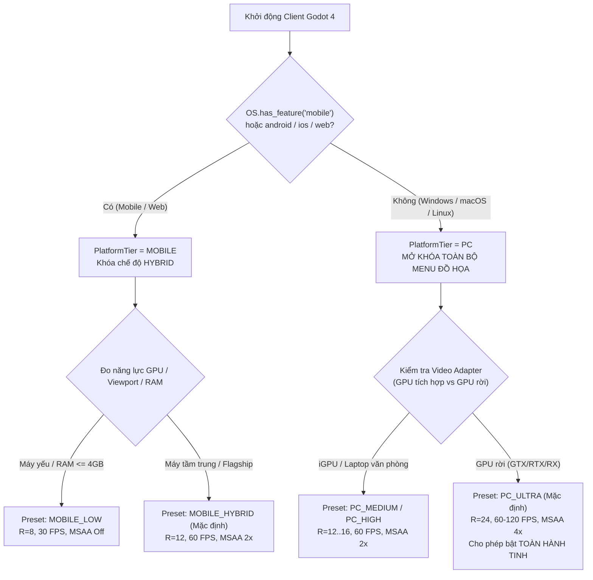

# Tài Liệu Thiết Kế: Hệ Thống Cài Đặt Đồ Họa & Render Distance Bản Đồ Hành Tinh (PC vs Mobile)

**Phiên bản:** 1.1 (thiết kế kết hợp tính năng đã có và đề xuất)
**Phạm vi áp dụng:** Chế độ Viễn Chinh — Bản Đồ Hành Tinh 3D (`WorldRtsMap`, `WorldMap3D`, `PlanetRenderer`, `TacticalGroundProps3D`, `DeviceProfile`) & API World Server (`600 × 300 = 180.000` ô).  
**Ngày cập nhật:** 2026-11-24

> **Phân biệt trạng thái, cập nhật 25/11/2026:** Đây là tài liệu thiết kế, không phải mô tả toàn bộ tính năng đã triển khai. Hiện có `DeviceProfile`, preset/cài đặt lưu qua `GameState`, renderer hành tinh và chunk snapshot; chế độ `PLANET_WIDE` là tên preset, không chứng minh Binary Atlas đã hoạt động. `GraphicsProfileManager`, autoload `GraphicsSettings`, endpoint `atlas.bin`, `WorldChunkCache` LRU/prefetch, memory-pressure handler, thermal adaptation, macro feed và các số đo hiệu năng bên dưới là **đề xuất hoặc mục tiêu**, chưa được xác nhận là code hiện hành. Không coi dự toán 0 ms, 60 FPS hay dung lượng như kết quả đo. Đối chiếu code và [hướng dẫn client](../client-godot/README.md) trước khi áp dụng.

---

## 1. Tổng Quan & Triết Lý Thiết Kế

Bản đồ Viễn Chinh của game vận hành trên **một hành tinh 3D liên tục (`600 × 300 = 180.000` ô gồm 5 lục địa, Kỳ Quan Hoàng Đế và Đại Dương)** với khả năng zoom mượt từ mặt đất chiến thuật ra quả cầu 3D xoay `360°`.

Vì giới hạn phần cứng giữa **Mobile** (RAM 3–8 GB, GPU tích hợp, giới hạn nhiệt & pin, mạng di động) và **PC** (RAM 16–64 GB, GPU rời 4–24 GB VRAM, nguồn điện ổn định) chênh lệch từ **10× đến 40×**, hệ thống đồ họa áp dụng nguyên tắc **Platform-Adaptive Architecture**:

| Nền tảng | Chiến lược mặc định | Quyền tùy chỉnh của người chơi |
| :--- | :--- | :--- |
| **Mobile** (`Android` / `iOS` / `Web`) | **Khóa vào Kiến trúc Hybrid Streaming** (vỏ hành tinh `360°` luôn hiển thị `≤ 3 Draw Calls`; 3D Props & dữ liệu ô stream theo cửa sổ quanh camera kèm LRU Cache gọn). | Cho phép chỉnh 3 mức an toàn: **Tiết kiệm pin (Thấp)** / **Hybrid Cân bằng (Mặc định)** / **Hybrid Cao**. **Ẩn/Khóa** các mức `Cực đại` & `Toàn Hành Tinh` để ngăn crash tràn RAM (OOM) và nóng máy. |
| **PC** (`Windows` / `macOS` / `Linux`) | **Mở khóa toàn bộ Menu Cài Đặt Đồ Họa** (mặc định tự chọn `Cao` hoặc `Cực đại` theo GPU). | Mở khóa đầy đủ: **Thấp / Trung bình / Cao / Cực đại / Toàn Hành Tinh (PC Only) / Tùy chỉnh chi tiết từng thanh trượt** (Render Distance, Mật độ 3D, MSAA, Texture, FPS, Bóng mây, Hậu kỳ). |

---

## 2. Cơ Chế Nhận Diện Nền Tảng & Chọn Profile Tự Động

Khi game khởi động lần đầu (chưa có `user://graphics_settings.cfg`), `GraphicsProfileManager` (Autoload) thực hiện phân loại tự động:



### Quy tắc nhận diện trong Godot 4
- **Mobile Flag**: `OS.has_feature("mobile") or OS.has_feature("android") or OS.has_feature("ios") or OS.has_feature("web")`.
- **Desktop / PC Flag**: `OS.has_feature("pc") or OS.has_feature("windows") or OS.has_feature("macos") or OS.has_feature("linuxbsd")`.
- **Fallback an toàn**: Nếu client PC có `RenderingServer.get_video_adapter_name()` chứa từ khóa iGPU đời cũ (`Intel UHD`, `Vega 3`, `llvmpipe`), mặc định khởi tạo `PC_MEDIUM` nhưng **vẫn giữ mở khóa toàn bộ thanh cài đặt** để người chơi tự quyết định.

---

## 3. Ma Trận Cài Đặt Đồ Họa Chi Tiết: Mobile (Hybrid) vs PC (Full Unlock)

### 3.1. Bảng preset thiết kế (tham khảo, không phải cam kết triển khai)

| Hạng mục cài đặt | Mobile: Thấp (`MOBILE_LOW`) | Mobile: Cân bằng (`MOBILE_HYBRID`) | Mobile: Cao (`MOBILE_HIGH`) | PC: Trung bình (`PC_MEDIUM`) | PC: Cao (`PC_HIGH`) | PC: Cực đại (`PC_ULTRA`) | PC: Toàn Hành Tinh (`PC_PLANET_WIDE`) |
| :--- | :---: | :---: | :---: | :---: | :---: | :---: | :---: |
| **Nền tảng cho phép** | Mobile / PC | Mobile / PC | Mobile / PC | PC | PC | PC | **Chỉ PC** |
| **Chế độ Streaming** | Hybrid | Hybrid | Hybrid | Hybrid | Hybrid+ | Wide Stream | **Planet Atlas + Wide 3D** |
| **Bán kính Render 3D Props (`R`)** | `8` ô (`17×17`) | `10` ô (`21×21`) | `12` ô (`25×25`) | `12` ô | `16` ô | `24` ô | **36 ô Near + Far-LOD Toàn Cầu** |
| **Ngưỡng ẩn 3D Props khi Zoom Out** | `zoom < 0.68` | `zoom < 0.62` | `zoom < 0.58` | `zoom < 0.60` | `zoom < 0.54` | `zoom < 0.46` | **Giữ Far-LOD tới `zoom 0.28`** |
| **Bán kính Chunk Server (`radius`)** | `8` (`289` ô) | `12` (`625` ô) | `12` (`625` ô) | `12` | `16` (`1.089` ô) | `16` + Pre-fetch 4 hướng | **Binary Atlas 180k ô + Live Sync** |
| **Bộ đệm RAM `WorldChunkCache`** | `800` ô (~0.5 MB) | `1.800` ô (~1 MB) | `3.000` ô (~1.8 MB) | `3.600` ô | `6.000` ô | `12.000` ô | **180.000 ô Packed (~540 KB)** |
| **Mật độ cây & chi tiết 3D Props** | `50%` (3 cây/ô) | `75%` (4–5 cây/ô) | `100%` (6 cây/ô) | `100%` | `100%` | `135%` (8 cây/ô) | **`150%` (9 cây/ô + Far Instancing)** |
| **Độ phân giải lưới hành tinh 3D** | `96 × 48` | `128 × 64` | `160 × 80` | `160 × 80` | `192 × 96` | `256 × 128` | **`256 × 128`** |
| **Độ phân giải `LocalTerrainPatch`** | `32 × 32` | `48 × 48` | `64 × 64` | `64 × 64` | `64 × 64` | `96 × 96` | **`96 × 96`** |
| **Texture Albedo / Detail Ground** | `1024×512` / `256²` | `2048×1024` / `512²` | `2048×1024` / `512²` | `2048×1024` / `512²` | `2048×1024` / `512²` | `2048×1024` / `512²` + AF 16x | **`2048×1024` / `512²` + AF 16x** |
| **Khử răng cưa (`SubViewport MSAA`)** | Tắt (`DISABLED`) | `2x` | `2x` | `2x` | `2x` | `4x` | **`4x` (tùy chọn `8x`)** |
| **Bóng chân mây & Sóng biển Shader** | Đơn giản hóa | Đầy đủ | Đầy đủ | Đầy đủ | Đầy đủ | Đầy đủ + Specular cao | **Đầy đủ + Specular cao** |
| **Lớp Mây 3D & Khí quyển Fresnel** | Khí quyển nhẹ | Đầy đủ | Đầy đủ | Đầy đủ | Đầy đủ | Đầy đủ | **Đầy đủ** |
| **Hậu kỳ `Glow / Bloom`** | Tắt | Nhẹ (`0.25`) | Chuẩn (`0.36`) | Chuẩn (`0.36`) | Chuẩn (`0.36`) | Cao (`0.45`) | **Cao (`0.45`)** |
| **Giới hạn FPS mặc định** | `30 FPS` | `60 FPS` | `60 FPS` | `60 FPS` | `60 FPS` | `120 FPS` | **Không giới hạn / `144 FPS`** |
| **Chu kỳ Poll mạng (`POLL_INTERVAL`)** | `5.0 giây` | `4.0 giây` | `3.0 giây` | `3.0 giây` | `3.0 giây` | `2.5 giây` | **`2.0 giây`** |

### 3.2. Các guardrail Mobile trong thiết kế (một phần chưa triển khai)
1. **Không bao giờ tải toàn bộ 180.000 ô dạng JSON** trên Mobile.
2. **Tự động giải phóng Cache khi hệ điều hành báo thiếu RAM** (`NOTIFICATION_APPLICATION_PAUSED` / memory warning → co `WorldChunkCache` về `600` ô gần nhất).
3. **Bảo vệ nhiệt độ & pin**: Nếu frame time Mobile vượt `28ms` liên tục trong `5 giây`, tự động gợi ý chuyển sang `MOBILE_LOW` hoặc giảm MSAA `2x → Off`.
4. **Ẩn hoặc khóa kèm chú thích**: Trong Menu Cài Đặt trên Mobile, hai mức `Cực đại` và `Toàn Hành Tinh` hiển thị trạng thái khóa mờ với chú thích *"Tính năng dành riêng cho bản PC để bảo vệ pin và bộ nhớ thiết bị"*.

---

## 4. Đề xuất kiến trúc chế độ "Toàn Hành Tinh" trên PC

Khi người chơi PC bật chế độ **Mở khóa Toàn Hành Tinh (`PC_PLANET_WIDE`)**, hệ thống **không** thực hiện kiểu brute-force (tải 40 MB JSON + vẽ 400.000 cây full-poly), mà kết hợp **3 kỹ thuật chuẩn game chiến thuật AAA**:

### 4.1. Binary World Terrain Atlas (~85 KB nén gzip cho toàn bộ 180.000 ô!)
- **Vấn đề của JSON**: 180.000 ô JSON chiếm ~38–45 MB, tốn nhiều giây tải mạng và gây đơ Main Thread khi parse.
- **Giải pháp Binary Atlas**:
  - Thêm 1 endpoint chỉ đọc, cache RAM trên server: `GET /api/world/planet/atlas.bin` (ETag cố định theo `planet_seed_version`).
  - Mỗi ô trong lưới `600 × 300` chỉ cần **3 bytes nhị phân**:
    - `byte 0`: `terrain_code` (`0=OCEAN, 1=PLAINS, 2=FOREST, 3=HILLS, 4=MOUNTAIN, 5=MARSH, 6=RUINS, 7=WONDER`).
    - `byte 1`: `continent_id` (4 bit cao) + `zone_tier` (2 bit) + `is_outer_rim` (1 bit).
    - `byte 2`: `region_index` (`0..255`).
  - Tổng kích thước thô: `180.000 × 3 bytes = 540 KB`. Khi nén `gzip`: chỉ còn **`~85 KB`** (nhỏ hơn 1 tấm ảnh thumbnail!).
  - **Kết quả trên PC**: Tải 1 lần duy nhất trong `< 40 ms` lúc vào Bản Đồ Viễn Chinh → Client PC sở hữu địa hình toàn bộ 180.000 ô trong RAM (`PackedByteArray` 540 KB), kéo chuột đi bất kỳ lục địa nào trên hành tinh đều hiển thị **Terrain Splat & địa hình 3D ngay lập tức 0ms**; chỉ cần đồng bộ dữ liệu động (Sương mù, Hầm ngục, Hạm đội, Lâu đài người chơi) qua chunk snapshot & macro feed!

### 4.2. Hierarchical 3D Props LOD (3 Vành Đai GPU Instancing)
Trên PC ở mức `PC_ULTRA` / `PC_PLANET_WIDE`, `TacticalGroundProps3D` mở rộng thành 2–3 tầng `MultiMeshInstance3D`:
1. **Vành đai Gần (`0 .. near_radius`, tối đa 24–36 ô quanh camera)**:
   - Render đầy đủ Lâu Đài 3D 4 tháp, Cổng Hầm Ngục phát sáng, Rừng cây nhiều tầng (`6–9` cây/ô), Núi chóp tuyết, Đồi, Cột Phế tích.
2. **Vành đai Trung (`near_radius .. mid_radius`, chỉ bật ở PC `PC_PLANET_WIDE`)**:
   - Dùng **1 mesh khối siêu tối giản (Low-poly Cluster / Billboard Impostor)** đại diện cả 1 cụm rừng hoặc 1 dãy núi trên mỗi ô (1 instance/ô thay vì 12 instance/ô) → tăng tầm nhìn 3D gấp **3–4 lần diện tích** mà chỉ thêm đúng `2–3 Draw Calls`!
3. **Vành đai Toàn Hành Tinh (`Global Macro Layer`)**:
   - Toàn bộ vỏ hành tinh `360° × 180°` + Mây + Khí quyển + Mốc Kỳ Quan + Chấm sáng Hạm đội + Lâu đài Đồng minh / Hầm Ngục Raid hạng A–S trên toàn cầu (qua endpoint nhẹ `GET /api/world/rts/macro`, ~3 KB JSON).

### 4.3. Build Transform Bất Đồng Bộ (`WorkerThreadPool`) & GPU Dirty-Hash
- Khi PC bật bán kính rộng (`R = 24..36`), việc tạo mảng `Transform3D` cho hàng nghìn cây/núi được đẩy sang `WorkerThreadPool.add_task(...)` (luồng phụ) để tính xong rồi mới nạp 1 lần vào `MultiMesh.buffer` trên Main Thread → **0 frame drop** khi kéo bản đồ tốc độ cao.

---

## 5. Thiết Kế Giao Diện Menu Cài Đặt Đồ Họa (Tập Trung Tại Avatar Master → Tab `⚙️ Cài Đặt`)

> **Quy tắc kiến trúc bắt buộc:** Tất cả mọi cài đặt hiện tại và về sau (Âm thanh, FPS, Đồ họa tổng thể, Bản Đồ Hành Tinh / Render Distance, Mây, Glow, MSAA...) đều đặt tập trung trong **Avatar Master → `PlayerProfileModal` → Tab `⚙️ Cài Đặt`** (`client-godot/scripts/ui/player_profile_modal.gd`) — **không tạo modal cài đặt riêng lẻ**.

Người chơi mở bằng cách bấm vào **Avatar Master** (góc trên-trái) → chọn tab **⚙️ Cài Đặt**:

### Bố cục giao diện đề xuất
1. **Thanh Chọn Nhanh Chất Lượng (Quality Preset Bar)**:
   - **Trên Mobile**: `[ Tiết kiệm pin ]` `[ Hybrid Cân bằng (Khuyên dùng) ]` `[ Hybrid Cao ]` `[ 🔒 Cực đại (PC) ]` `[ 🔒 Toàn Hành Tinh (PC) ]`
   - **Trên PC**: `[ Thấp ]` `[ Trung bình ]` `[ Cao ]` `[ Cực đại ]` `[ 🌟 Toàn Hành Tinh ]` `[ Tùy chỉnh ]`
2. **Nhóm 1 — Tầm Nhìn & Bản Đồ Hành Tinh (Render Distance)**:
   - *Chế độ tải bản đồ*: Hiển thị badge `📱 Hybrid Streaming` (cố định trên Mobile) hoặc cho phép chọn `Hybrid` ↔ `Toàn Hành Tinh (Atlas 180k ô)` (trên PC).
   - *Tầm nhìn Cảnh quan 3D (Render Distance)*: Thanh trượt `8 ô → 12 ô` (Mobile) | mở khóa rộng `8 ô → 36 ô + Far-LOD` (PC).
   - *Mật độ Rừng & Công trình 3D*: `50% / 75% / 100% / 150%`.
   - *Mốc Chiến Lược Toàn Cầu (Macro Markers)*: Bật / Tắt.
3. **Nhóm 2 — Chất Lượng Hình Ảnh 3D**:
   - *Chất lượng Địa hình & Shader*: `Thấp / Chuẩn / Cao`.
   - *Mây Hành Tinh & Khí Quyển 3D*: Bật / Tắt.
   - *Khử răng cưa (MSAA)*: `Tắt / 2x` (Mobile) | `Tắt / 2x / 4x / 8x` (PC).
   - *Hiệu ứng Phát sáng (Glow / Bloom)*: Tắt / Nhẹ / Cao.
4. **Nhóm 3 — Hiệu Năng & Pin**:
   - *Giới hạn FPS*: `30 / 60` (Mobile) | `30 / 60 / 120 / 144 / Không giới hạn` (PC).
   - *Bộ hiển thị thông số kỹ thuật (Tùy chọn)*: Bật/tắt góc nhỏ hiện `FPS | Draw Calls | Chunk Cache`.
5. **Thanh Ước Tính Tải VRAM / RAM (Chỉ hiện trên PC khi tùy chỉnh cao)**:
   - Ví dụ: `Ước tính bộ nhớ: ~145 MB VRAM • Chế độ Toàn Hành Tinh: Mượt trên GPU >= 4GB VRAM`.
   - Nếu người chơi PC chọn `PC_PLANET_WIDE` trên iGPU yếu, hiện hộp cảnh báo màu vàng nhẹ (*"Chế độ Toàn Hành Tinh yêu cầu GPU rời để giữ 60 FPS, bạn có chắc muốn áp dụng?"*).

---

## 6. Kiến Trúc Dữ Liệu & Tích Hợp Codebase Đề Xuất

### 6.1. Autoload `GraphicsSettings` (`client-godot/scripts/core/graphics_settings.gd`)
```gdscript
class_name GraphicsSettingsData
extends RefCounted

enum PlatformClass { MOBILE, PC }
enum QualityPreset {
	MOBILE_LOW,
	MOBILE_HYBRID,
	MOBILE_HIGH,
	PC_MEDIUM,
	PC_HIGH,
	PC_ULTRA,
	PC_PLANET_WIDE,
	CUSTOM,
}

# Các tham số cốt lõi được phát tín hiệu tới WorldMap3D / PlanetRenderer / WorldRtsMap
var platform_class: int = PlatformClass.PC
var preset: int = QualityPreset.PC_HIGH
var streaming_mode: String = "HYBRID"      # "HYBRID" | "PLANET_WIDE" (PC only)
var props_render_radius: int = 12          # 8..12 (Mobile), 8..36 (PC)
var props_cull_zoom: float = 0.60          # 0.68 (Mobile Low) .. 0.28 (PC Planet-Wide)
var props_density_scale: float = 1.0       # 0.5 .. 1.5
var chunk_request_radius: int = 12         # 8..12 (Mobile), 12..16 (PC)
var chunk_cache_max_tiles: int = 3600      # 800..3000 (Mobile), 3600..180000 (PC)
var planet_mesh_cols: int = 192            # 96..160 (Mobile), 160..256 (PC)
var local_patch_subdiv: int = 64           # 32..64 (Mobile), 64..96 (PC)
var msaa_3d: int = Viewport.MSAA_2X        # DISABLED..2X (Mobile), DISABLED..8X (PC)
var enable_clouds_3d: bool = true
var enable_glow: bool = true
var enable_far_lod_props: bool = false     # PC Only
var enable_global_macro_layer: bool = true
var max_fps: int = 60
var poll_interval_sec: float = 3.0
```

### 6.2. Điểm gắn vào các module hiện có (Không phá kiến trúc cũ)
| Module hiện có | Phản hồi khi `EventBus.world_graphics_settings_changed` phát ra |
| :--- | :--- |
| `client-godot/scripts/core/device_profile.gd` | Tự động phát hiện thiết bị PC vs Mobile (`detect_hardware`, `classify_hardware`, `sanitize_settings`). |
| `client-godot/scripts/state/game_state.gd` | Lưu/tải `user://graphics_settings.json`, tự áp preset lần đầu và giữ tương thích ngược `graphics_quality_changed`. |
| `client-godot/scripts/ui/player_profile_modal.gd` | Trung tâm UI duy nhất cho mọi cài đặt tại **Avatar Master → Tab `⚙️ Cài Đặt`**. |
| `client-godot/scripts/ui/world_rts_map.gd` | Cập nhật `_sub_viewport.msaa_3d`, `_poll_interval_sec`, `_chunk_radius`, gọi `world_map_manager.apply_graphics_settings`. |
| `client-godot/world_map/planet_3d/planet_renderer.gd` | Bật/tắt `CloudLayer` (`set_clouds_enabled`). |
| `client-godot/world_map/scenes/world_map_3d.gd` | Bật/tắt `world_env.environment.glow_enabled`. |
| `client-godot/world_map/planet_3d/tactical_ground_props.gd` | Áp dụng `render_distance_tiles`, `props_cull_zoom`, `props_density_scale`. |
| `client-godot/world_map/core/world_map_manager.gd` | Chuyển tiếp `apply_graphics_settings` và xóa dirty-hash props để hot-reload tức thì. |

---

## 7. Ngân Sách Hiệu Năng & Tiêu Chí Nghiệm Thu (Target Budgets)

| Phân khúc thiết bị | Preset mặc định | Mục tiêu FPS | Max Draw Calls (Tactical / 3D Globe) | Max RAM bản đồ | Max băng thông tải đầu |
| :--- | :--- | :---: | :---: | :---: | :---: |
| **Mobile Phổ Thông** (Snapdragon 6xx / 4GB RAM) | `MOBILE_LOW` | `>= 30 FPS` ổn định | `≤ 8 / ≤ 3` | `< 35 MB` | `< 60 KB` |
| **Mobile Tầm Trung / Flagship** | `MOBILE_HYBRID` | `60 FPS` ổn định | `≤ 10 / ≤ 3` | `< 60 MB` | `< 90 KB` |
| **PC Tầm Trung** (iGPU / GTX 1060 / 1650) | `PC_HIGH` | `60 FPS` ổn định | `≤ 12 / ≤ 4` | `< 120 MB` | `< 120 KB` |
| **PC Cấu Hình Cao** (RTX 3060+ / RX 6600+) | `PC_ULTRA` / `PC_PLANET_WIDE` | `60–144 FPS` | `≤ 18 / ≤ 6` | `< 250 MB` | **`< 180 KB`** (nhờ Binary Atlas gzip) |

---

## 8. Lộ Trình Triển Khai Đề Xuất (3 Giai Đoạn)

1. **Giai đoạn 1 — Khung Cài Đặt Đồ Họa PC/Mobile (`GraphicsSettings` + UI Modal)**:
   - Xây dựng Autoload `GraphicsSettings` tự động nhận diện PC vs Mobile, lưu/tải `user://graphics_settings.cfg`.
   - Áp dụng cấu hình thời gian thực (hot-reload không cần thoát game) vào `WorldRtsMap`, `PlanetRenderer`, `TacticalGroundProps3D`, `WorldMap3D`.
   - Tạo UI `GraphicsSettingsModal` khóa an toàn các mức Ultra/Planet-Wide trên Mobile và mở khóa toàn bộ trên PC.
2. **Giai đoạn 2 — Tối Ưu Hybrid Cho Cả Mobile & PC (`WorldChunkCache` LRU + Pre-fetch)**:
   - Triển khai `WorldChunkCache` (LRU trong RAM) + tải đón đầu theo hướng kéo để di chuyển qua vùng cũ tức thì **0ms**.
3. **Giai đoạn 3 — Mở Khóa Chế Độ "Toàn Hành Tinh" Độc Quyền PC (`Binary Atlas` + `Far-LOD` + `Macro Layer`)**:
   - Bổ sung endpoint `GET /api/world/planet/atlas.bin` (`~85 KB` gzip) & `GET /api/world/rts/macro` (`~3 KB` JSON) trên `packages/server`.
   - Bổ sung tầng Far-LOD MultiMesh + `WorkerThreadPool` trên Client PC cho tầm nhìn siêu rộng 60+ FPS.
