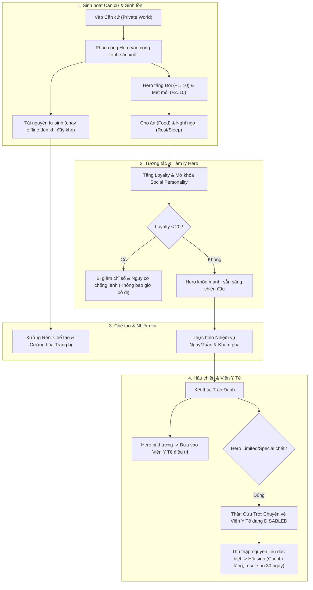

> Updated contract (2026-11-22): [Hero Chronicle, mortality and 1-7 star rarity](../HERO_CHRONICLE.md) supersedes the legacy origin-based death/duplicate rules and Divine Grace sections below. All Heroes die as DEAD and drop equipped gear; one RESURRECTION_GEM_7 revives to full HP with no Silver fee or escalating cycle. NORMAL/SPECIAL/LIMITED remain payment/banner types only.

# Business Requirements Document (BRD) — Phase P1

> **L?u tr? thi?t k? l?ch s?.** Checklist v? k?t qu? ki?m tra ph?n ?nh th?i ?i?m vi?t; c?c m? t? Web/Unity, pity v? duplicate c? th? ?? ???c thay th?. Xem [README hi?n h?nh](../../README.md) v? [backlog Godot](../../GODOT_BACKLOG.md), c?p nh?t 22/11/2026 (UTC+7).

| Field | Value |
|---|---|
| Document ID | IG-BA-BRD-P1-001 |
| Version | 0.1 Draft |
| Project | Infinite Gacha (Hero Management & Survival Strategy RPG) |
| Source of Truth | MBFL.docx, Phase_Scope_Matrix_P1.csv, Confirmed Owner Decisions |
| Status | Draft for Review |

---

## 1. Mục đích tài liệu (Purpose)

Tài liệu Đặc tả Yêu cầu Nghiệp vụ (BRD) Giai đoạn **P1: Hero & World Management** xác định chi tiết phạm vi 93 chức năng nghiệp vụ mở rộng chiều sâu quản lý Hero, hệ thống tâm lý - tính cách, cơ chế sinh tồn, công trình căn cứ, y tế, phục hồi và chế tạo trang bị, xây dựng trên nền tảng Core Gameplay P0 đã hoàn thành.

---

## 2. Phạm vi giai đoạn P1 (Scope)

### 2.1. Nằm trong phạm vi P1 (In Scope)
- **Tài khoản nâng cao (DM-01)**: Liên kết tài khoản bên thứ 3 (Google, Apple,...) và quy trình hỗ trợ khôi phục tài khoản.
- **Tâm lý & Mối quan hệ Hero (DM-03)**:
  - Cấu trúc 4 nhóm tính cách (Personality Traits): Core, Social, Behavioral, Special.
  - Hệ thống độ trung thành (Loyalty Score & State) và cơ chế chống lệnh/giảm chỉ số khi bất mãn.
  - Quan hệ giữa các Hero (Relationships) và sự kiện gắn kết (Bonding Events).
- **Y tế, Chữa trị & Hồi sinh (DM-04)**:
  - Phân loại chấn thương và giảm chỉ số tạm thời sau giao tranh.
  - Xây dựng, vận hành và nâng cấp Viện Y Tế (Medical Facility).
  - Cơ chế Thần Cứu Trợ (God's Grace): Hero Limited/Special tử trận chuyển về Viện Y Tế dạng `DISABLED`, hồi sinh bằng nguyên liệu đặc biệt, chi phí tăng dần theo chu kỳ 30 ngày.
- **Tiến trình Căn cứ & Thế giới riêng (DM-08)**:
  - Mở rộng Private World, xây dựng, nâng cấp và vận hành các công trình căn cứ.
  - Sản xuất tài nguyên tự động (Resource Production) và phân công Hero vào công trình theo hiệu suất.
- **Hệ thống Sinh tồn Hero (DM-09)**:
  - Chỉ số Đói (Hunger) và Mệt mỏi (Fatigue) theo thang đo 0–100.
  - Tiêu hao năng lượng theo thời gian và hoạt động (chiến đấu, hành quân, làm việc).
  - Quản lý kho lương thực, chế biến món ăn và cơ chế nghỉ ngơi/hồi phục sức lực.
- **Chế tạo & Cường hóa Trang bị (DM-10)**:
  - Chế tạo vật phẩm (Crafting) từ nguyên liệu Dungeon/Căn cứ.
  - Nâng cấp trang bị (Enhancement) và hợp thành nguyên liệu (Item Fusion).
- **Kinh tế cơ bản & Hòm thư (DM-11)**:
  - Cửa hàng tài nguyên (Shop catalog, rotation, giới hạn mua).
  - Hệ thống Hòm thư (Mailbox) nhận quà và đền bù hệ thống.
- **Nhiệm vụ & Thành tựu (DM-12)**:
  - Nhiệm vụ chính tuyến (Main Quest) và nhiệm vụ phụ (Side Quest).
  - Nhiệm vụ hằng ngày (Daily) và hằng tuần (Weekly).
  - Hệ thống Thành tựu tích lũy (Achievements).

### 2.2. Nằm ngoài phạm vi P1 (Deferred to P2 & P3)
- **Phase P2**: Cổng thanh toán nạp tiền thực (IAP / Payment Gateway), Sự kiện vận hành (LiveOps Events), Bảng xếp hạng liên server, Hệ thống Game Analytics chuyên sâu.
- **Phase P3**: Bản đồ thế giới chung (Global World Map), Chiếm đóng lãnh thổ, Trinh sát, PvP giữa người chơi, Bang hội (Alliances) và Chiến tranh thế giới (World Conquest War).

---

## 3. Các tác nhân tham gia (Actors)

| Mã Actor | Tác nhân | Vai trò trong P1 |
|---|---|---|
| **ACT-01** | Player | Người chơi điều khiển tài khoản, thực hiện chế tạo, phân công Hero, nâng cấp căn cứ |
| **ACT-02** | Master | Chỉ huy tối cao trong thế giới game, tương tác trực tiếp tạo dựng Loyalty với Hero |
| **ACT-03** | Game System | Hệ thống xử lý tự động (tính toán Hunger/Fatigue, sản xuất tài nguyên offline, kiểm tra chống lệnh) |
| **ACT-04** | Game Admin | Quản trị viên cấu hình công trình, giá trị sản xuất, thông số kinh tế |
| **ACT-05** | Game Operator | Nhân viên vận hành thiết lập lịch nhiệm vụ tuần, thông báo bảo trì, gửi thư đền bù |
| **ACT-06** | Game Designer | Nhà thiết kế cân bằng chỉ số tính cách, công thức đói/mệt, chi phí hồi sinh |
| **ACT-08** | Customer Support | Nhân viên hỗ trợ xử lý yêu cầu khôi phục tài khoản người chơi |

---

## 4. Các quy tắc nghiệp vụ đã chốt (Confirmed P1 Business Rules)

### BR-P1-001: Cơ chế Hồi sinh & Y tế (Resurrection & Recovery)
- Mọi Hero tử trận chuyển sang `DEAD` và rơi trang bị đang mặc, không phân biệt nguồn triệu hồi.
- Hồ sơ và tiểu sử được giữ trong **Sử Điện Anh Hùng** (`HERO_CHRONICLE`).
- Dùng **1 Ngọc hồi sinh 7★** (`RESURRECTION_GEM_7`) cho một Hero tử trận: trở lại `HEALTHY`, 100% HP, không mất Silver và không tăng chi phí theo số lần.
- Không tái tạo trang bị đã rơi. Điều trị thường không hồi sinh. Chi tiết và giới hạn dữ liệu cũ: [quy tắc hiện hành](../HERO_CHRONICLE.md).

### BR-P1-002: Lòng trung thành & Bất tuân lệnh (Hero Loyalty)
- **Nguyên tắc bất biến**: **HERO KHÔNG BAO GIỜ RỜI BỎ MASTER DƯỚI MỌI HÌNH THỨC**. Dù điểm Loyalty rơi xuống mức tối thiểu, Hero vẫn vĩnh viễn thuộc quyền sở hữu của Master.
- **Hậu quả khi Loyalty thấp**:
  - Khi Loyalty rơi vào vùng Nguy hiểm (`Loyalty < 20`): Hero bị giảm mạnh chỉ số chiến đấu cơ bản (ATK, DEF, SPD giảm từ 20% đến 50%).
  - Hero có xác suất nhất định từ chối tuân lệnh xuất trận (Disobedience) hoặc không kích hoạt kỹ năng theo chỉ thị chiến thuật của Master.
- **Gia tăng Loyalty**: Tặng món ăn yêu thích (Favorite Food), hoàn thành nhiệm vụ chung, nghỉ ngơi tại phòng cao cấp, hoặc thăng tiến sức mạnh.

### BR-P1-003: Cấu trúc 4 nhóm Tính cách Hero (Personality Traits)
Mỗi Hero khi khởi tạo được xác lập bộ tính cách gồm chính xác 4 Traits tương ứng 4 nhóm:
1. **Core Personality (Tính cách cốt lõi)**:
   - *Tính chất*: Bắt buộc, cố định vĩnh viễn, không thể thay đổi.
   - *Vai trò*: Quyết định bản chất gốc, khả năng chịu áp lực và tính miễn nhiễm với các hiệu ứng tinh thần/sợ hãi (Fear/Terror).
   - *Ví dụ*: `Brave` (Dũng cảm), `Introverted` (Trầm lặng), `Prideful` (Kiêu hãnh), `Kind` (Nhân từ).
2. **Social Personality (Tính cách xã hội)**:
   - *Tính chất*: Có thể phát triển và điều chỉnh thông qua tương tác và mức độ gắn kết (Bonding) với Master và đồng đội.
   - *Vai trò*: Quyết định cách giao tiếp, tốc độ tăng/giảm Loyalty và phản ứng khi đồng đội gặp nguy nan.
   - *Ví dụ*: `Friendly` (Thân thiện), `Loyal` (Trung thành), `Jealous` (Đố kỵ), `Independent` (Độc lập).
3. **Behavioral Personality (Hành vi & Phản xạ)**:
   - *Tính chất*: Có thể thay đổi dựa trên trải nghiệm thực chiến và quá trình huấn luyện.
   - *Vai trò*: Tác động trực tiếp lên logic ra quyết định của AI trong Auto Battle (thiên hướng tấn công dồn dập, phòng thủ cẩn trọng, hay rình rập).
   - *Ví dụ*: `Aggressive` (Hiếu chiến), `Cautious` (Thận trọng), `Curious` (Tò mò), `Disciplined` (Kỷ luật).
4. **Special Personality (Đặc tính chuyên biệt)**:
   - *Tính chất*: Phần lớn cố định; chỉ phát triển trong các sự kiện cốt truyện đặc biệt.
   - *Vai trò*: Tạo dấu ấn độc bản cho Hero, kích hoạt các phản ứng kỳ lạ trong sinh hoạt căn cứ hoặc phần thưởng ẩn.
   - *Ví dụ*: `Perfectionist` (Cầu toàn), `Gluttonous` (Háu ăn - tốn thêm thức ăn nhưng tăng kháng độc), `Romantic` (Lãng mạn), `Competitive` (Hiếu thắng).

### BR-P1-004: Hệ thống Sinh tồn — Thang đo Đói & Mệt mỏi (0–100)
Tất cả Hero đều chịu sự chi phối của 2 chỉ số sinh tồn chuẩn hóa từ `0` đến `100`:

#### 1. Chỉ số Đói (Hunger):
- `0` = No bụng hoàn toàn (No Hunger); `100` = Chết đói / Kiệt quệ (Starving).
- **Mức tăng**:
  - Tự nhiên theo thời gian: `+1` điểm / giờ.
  - Tham gia chiến đấu: `+5 đến +10` điểm / trận.
  - Di chuyển đường dài: `+3 đến +5` điểm / chặng.
  - Thực hiện nhiệm vụ căn cứ: `+3 đến +8` điểm / ca làm việc.
  - Sử dụng kỹ năng tiêu hao lớn: `+1 đến +3` điểm.
- **Phân cấp trạng thái**:
  - `0 – 19 (Full)`: Không chịu hình phạt, thể trạng sung mãn.
  - `20 – 39 (Satisfied)`: Trạng thái bình thường.
  - `40 – 59 (Hungry)`: Giảm nhẹ hiệu suất làm việc (-5%).
  - `60 – 79 (Very Hungry)`: Giảm đáng kể hiệu suất chiến đấu (-15% ATK/DEF).
  - `80 – 99 (Starving)`: Suy nhược nặng (-40% chỉ số), nguy cơ ngất xỉu.
  - `100 (Critical)`: Không thể tham gia hoạt động cường độ cao hoặc chiến đấu.
- **Phương thức hồi phục**:
  - `Food`: Thức ăn tiêu chuẩn, giảm điểm đói.
  - `Favorite Food`: Món ăn khoái khẩu, vừa giảm đói vừa tăng điểm Loyalty.
  - `Premium Food`: Thức ăn cao cấp, phục hồi nhanh và nhiều chỉ số.
  - `Special Meal`: Bữa tiệc đặc biệt, nhận thêm buff chỉ số tạm thời.

#### 2. Chỉ số Mệt mỏi (Fatigue):
- `0` = Hoàn toàn sung sức (Fully Rested); `100` = Kiệt sức hoàn toàn (Exhausted).
- **Mức tăng**:
  - Theo thời gian khi thức: `+2` điểm / giờ.
  - Tham gia chiến đấu: `+10 đến +15` điểm / trận.
  - Di chuyển đường dài: `+5 đến +8` điểm.
  - Nhiệm vụ kéo dài: `+5 đến +10` điểm.
  - Sử dụng tuyệt kỹ đặc biệt: `+2 đến +5` điểm.
- **Phân cấp trạng thái**:
  - `0 – 19 (Rested)`: Nhận buff thưởng nhỏ (+5% tốc độ hành động).
  - `20 – 39 (Normal)`: Trạng thái bình thường.
  - `40 – 59 (Tired)`: Giảm nhẹ tốc độ và khả năng né tránh.
  - `60 – 79 (Exhausted)`: Giảm mạnh tốc độ hồi phục năng lượng và chính xác.
  - `80 – 99 (Critical Fatigue)`: Báo động kiệt sức, khuyến cáo dừng chiến đấu.
  - `100 (Overexhausted)`: Đột quỵ / Bắt buộc phải đưa vào khu vực nghỉ ngơi.
- **Phương thức hồi phục**:
  - `Normal Rest`: Nghỉ chân tại ghế nghỉ căn cứ.
  - `Sleeping`: Ngủ tại giường trong Khu Ký Túc Xá.
  - `Premium Rest`: Nghỉ dưỡng tại Phòng Suite cao cấp (hồi phục thần tốc).
  - `Recovery Item`: Sử dụng thuốc tỉnh táo hoặc thần dược hồi sức.

### BR-P1-005: Sản xuất Offline Căn cứ & Giới hạn Kho (Offline Production)
- **Cơ chế Offline**: Khi người chơi thoát game (offline), các công trình sản xuất tài nguyên (gỗ, đá, quặng, lương thực) vẫn tiếp tục hoạt động liên tục mà **không bị giới hạn số giờ tích lũy**.
- **Điều kiện dừng**: Quá trình sản xuất chỉ tự động tạm ngưng khi lượng tài nguyên đạt ngưỡng **Dung lượng lưu trữ tối đa (Storage Capacity)** của công trình đó hoặc của Kho Tổng căn cứ. Người chơi cần đăng nhập để thu thập (Collect) nhằm giải phóng kho bãi.

### BR-P1-006: Liên kết & Khôi phục Tài khoản (Account Linking & Recovery)
- Cho phép người chơi liên kết tài khoản Guest hoặc tài khoản cục bộ với tài khoản mạng xã hội / nền tảng (Google Play Games, Apple Game Center).
- Cung cấp mã khôi phục (Recovery Code) hoặc quy trình xác thực CS (Customer Support) để lấy lại quyền truy cập tài khoản khi đổi hoặc mất thiết bị.

---

## 5. Danh mục 93 Chức năng P1 & Phân hệ chi tiết

### 5.1. Phân hệ DM-01: Tài khoản nâng cao (2 Functions)
| Function ID | Tên chức năng | Mô tả nghiệp vụ | Actor | Priority | Dependency |
|---|---|---|---|---|---|
| `FUN-01-01-004` | Account Linking – Liên kết tài khoản | Liên kết tài khoản với nền tảng Google / Apple | ACT-01 | Should | `FUN-01-01-001` |
| `FUN-01-01-005` | Account Recovery – Khôi phục tài khoản | Hỗ trợ khôi phục quyền truy cập tài khoản qua mã hoặc CS | ACT-01, ACT-03, ACT-08 | Should | `FUN-01-01-001` |

### 5.2. Phân hệ DM-03: Tâm lý & Quan hệ Hero (10 Functions)
| Function ID | Tên chức năng | Mô tả nghiệp vụ | Actor | Priority | Dependency |
|---|---|---|---|---|---|
| `FUN-03-04-001` | Assign Personality – Gán tính cách | Thiết lập cấu trúc 4 nhóm Personality Traits cho Hero | ACT-03 | Must | `FUN-03-01-002` |
| `FUN-03-04-002` | View Personality – Xem tính cách | Hiển thị hồ sơ chi tiết 4 tính cách của Hero | ACT-01 | Should | `FUN-03-04-001` |
| `FUN-03-04-003` | Personality Behavior – Xử lý hành vi | Điều chỉnh phản xạ và hành vi AI chiến đấu dựa trên tính cách | ACT-03 | Must | `FUN-03-04-001` |
| `FUN-03-04-004` | Calculate Loyalty – Tính Loyalty | Cập nhật điểm Loyalty dựa trên hành động chăm sóc, cho ăn, chiến đấu | ACT-03 | Must | `FUN-03-04-001` |
| `FUN-03-04-005` | View Loyalty – Xem Loyalty | Hiển thị thang điểm và trạng thái trung thành của Hero | ACT-01 | Should | `FUN-03-04-004` |
| `FUN-03-04-006` | Loyalty State Change – Thay đổi trạng thái | Xử lý suy giảm chỉ số / từ chối ra trận khi Loyalty < 20 (không rời bỏ) | ACT-03 | Must | `FUN-03-04-004` |
| `FUN-03-05-001` | Initialize Relationship – Khởi tạo quan hệ | Thiết lập trạng thái quan hệ ban đầu giữa các Hero cùng căn cứ | ACT-03 | Should | `FUN-03-04-001` |
| `FUN-03-05-002` | Update Relationship – Cập nhật quan hệ | Điều chỉnh mức độ hảo cảm/thù địch qua cùng đội hình, làm việc | ACT-03 | Should | `FUN-03-05-001` |
| `FUN-03-05-003` | View Relationship – Xem quan hệ | Hiển thị sơ đồ quan hệ mạng lưới giữa các Hero | ACT-01 | Could | `FUN-03-05-002` |
| `FUN-03-05-004` | Relationship Event – Sự kiện quan hệ | Kích hoạt các sự kiện hội thoại và buff cộng hưởng khi ra trận | ACT-03 | Could | `FUN-03-05-002` |

### 5.3. Phân hệ DM-04: Y tế & Hồi sinh Thần Cứu Trợ (17 Functions)
| Function ID | Tên chức năng | Mô tả nghiệp vụ | Actor | Priority | Dependency |
|---|---|---|---|---|---|
| `FUN-04-02-001` | Classify Injury – Phân loại thương tích | Xác định mức độ chấn thương sau trận đánh | ACT-03 | Must | `FUN-04-01-004` |
| `FUN-04-02-002` | Apply Temporary Reduction – Giảm chỉ số tạm thời | Áp dụng hình phạt suy giảm chỉ số khi bị thương | ACT-03 | Must | `FUN-04-02-001` |
| `FUN-04-02-003` | Calculate Recovery Duration – Tính thời gian hồi phục | Xác định thời gian cần thiết để chữa lành chấn thương | ACT-03 | Must | `FUN-04-02-001` |
| `FUN-04-02-004` | View Injury Status – Xem thương tích | Hiển thị chi tiết vết thương và đồng hồ đếm ngược phục hồi | ACT-01 | Should | `FUN-04-02-001` |
| `FUN-04-02-005` | Restore Hero Stats – Khôi phục chỉ số | Hoàn trả đầy đủ chỉ số sau khi thời gian chữa trị hoàn tất | ACT-03 | Must | `FUN-04-02-002`, `FUN-04-02-003` |
| `FUN-04-03-001` | Construct Medical Facility – Xây cơ sở chữa trị | Xây dựng Viện Y Tế tại Căn cứ để tiếp nhận Hero | ACT-01, ACT-03 | Must | `FUN-08-02-001` |
| `FUN-04-03-002` | Upgrade Medical Facility – Nâng cấp cơ sở | Nâng cấp cấp độ Viện Y Tế để rút ngắn thời gian và tăng giường bệnh | ACT-01, ACT-03 | Should | `FUN-04-03-001` |
| `FUN-04-03-003` | Manage Treatment Capacity – Quản lý công suất | Kiểm soát số lượng Hero tối đa được tiếp nhận chữa trị đồng thời | ACT-03 | Must | `FUN-04-03-001` |
| `FUN-04-03-004` | View Medical Facility – Xem cơ sở | Xem danh sách Hero đang nằm viện điều trị | ACT-01 | Should | `FUN-04-03-001` |
| `FUN-04-04-001` | Start Treatment – Bắt đầu chữa trị | Đưa Hero bị thương vào giường bệnh điều trị | ACT-01, ACT-03 | Must | `FUN-04-03-001` |
| `FUN-04-04-002` | Treatment Queue – Hàng đợi điều trị | Quản lý hàng chờ khi các buồng bệnh đã kín chỗ | ACT-03 | Must | `FUN-04-04-001` |
| `FUN-04-04-003` | Emergency Treatment – Chữa trị khẩn cấp | Tiêu hao dược liệu quý để chữa lành ngay lập tức | ACT-01, ACT-03 | Should | `FUN-04-04-001` |
| `FUN-04-04-004` | Treatment Completion – Hoàn tất chữa trị | Xác nhận Hero đã bình phục và đưa trở lại trạng thái khả dụng | ACT-03 | Must | `FUN-04-04-001` |
| `FUN-04-04-005` | Resurrection Request – Yêu cầu hồi sinh | Yêu cầu hồi sinh Hero Limited/Special ở trạng thái Disabled | ACT-01 | Should | `FUN-04-01-004` |
| `FUN-04-04-006` | Resurrection Validation – Kiểm tra hồi sinh | Kiểm tra nguyên liệu Thần Cứu Trợ và chi phí lũy tiến hiện tại | ACT-03 | Must | `FUN-04-04-005` |
| `FUN-04-04-007` | Process Resurrection – Xử lý hồi sinh | Hồi sinh Hero về trạng thái ALIVE, ghi nhận số lần và kiểm tra mốc 30 ngày | ACT-03 | Must | `FUN-04-04-006` |
| `FUN-04-04-008` | Recovery History – Lịch sử phục hồi | Lưu trữ nhật ký các ca điều trị và hồi sinh | ACT-03 | Should | `FUN-04-04-004`, `FUN-04-04-007` |

### 5.4. Phân hệ DM-08: Quản lý Căn cứ & Sản xuất (18 Functions)
| Function ID | Tên chức năng | Mô tả nghiệp vụ | Actor | Priority | Dependency |
|---|---|---|---|---|---|
| `FUN-08-01-002` | View World Overview – Xem tổng quan thế giới | Hiển thị toàn cảnh căn cứ, quy hoạch đất đai và tài nguyên | ACT-01 | Must | `FUN-08-01-001` |
| `FUN-08-01-003` | Manage World Progress – Quản lý tiến trình | Theo dõi cấp độ thế giới và các cột mốc phát triển | ACT-03 | Should | `FUN-08-01-001` |
| `FUN-08-01-004` | Expand Private World – Mở rộng thế giới | Khai hoang mở rộng các ô đất mới để xây dựng công trình | ACT-01, ACT-03 | Should | `FUN-08-01-002` |
| `FUN-08-01-005` | World Feature Unlock – Mở khóa tính năng | Mở khóa các công trình và khu vực mới theo mốc phát triển | ACT-03 | Must | `FUN-08-01-003` |
| `FUN-08-02-001` | Construct Building – Xây dựng công trình | Khởi công xây dựng nhà ở, kho bãi, xưởng rèn, nông trại | ACT-01, ACT-03 | Must | `FUN-08-01-001` |
| `FUN-08-02-002` | Upgrade Building – Nâng cấp công trình | Nâng cấp cấp độ công trình để tăng sản lượng và sức chứa | ACT-01, ACT-03 | Must | `FUN-08-02-001` |
| `FUN-08-02-003` | Unlock Building – Mở khóa công trình | Cho phép xây dựng các công trình cấp cao khi đủ điều kiện | ACT-03 | Must | `FUN-08-01-005` |
| `FUN-08-02-004` | Demolish Building – Phá dỡ công trình | Phá bỏ công trình không cần thiết và thu hồi một phần vật tư | ACT-01 | Could | `FUN-08-02-001` |
| `FUN-08-02-005` | View Building Status – Xem trạng thái | Hiển thị tiến độ xây dựng, nâng cấp và hiệu suất công trình | ACT-01 | Must | `FUN-08-02-001` |
| `FUN-08-03-001` | Configure Production – Cấu hình sản xuất | Thiết lập mục tiêu sản xuất tài nguyên (gỗ, đá, lương thực) | ACT-01 | Must | `FUN-08-02-001` |
| `FUN-08-03-002` | Generate Resources – Sản xuất tài nguyên | Tự động tạo sản lượng tài nguyên theo chu kỳ (kể cả khi offline) | ACT-03 | Must | `FUN-08-03-001` |
| `FUN-08-03-003` | Collect Resources – Thu thập tài nguyên | Chuyển tài nguyên sản xuất vào kho tổng của Master | ACT-01 | Must | `FUN-08-03-002` |
| `FUN-08-03-004` | Upgrade Production – Nâng cấp sản xuất | Áp dụng công nghệ/kỹ thuật nâng cao tốc độ sản xuất | ACT-01 | Should | `FUN-08-03-001` |
| `FUN-08-03-005` | Manage Production Capacity – Quản lý công suất | Kiểm soát giới hạn trữ lượng tối đa; dừng sinh sản khi đầy kho | ACT-03 | Should | `FUN-08-03-002` |
| `FUN-08-04-001` | Assign Hero to Building – Phân công Hero | Gán Hero vào làm việc tại các công trình tương ứng | ACT-01 | Should | `FUN-08-02-001` |
| `FUN-08-04-002` | Remove Hero from Building – Thu hồi Hero | Rút Hero khỏi công trình để phục vụ chiến đấu hoặc nghỉ ngơi | ACT-01 | Should | `FUN-08-04-001` |
| `FUN-08-04-003` | Calculate Work Efficiency – Tính hiệu suất | Tính toán chỉ số cộng thêm dựa trên Class và Trait của Hero | ACT-03 | Should | `FUN-08-04-001` |
| `FUN-08-04-004` | Monitor Hero Assignment – Theo dõi phân công | Kiểm tra mức độ tiêu hao năng lượng của Hero khi làm việc | ACT-03 | Should | `FUN-08-04-001` |

### 5.5. Phân hệ DM-09: Quản lý Sinh tồn Hero (16 Functions)
| Function ID | Tên chức năng | Mô tả nghiệp vụ | Actor | Priority | Dependency |
|---|---|---|---|---|---|
| `FUN-09-01-001` | Track Hero Hunger – Theo dõi đói | Quản lý thang đo Hunger 0–100 của từng Hero | ACT-03 | Must | `FUN-03-01-001` |
| `FUN-09-01-002` | Calculate Hunger Consumption – Tính tiêu hao | Tăng điểm đói theo thời gian (+1/h), chiến đấu và làm việc | ACT-03 | Must | `FUN-09-01-001` |
| `FUN-09-01-003` | Distribute Food – Phân phối thức ăn | Cung cấp khẩu phần ăn (Food, Favorite, Premium) để hạ điểm đói | ACT-01, ACT-03 | Must | `FUN-09-01-001` |
| `FUN-09-01-004` | Process Starvation – Xử lý thiếu đói | Áp dụng hình phạt suy giảm chỉ số khi Hunger > 40; đình chỉ ở 100 | ACT-03 | Must | `FUN-09-01-002` |
| `FUN-09-01-005` | View Hunger Status – Xem trạng thái đói | Hiển thị mức độ đói và các hiệu ứng đi kèm trên giao diện Hero | ACT-01 | Should | `FUN-09-01-001` |
| `FUN-09-02-001` | Track Hero Fatigue – Theo dõi mệt mỏi | Quản lý thang đo Fatigue 0–100 của từng Hero | ACT-03 | Must | `FUN-03-01-001` |
| `FUN-09-02-002` | Calculate Fatigue Increase – Tính mức mệt mỏi | Tăng điểm mệt mỏi theo thời gian thức (+2/h), trận đánh và nhiệm vụ | ACT-03 | Must | `FUN-09-02-001` |
| `FUN-09-02-003` | Start Hero Rest – Bắt đầu nghỉ ngơi | Đưa Hero vào phòng nghỉ hoặc giường ngủ trong căn cứ | ACT-01, ACT-03 | Must | `FUN-09-02-001` |
| `FUN-09-02-004` | Process Fatigue Recovery – Phục hồi mệt mỏi | Giảm dần điểm mệt mỏi theo tốc độ của buồng nghỉ ngơi | ACT-03 | Must | `FUN-09-02-003` |
| `FUN-09-02-005` | View Fatigue Status – Xem trạng thái mệt mỏi | Hiển thị thanh thể lực và cảnh báo kiệt sức | ACT-01 | Should | `FUN-09-02-001` |
| `FUN-09-02-006` | Prevent Overexertion – Ngăn quá sức | Cấm xuất trận hoặc làm việc nặng khi Fatigue đạt 100 | ACT-03 | Must | `FUN-09-02-001` |
| `FUN-09-03-001` | Manage Food Storage – Quản lý kho thức ăn | Bảo quản các loại thực phẩm, theo dõi số lượng tồn trữ | ACT-03 | Must | `FUN-10-01-001` |
| `FUN-09-03-002` | Produce Food – Sản xuất thức ăn | Nông trại và bếp ăn sản xuất lương thực cho toàn căn cứ | ACT-03 | Must | `FUN-08-03-002` |
| `FUN-09-03-003` | Consume Base Resources – Tiêu hao tại căn cứ | Khấu trừ lương thực sinh hoạt thường nhật của các Hero | ACT-03 | Must | `FUN-08-01-001` |
| `FUN-09-03-004` | Consume Dungeon Resources – Tiêu hao Dungeon | Khấu trừ lương khô và nước uống khi tổ đội đi khám phá | ACT-03 | Must | `FUN-07-05-002` |
| `FUN-09-03-005` | Consume War Resources – Tiêu hao chiến tranh | Chuẩn bị quân lương cho các chiến dịch quy mô lớn | ACT-03 | Should | `FUN-05-01-001` |

### 5.6. Phân hệ DM-10: Chế tạo & Nâng cấp Trang bị (4 Functions)
| Function ID | Tên chức năng | Mô tả nghiệp vụ | Actor | Priority | Dependency |
|---|---|---|---|---|---|
| `FUN-10-03-001` | Craft Item – Chế tạo vật phẩm | Chế tạo vũ khí, giáp trụ và trang sức theo bản thiết kế | ACT-01, ACT-03 | Must | `FUN-10-01-001` |
| `FUN-10-03-002` | Upgrade Equipment – Nâng cấp trang bị | Cường hóa cấp sao / cấp độ trang bị để tăng chỉ số | ACT-01, ACT-03 | Must | `FUN-10-02-001` |
| `FUN-10-03-003` | Item Fusion – Hợp thành vật phẩm | Dung hợp nhiều trang bị cùng loại để tạo trang bị phẩm cấp cao hơn | ACT-01, ACT-03 | Should | `FUN-10-03-001` |
| `FUN-10-03-004` | Material Requirement – Kiểm tra nguyên liệu | Xác thực đủ số lượng và chất lượng nguyên liệu trước khi rèn | ACT-03 | Must | `FUN-10-03-001` |

### 5.7. Phân hệ DM-11: Cửa hàng cơ bản & Hòm thư (12 Functions)
| Function ID | Tên chức năng | Mô tả nghiệp vụ | Actor | Priority | Dependency |
|---|---|---|---|---|---|
| `FUN-11-02-001` | View Shop – Xem cửa hàng | Hiển thị các gian hàng vật phẩm, nguyên liệu và trang bị | ACT-01 | Must | — |
| `FUN-11-02-002` | View Product Detail – Chi tiết sản phẩm | Hiển thị giá tiền Xu Bạc, mô tả và giới hạn mua | ACT-01 | Must | `FUN-11-02-001` |
| `FUN-11-02-003` | Purchase Item – Mua vật phẩm | Mua vật phẩm bằng Xu Bạc và nhận đồ vào túi | ACT-01, ACT-03 | Must | `FUN-11-02-001` |
| `FUN-11-02-004` | Shop Rotation – Luân phiên cửa hàng | Tự động làm mới danh mục hàng hóa theo ngày/tuần | ACT-03 | Should | `FUN-11-02-001` |
| `FUN-11-02-005` | Configure Shop – Cấu hình cửa hàng | Quản trị viên thiết lập giá bán và danh mục hàng hóa | ACT-04, ACT-06 | Must | — |
| `FUN-11-02-006` | Purchase Limit – Giới hạn mua | Áp đặt số lần mua tối đa trên từng món hàng theo chu kỳ | ACT-03 | Must | `FUN-11-02-003` |
| `FUN-11-04-001` | Generate Reward – Tạo phần thưởng | Đóng gói phần thưởng hệ thống theo sự kiện/cột mốc | ACT-03 | Must | — |
| `FUN-11-04-002` | Distribute Reward – Phân phối thưởng | Phân phát gói quà đến từng Master hợp lệ | ACT-03 | Must | `FUN-11-04-001` |
| `FUN-11-04-003` | Send Mail – Gửi thư | Hệ thống gửi thư hệ thống kèm vật phẩm đính kèm | ACT-03, ACT-05 | Must | `FUN-11-04-001` |
| `FUN-11-04-004` | View Mailbox – Xem hộp thư | Người chơi kiểm tra danh sách thư đến và đọc nội dung | ACT-01 | Must | `FUN-11-04-003` |
| `FUN-11-04-005` | Claim Mail Attachment – Nhận đính kèm | Nhận các vật phẩm/tiền tệ đính kèm vào kho | ACT-01, ACT-03 | Must | `FUN-11-04-004` |
| `FUN-11-04-006` | Mail Expiration – Hết hạn thư | Tự động hủy thư quá hạn (ví dụ: sau 30 ngày) | ACT-03 | Should | `FUN-11-04-003` |

### 5.8. Phân hệ DM-12: Nhiệm vụ & Thành tựu (14 Functions)
| Function ID | Tên chức năng | Mô tả nghiệp vụ | Actor | Priority | Dependency |
|---|---|---|---|---|---|
| `FUN-12-01-001` | View Quest List – Danh sách nhiệm vụ | Xem danh sách Main Quest và Side Quest đang khả dụng | ACT-01 | Must | — |
| `FUN-12-01-002` | Accept Quest – Nhận nhiệm vụ | Tiếp nhận nhiệm vụ phụ từ cư dân căn cứ hoặc bản tin | ACT-01 | Must | `FUN-12-01-001` |
| `FUN-12-01-003` | Track Quest Progress – Theo dõi tiến độ | Giám sát tiến độ hoàn thành các điều kiện nhiệm vụ | ACT-03 | Must | `FUN-12-01-002` |
| `FUN-12-01-004` | Complete Quest – Hoàn thành nhiệm vụ | Xác nhận nghiệm thu nhiệm vụ khi đủ điều kiện | ACT-03 | Must | `FUN-12-01-003` |
| `FUN-12-01-005` | Claim Quest Reward – Nhận thưởng | Nhận EXP Master, Xu Bạc và vật phẩm thưởng nhiệm vụ | ACT-01, ACT-03 | Must | `FUN-12-01-004` |
| `FUN-12-02-001` | Generate Daily Quest – Tạo nhiệm vụ ngày | Tạo ngẫu nhiên chuỗi nhiệm vụ hằng ngày lúc 00:00 UTC+7 | ACT-03 | Must | — |
| `FUN-12-02-002` | Generate Weekly Quest – Tạo nhiệm vụ tuần | Tạo chuỗi nhiệm vụ tuần reset vào thứ Năm 00:00 UTC+7 | ACT-03 | Must | — |
| `FUN-12-02-003` | Reset Daily Quest – Làm mới nhiệm vụ ngày | Làm mới tiến độ và danh sách nhiệm vụ ngày | ACT-03 | Must | `FUN-12-02-001` |
| `FUN-12-02-004` | Reset Weekly Quest – Làm mới nhiệm vụ tuần | Làm mới tiến độ và danh sách nhiệm vụ tuần | ACT-03 | Must | `FUN-12-02-002` |
| `FUN-12-02-005` | Track Mission Progress – Theo dõi nhiệm vụ | Ghi nhận tích lũy hoàn thành các chỉ tiêu ngày/tuần | ACT-03 | Must | `FUN-12-02-001`, `FUN-12-02-002` |
| `FUN-12-03-001` | View Achievement – Xem thành tựu | Hiển thị danh mục thành tựu tích lũy trọn đời | ACT-01 | Must | — |
| `FUN-12-03-002` | Track Achievement – Theo dõi thành tựu | Tự động ghi nhận mốc số lượng Hero, tầng Dungeon, tài nguyên rèn | ACT-03 | Must | `FUN-12-03-001` |
| `FUN-12-03-003` | Unlock Achievement – Mở khóa thành tựu | Mở khóa danh hiệu và danh mục thành tựu hoàn thành | ACT-03 | Must | `FUN-12-03-002` |
| `FUN-12-03-004` | Claim Achievement Reward – Nhận thưởng | Nhận phần thưởng thành tựu (Danh hiệu, Ngọc, Vé) | ACT-01, ACT-03 | Must | `FUN-12-03-003` |

---

## 6. Sơ đồ luồng nghiệp vụ P1 tổng thể (Indicative Flow)

---

## 7. Kiểm soát tài liệu & Truy xuất nguồn gốc (Traceability)

- Tài liệu BRD P1 này bao phủ chính xác **93 Chức năng nghiệp vụ** được phân loại rõ ràng theo `Function ID`.
- Bảng ma trận chức năng P1 tương ứng được lưu trữ tại file [Phase_Scope_Matrix_P1.csv](file:///f:/infiniti_gacha/Phase_Scope_Matrix_P1.csv).
- Các trường hợp ngoại lệ, thông số giao diện và kịch bản thử nghiệm sẽ được đặc tả trong bộ **Use Case Specifications P1** tiếp theo.
