# Business Requirements Document (BRD) — Phase P2

> **L?u tr? thi?t k? l?ch s?.** Checklist v? k?t qu? ki?m tra ph?n ?nh th?i ?i?m vi?t; c?c m? t? Web/Unity, pity v? duplicate c? th? ?? ???c thay th?. Xem [README hi?n h?nh](../../README.md) v? [backlog Godot](../../GODOT_BACKLOG.md), c?p nh?t 22/11/2026 (UTC+7).

| Field | Value |
|---|---|
| Document ID | IG-BA-BRD-P2-001 |
| Version | 0.1 Draft |
| Project | Infinite Gacha (Hero Management & Survival Strategy RPG) |
| Source of Truth | MBFL.docx, Phase_Scope_Matrix_P2.csv, Confirmed Owner Decisions |
| Status | Draft for Review |

---

## 1. Mục đích tài liệu (Purpose)

Tài liệu Đặc tả Yêu cầu Nghiệp vụ (BRD) Giai đoạn **P2: Economy & Live Operations** xác định chi tiết phạm vi 40 chức năng nghiệp vụ vận hành kinh tế, thanh toán In-App Purchase (IAP), sự kiện LiveOps định kỳ, bảng xếp hạng thành tích người chơi, hệ thống phân tích dữ liệu chuyên sâu và công cụ quản trị/chăm sóc khách hàng.

---

## 2. Phạm vi giai đoạn P2 (Scope)

### 2.1. Nằm trong phạm vi P2 (In Scope)
- **Thanh toán & Nạp tiền IAP (MOD-11-03)**:
  - Xem danh mục gói nạp Ngọc (Gems), vé triệu hồi và thẻ tháng.
  - Khởi tạo và xác thực thanh toán phía máy chủ qua Google Play Billing và Apple StoreKit.
  - Cấp phát vật phẩm tự động và ghi nhận lịch sử giao dịch.
  - Xử lý hoàn tiền (Refund / Chargeback) theo cơ chế Nợ Ngọc (**Gem Debt**).
- **Quản lý Sự kiện LiveOps (MOD-12-04)**:
  - Cấu hình, lên lịch và kích hoạt các sự kiện định kỳ (Mini, Standard, Major, Seasonal).
  - Chuỗi nhiệm vụ sự kiện, cửa hàng sự kiện và cơ chế ân hạn nhận thưởng 48 giờ.
  - Quy tắc kiểm soát gối đầu sự kiện (Overlap) và thời gian nghỉ giữa các sự kiện lớn (7-day cooldown).
- **Bảng xếp hạng Người chơi (MOD-12-05)**:
  - Bảng xếp hạng Tiến độ Dungeon (Tầng cao nhất & Thời gian vượt tầng nhanh nhất).
  - Bảng xếp hạng Lực chiến tổng thể (Total Account / Squad Power).
  - Phát thưởng xếp hạng theo chu kỳ mùa (Season).
- **Quản trị Người chơi & Hỗ trợ Khách hàng (MOD-14-01 & MOD-14-06)**:
  - Tra cứu hồ sơ người chơi, đóng băng/mở khóa tài khoản vi phạm.
  - Hệ thống gửi Ticket khiếu nại và công cụ đền bù vật phẩm trực tiếp vào hòm thư.
- **Cấu hình Nội dung & Kinh tế Vận hành (MOD-14-02 & MOD-14-04)**:
  - Cấu hình chỉ số Hero, quái vật, Boss, vật phẩm rớt và tỷ lệ shop.
  - Đẩy cấu hình động qua OTA (Over-The-Air) không cần cập nhật client.
- **Phân tích Dữ liệu Hệ thống (MOD-14-05)**:
  - Phân tích hành vi người chơi, Retention (D1, D7, D30), dòng tiền kinh tế (Gems / Silver sinks & sources), và hiệu suất Gacha.

### 2.2. Nằm ngoài phạm vi P2 (Deferred to Phase P3)
- **Phase P3: Multiplayer & World Conquest**:
  - Bản đồ thế giới chung (Global World Map), Hành quân thời gian thực, Chiếm cứ điểm lãnh thổ, Tấn công người chơi khác (PvP), Hệ thống Bang hội (Alliances) và Chiến tranh Chinh Phục Thế Giới (World Conquest Wars).

---

## 3. Các tác nhân tham gia (Actors)

| Mã Actor | Tác nhân | Vai trò trong P2 |
|---|---|---|
| **ACT-01** | Player | Người chơi mua gói nạp, tham gia sự kiện, theo dõi thứ hạng Leaderboard |
| **ACT-03** | Game System | Tự động tính toán điểm xếp hạng, ghi nhận nợ Gems, xoay tua sự kiện |
| **ACT-04** | Game Admin | Quản trị viên cấp cao, phân quyền, can thiệp tài khoản vi phạm, phê duyệt đền bù |
| **ACT-05** | Game Operator | Nhân viên LiveOps lên lịch sự kiện, mở gói khuyến mãi, gửi thư hệ thống |
| **ACT-06** | Game Designer | Nhà thiết kế cấu hình giá vật phẩm, thông số Boss sự kiện, phần thưởng mùa |
| **ACT-07** | Payment Gateway | Cổng thanh toán Google Play Store và Apple App Store xác thực biên lai |
| **ACT-08** | Customer Support | Nhân viên CS tiếp nhận ticket khiếu nại và xử lý đền bù |

---

## 4. Các quy tắc nghiệp vụ đã chốt (Confirmed P2 Business Rules)

### BR-P2-001: Chính sách Thanh toán & Cơ chế Ghi nợ Ngọc (Gem Debt)
- **Xác thực Biên lai**: Tất cả giao dịch nạp tiền IAP bắt buộc phải gửi mã biên lai (Receipt Token) về Game Server để gọi API xác thực với Apple App Store / Google Play Console trước khi cấp phát Gems hoặc vật phẩm vào tài khoản người chơi.
- **Quy tắc Xử lý Hoàn tiền (Refund / Chargeback)**:
  1. Khi nhận được thông báo hoàn tiền thành công từ cổng thanh toán (Apple/Google), hệ thống tự động trừ lại đúng số Gems tương ứng của gói đã hoàn.
  2. **Thu hồi Gems sẵn có**: Hệ thống thu hồi toàn bộ số Gems còn dư trong tài khoản người chơi.
  3. **Ghi nhận Nợ Ngọc (Gem Debt)**: Nếu người chơi đã tiêu xài một phần hoặc toàn bộ số Gems trước khi hoàn tiền:
     - Số Gems thiếu hụt được ghi nhận vào trường dữ liệu `gem_debt`.
     - Số dư Gems hiển thị sẽ về `0`, kèm chỉ báo số nợ hiện tại.
  4. **Ưu tiên Khấu trừ**: Mọi nguồn thu nhận Gems trong tương lai (qua nạp gói mới, quà bảo trì, thưởng thành tựu, thưởng sự kiện) sẽ được hệ thống tự động ưu tiên cấn trừ vào khoản nợ `gem_debt` trước cho đến khi hết nợ.
  5. **Chính sách Tài khoản**: Tài khoản **KHÔNG BỊ KHÓA VĨNH VIỄN**; người chơi vẫn có quyền đăng nhập và tham gia các tính năng bình thường không đòi hỏi sử dụng Gems.

### BR-P2-002: Chu kỳ Sự kiện LiveOps & Quy tắc Gối đầu (Event Duration & Overlap)
- **Phân loại Thời lượng Sự kiện**:
  - `Mini Event`: Kéo dài từ **3 đến 5 ngày** (sự kiện phụ trợ, tăng x2 EXP, x2 tỷ lệ rớt đồ).
  - `Standard Event`: Cố định đúng **14 ngày** (sự kiện chủ đạo, gắn liền với chu kỳ xoay tua Banner Gacha Giới Hạn).
  - `Major Event`: Kéo dài từ **14 đến 21 ngày** (sự kiện theo chủ đề lớn, có phụ bản và cốt truyện riêng).
  - `Seasonal Event`: Kéo dài từ **28 đến 35 ngày** (sự kiện mùa, lễ hội lớn, Battle Pass).
- **Quy tắc Kiểm soát Gối đầu (Event Overlap Policy)**:
  - Tối đa **1 Standard Event** hoạt động tại một thời điểm.
  - Cho phép chạy song song từ **1 đến 2 Mini Events** bổ trợ.
  - Không cho phép chạy đồng thời nhiều sự kiện có độ căng thẳng cao (high-intensity) nhằm tránh áp lực cày cuốc tiêu cực cho người chơi.
  - Mục tiêu, điểm tích lũy và cửa hàng đổi thưởng của từng sự kiện phải hoàn toàn độc lập.
- **Thời gian Hồi Sự kiện Lớn (Major Event Cooldown)**:
  - Bắt buộc phải có khoảng nghỉ tối thiểu **7 ngày** giữa 2 sự kiện lớn liên tiếp.
  - Trong thời gian 7 ngày này: Chỉ duy trì Mini Event nhẹ nhàng, quà đăng nhập và nhiệm vụ thường nhật.
- **Thời gian Ân hạn Nhận thưởng (Reward Claim Period)**:
  - Cung cấp thời gian ân hạn kéo dài **48 giờ** sau khi sự kiện kết thúc.
  - Trong 48 giờ này: Người chơi chỉ có thể nhận các mốc phần thưởng đã đạt chỉ tiêu; hệ thống không ghi nhận thêm tiến độ nhiệm vụ mới.

### BR-P2-003: Hệ thống Xếp hạng Đôi (Dual Leaderboard Structure)
Do Phase P2 chưa mở PvP, hệ thống xếp hạng tập trung vào thử thách PVE và thực lực đội hình:
1. **Bảng xếp hạng Tiến độ Dungeon (Dungeon Progression Leaderboard)**:
   - *Tiêu chí chính*: Tầng Dungeon cao nhất đã hoàn thành.
   - *Tiêu chí phụ (Tie-breaker)*: Tổng thời gian hoàn thành (Clear Time) tính bằng giây; người chơi vượt tầng nhanh hơn sẽ xếp trên.
2. **Bảng xếp hạng Lực chiến Tổng thể (Total Power Leaderboard)**:
   - *Tiêu chí*: Tổng điểm chiến lực (Combat Power - CP) của 5 Hero mạnh nhất trong danh sách sở hữu của Master.
- **Chu kỳ & Phần thưởng Mùa**:
  - Bảng xếp hạng chốt kết quả định kỳ theo mùa (Season: 14 ngày hoặc 30 ngày).
  - Phần thưởng (Danh hiệu độc quyền, Khung Avatar, Vé triệu hồi, Xu Bạc) được tự động kết toán và gửi qua Hòm thư hệ thống.

### BR-P2-004: Cấu hình Vận hành Nóng (LiveOps OTA Hotfix)
- Bảng cấu hình `system_configs` cho phép Admin điều chỉnh thông số cân bằng (chỉ số quái, tỷ lệ rớt đồ, lịch banner, danh mục shop) có versioning kiểm toán.
- Client tự động tải delta cấu hình mới nhất khi khởi động hoặc chuyển cảnh mà không yêu cầu người chơi tải lại gói cài đặt từ App Store/Google Play.

---

## 5. Danh mục 40 Chức năng P2 & Phân hệ chi tiết

### 5.1. Phân hệ DM-11: Thanh toán & Nạp tiền IAP (7 Functions)
| Function ID | Tên chức năng | Mô tả nghiệp vụ | Actor | Priority | Dependency |
|---|---|---|---|---|---|
| `FUN-11-03-001` | View Purchase Package – Xem gói mua | Hiển thị các gói nạp Gems, thẻ tháng, gói quà khởi đầu | ACT-01 | Must | — |
| `FUN-11-03-002` | Initiate Payment – Khởi tạo thanh toán | Tạo phiên giao dịch IAP và gửi lệnh mua đến Store | ACT-01, ACT-03 | Must | `FUN-11-03-001` |
| `FUN-11-03-003` | Process Payment – Xử lý thanh toán | Tiếp nhận xác nhận thanh toán từ Apple/Google | ACT-03, ACT-07 | Must | `FUN-11-03-002` |
| `FUN-11-03-004` | Validate Payment – Xác minh thanh toán | Gọi API máy chủ Store để kiểm thực biên lai giao dịch | ACT-03, ACT-07 | Must | `FUN-11-03-003` |
| `FUN-11-03-005` | Grant Purchase Reward – Cấp vật phẩm | Cộng Gems hoặc vật phẩm vào tài khoản; ưu tiên trừ nợ Gem Debt | ACT-03 | Must | `FUN-11-03-004` |
| `FUN-11-03-006` | Payment History – Lịch sử thanh toán | Tra cứu lịch sử nạp thẻ và trạng thái các đơn hàng | ACT-01, ACT-03 | Should | `FUN-11-03-003` |
| `FUN-11-03-007` | Refund Processing – Xử lý hoàn tiền | Thu hồi Gems và ghi nhận Nợ Gems (Gem Debt) khi có Refund | ACT-03, ACT-07 | Could | `FUN-11-03-004` |

### 5.2. Phân hệ DM-12: Quản lý Sự kiện LiveOps (7 Functions)
| Function ID | Tên chức năng | Mô tả nghiệp vụ | Actor | Priority | Dependency |
|---|---|---|---|---|---|
| `FUN-12-04-001` | Configure Event – Cấu hình sự kiện | Thiết lập nội dung, mục tiêu, phần thưởng và loại sự kiện | ACT-04, ACT-06 | Must | — |
| `FUN-12-04-002` | Schedule Event – Lên lịch sự kiện | Thiết lập mốc Start/End/Claim theo chu kỳ (chuẩn 14 ngày) | ACT-05 | Must | `FUN-12-04-001` |
| `FUN-12-04-003` | Activate Event – Kích hoạt sự kiện | Mở sự kiện theo lịch trình sau khi kiểm tra overlap | ACT-03, ACT-05 | Must | `FUN-12-04-002` |
| `FUN-12-04-004` | View Event – Xem sự kiện | Người chơi xem banner, thể lệ và tiến độ sự kiện | ACT-01 | Must | `FUN-12-04-003` |
| `FUN-12-04-005` | Event Mission – Nhiệm vụ sự kiện | Thực hiện các thử thách đặc biệt của sự kiện | ACT-01, ACT-03 | Must | `FUN-12-04-003` |
| `FUN-12-04-006` | Event Reward – Phần thưởng sự kiện | Đổi quà tại shop sự kiện hoặc nhận mốc tích lũy (kèm ân hạn 48h) | ACT-01, ACT-03 | Must | `FUN-12-04-005` |
| `FUN-12-04-007` | Close Event – Kết thúc sự kiện | Đóng cổng nhiệm vụ, kết toán dữ liệu và dọn dẹp tài nguyên | ACT-03, ACT-05 | Must | `FUN-12-04-003` |

### 5.3. Phân hệ DM-12: Bảng xếp hạng Người chơi (3 Functions)
| Function ID | Tên chức năng | Mô tả nghiệp vụ | Actor | Priority | Dependency |
|---|---|---|---|---|---|
| `FUN-12-05-001` | Calculate Ranking – Tính xếp hạng | Tính thứ hạng dựa trên Tầng Dungeon + Thời gian và Tổng Lực chiến | ACT-03 | Must | `FUN-07-04-005` |
| `FUN-12-05-002` | View Leaderboard – Xem bảng xếp hạng | Hiển thị Top 100 người chơi và thứ hạng hiện tại của bản thân | ACT-01 | Must | `FUN-12-05-001` |
| `FUN-12-05-003` | Distribute Ranking Reward – Thưởng xếp hạng | Kết toán mùa giải và phát thưởng danh hiệu/vật phẩm qua hòm thư | ACT-03 | Must | `FUN-12-05-001` |

### 5.4. Phân hệ DM-14: Quản trị Người chơi & CS (7 Functions)
| Function ID | Tên chức năng | Mô tả nghiệp vụ | Actor | Priority | Dependency |
|---|---|---|---|---|---|
| `FUN-14-01-001` | Search Player – Tìm người chơi | Tìm kiếm tài khoản theo ID, Username, Nickname | ACT-04, ACT-08 | Must | `FUN-01-01-001` |
| `FUN-14-01-002` | View Player Data – Xem dữ liệu | Tra cứu chi tiết tài nguyên, danh sách Hero, lịch sử nạp thẻ | ACT-04, ACT-08 | Must | `FUN-14-01-001` |
| `FUN-14-01-003` | Restrict Account – Hạn chế tài khoản | Khóa tài khoản (Ban), cấm chat (Mute) với tài khoản vi phạm | ACT-04 | Must | `FUN-14-01-001` |
| `FUN-14-01-004` | Restore Account – Khôi phục tài khoản | Gỡ lệnh cấm cho người chơi sau khi giải quyết khiếu nại | ACT-04 | Must | `FUN-14-01-003` |
| `FUN-14-01-005` | Player Compensation – Bồi thường | Công cụ gửi vật phẩm đền bù trực tiếp vào Hòm thư người chơi | ACT-04, ACT-08 | Must | `FUN-14-01-002` |
| `FUN-14-06-001` | Support Ticket – Yêu cầu hỗ trợ | Người chơi tạo phiếu khiếu nại báo lỗi hoặc vấn đề nạp thẻ | ACT-01 | Must | — |
| `FUN-14-06-002` | Handle Support Request – Xử lý hỗ trợ | Nhân viên CS phản hồi và đóng phiếu hỗ trợ | ACT-08 | Must | `FUN-14-06-001` |

### 5.5. Phân hệ DM-14: Cấu hình Nội dung & Vận hành (11 Functions)
| Function ID | Tên chức năng | Mô tả nghiệp vụ | Actor | Priority | Dependency |
|---|---|---|---|---|---|
| `FUN-14-02-001` | Hero Template Configuration – Cấu hình Hero | Quản lý bộ dữ liệu gốc của Hero | ACT-04, ACT-06 | Must | — |
| `FUN-14-02-002` | Hero Stats Configuration – Cấu hình chỉ số | Điều chỉnh chỉ số cơ bản, tăng trưởng chỉ số Hero | ACT-04, ACT-06 | Must | `FUN-14-02-001` |
| `FUN-14-02-003` | Hero Skill Configuration – Cấu hình kỹ năng | Cấu hình sát thương và cơ chế kỹ năng Hero | ACT-04, ACT-06 | Must | `FUN-14-02-001` |
| `FUN-14-02-004` | Monster Configuration – Cấu hình quái vật | Thiết lập thông số và hành vi của quái Dungeon | ACT-04, ACT-06 | Must | — |
| `FUN-14-02-005` | Boss Configuration – Cấu hình Boss | Thiết lập kỹ năng và cơ chế Boss | ACT-04, ACT-06 | Must | `FUN-14-02-004` |
| `FUN-14-02-006` | Item Configuration – Cấu hình vật phẩm | Quản lý danh mục vật phẩm, nguyên liệu và trang bị | ACT-04, ACT-06 | Must | — |
| `FUN-14-04-001` | Currency Configuration – Cấu hình tiền tệ | Quản lý thông số nguồn thu và kênh tiêu hao tiền tệ | ACT-04, ACT-06 | Must | `DM-11` |
| `FUN-14-04-002` | Shop Configuration – Cấu hình cửa hàng | Thiết lập giá bán và hạn mức các gói shop | ACT-04, ACT-06 | Must | `DM-11` |
| `FUN-14-04-003` | Reward Configuration – Cấu hình thưởng | Quản lý bảng phần thưởng nhiệm vụ và phụ bản | ACT-04, ACT-06 | Must | `DM-11` |
| `FUN-14-04-004` | Event Configuration – Cấu hình sự kiện | Cấu hình thông số nội dung sự kiện theo mùa | ACT-04, ACT-06 | Must | `DM-12` |
| `FUN-14-04-005` | Banner Configuration – Cấu hình banner | Cấu hình danh sách Banner và lịch trình xoay tua | ACT-04, ACT-06 | Must | `DM-02` |

### 5.6. Phân hệ DM-14: Phân tích Dữ liệu Hệ thống (5 Functions)
| Function ID | Tên chức năng | Mô tả nghiệp vụ | Actor | Priority | Dependency |
|---|---|---|---|---|---|
| `FUN-14-05-001` | Player Analytics – Phân tích người chơi | Thống kê số lượng người dùng hoạt động (DAU, MAU, CCU) | ACT-03, ACT-04 | Must | `DM-01` |
| `FUN-14-05-002` | Gacha Analytics – Phân tích Gacha | Thống kê số lượt roll, phân bổ Pity và tỷ lệ ra Hero 5★ | ACT-03, ACT-04 | Must | `DM-02` |
| `FUN-14-05-003` | Economy Analytics – Phân tích kinh tế | Đo lường tỷ lệ lạm phát Xu Bạc, lượng Gems nạp và tiêu thụ | ACT-03, ACT-04 | Must | `DM-11` |
| `FUN-14-05-004` | Battle Analytics – Phân tích chiến đấu | Đo lường tỷ lệ thắng/thua, heatmap tử trận theo tầng Dungeon | ACT-03, ACT-04 | Must | `DM-06` |
| `FUN-14-05-005` | Retention Analytics – Phân tích duy trì | Theo dõi tỷ lệ giữ chân người chơi (D1, D7, D30) | ACT-03, ACT-04 | Must | `DM-01` |

---

## 6. Sơ đồ Luồng Nghiệp vụ Chính P2 (Indicative Flow)

```mermaid
flowchart TD
    subgraph IAP["1. Luồng Mua Hàng & Hoàn Tiền IAP"]
        Buy["Người chơi chọn Gói Gems"] --> Pay["Thanh toán qua Google/Apple"]
        Pay --> Verify["Game Server xác thực Biên lai (Receipt)"]
        Verify -- "Hợp lệ" --> DebtCheck{"Có nợ Gem Debt?"}
        DebtCheck -- "Có" --> DeductDebt["Khấu trừ nợ trước, cộng phần dư vào ví"]
        DebtCheck -- "Không" --> Grant["Cộng đầy đủ Gems vào ví"]
        Pay -. "Người chơi Refund" .-> RefundEvent["Nhận tín hiệu Refund từ Store"]
        RefundEvent --> Clawback["Thu hồi Gems hiện có"]
        Clawback --> RecordDebt["Phần Gems thiếu hụt ghi thành Gem Debt (Không khóa nick)"]
    end

    subgraph LiveOps["2. Luồng Vận hành Sự kiện & Xếp hạng"]
        AdminConfig["LiveOps lên lịch Standard Event (14 ngày)"] --> OverlapCheck{"Kiểm tra trùng sự kiện?"}
        OverlapCheck -- "Hợp lệ" --> EventActive["Kích hoạt Sự kiện"]
        EventActive --> EventPlay["Người chơi cày Nhiệm vụ & Leo Tháp"]
        EventPlay --> Leaderboard["Cập nhật BXH Tiến độ Dungeon & Lực chiến"]
        EventActive --> EventEnd["Sự kiện kết thúc -> Mở 48h ân hạn nhận quà"]
        Leaderboard --> SeasonEnd["Chốt mùa giải -> Tự động gửi thưởng BXH qua Hòm thư"]
    end
```

---

## 7. Kiểm soát tài liệu & Truy xuất nguồn gốc (Traceability)

- Tài liệu BRD P2 này bao phủ đầy đủ **40 Chức năng nghiệp vụ** được phân rã theo `Function ID`.
- Bảng ma trận chức năng P2 tương ứng được lưu trữ tại file [Phase_Scope_Matrix_P2.csv](file:///f:/infiniti_gacha/Phase_Scope_Matrix_P2.csv).
- Các kịch bản Use Case và mô hình dữ liệu hỗ trợ P2 sẽ được đặc tả trong các tài liệu tiếp theo.
