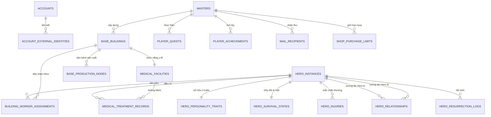

# P1 Data Model & Entity-Relationship Specification

> **L?u tr? thi?t k? l?ch s?.** Checklist v? k?t qu? ki?m tra ph?n ?nh th?i ?i?m vi?t; c?c m? t? Web/Unity, pity v? duplicate c? th? ?? ???c thay th?. Xem [README hi?n h?nh](../../README.md) v? [backlog Godot](../../GODOT_BACKLOG.md), c?p nh?t 22/11/2026 (UTC+7).

| Field | Value |
|---|---|
| Document ID | IG-TECH-ERD-P1-001 |
| Version | 0.1 Draft |
| Project | Infinite Gacha (Hero Management & Survival Strategy RPG) |
| Source Baseline | BRD_P1_Draft.md, Use_Case_Spec_P1_Draft.md, Data_Model_P0_Draft.md |
| Status | Draft for Review |

---

## 1. Tổng quan & Mở rộng Kiến trúc Dữ liệu P1

Tài liệu này đặc tả thiết kế cấu trúc dữ liệu, các bảng thực thể mới, quan hệ và ràng buộc toàn vẹn nhằm đáp ứng toàn bộ **93 Chức năng** và **17 Use Cases** thuộc Giai đoạn **Phase P1: Hero & World Management**.

### Các nguyên tắc mở rộng P1:
1. **Liên kết Danh tính Bên thứ 3 (OAuth 1:N)**: Một tài khoản `accounts` có thể liên kết nhiều định danh (Google, Apple) qua `account_external_identities`.
2. **Cấu trúc 4 Traits & Loyalty**: Bảng `hero_personality_traits` lưu trữ cố định `core_trait`, đồng thời quản lý `social_trait`, `behavioral_trait`, `special_trait` và điểm `loyalty_score` (0–100).
3. **Mối quan hệ Hero (Social Graph)**: Bảng `hero_relationships` lưu điểm hảo cảm hai chiều đối xứng giữa các cặp Hero.
4. **Viện Y Tế & Hồi sinh Thần Cứu Trợ (30 ngày)**: Bảng `medical_facilities`, `medical_treatment_records`, và `hero_resurrection_logs` theo dõi số lần hồi sinh và mốc 30 ngày để reset chi phí lũy tiến.
5. **Căn cứ & Sản xuất Offline không giới hạn**: Bảng `base_buildings`, `base_production_nodes` và `building_worker_assignments` lưu trữ sản lượng lũy tiến theo thời gian và ngắt tự động khi đạt `max_storage_capacity`.
6. **Thang đo Sinh tồn 0–100**: Bảng `hero_survival_states` theo dõi chính xác `hunger_score` và `fatigue_score`.
7. **Nhiệm vụ, Cửa hàng & Hòm thư**: Chuẩn hóa cấu trúc quản lý Quest (Main, Daily, Weekly), Shop rotation và hệ thống Mailbox có thời hạn hủy.

---

## 2. Sơ đồ Thực thể Mở rộng P1 (Mermaid ERD)

---

## 3. Danh mục Bảng Dữ liệu Chi tiết P1 (Data Dictionary)

### 3.1. Phân hệ Tài khoản Nâng cao (DM-01)

#### `account_external_identities`
Lưu trữ liên kết tài khoản mạng xã hội / nền tảng để bảo vệ dữ liệu và khôi phục khi đổi thiết bị.
| Cột | Kiểu | Ràng buộc | Mô tả |
|---|---|---|---|
| `id` | UUID | PK, DEFAULT gen_random_uuid() | Khóa chính bản ghi |
| `account_id` | UUID | NOT NULL, FK -> `accounts(id)` | Tài khoản người chơi |
| `provider` | VARCHAR(30) | NOT NULL | `GOOGLE`, `APPLE`, `STEAM` |
| `provider_user_id` | VARCHAR(128) | NOT NULL | ID định danh từ phía bên thứ 3 |
| `linked_at` | TIMESTAMP WITH TIME ZONE | NOT NULL, DEFAULT NOW() | Thời điểm liên kết |
| *Ràng buộc* | UNIQUE (`provider`, `provider_user_id`) | 1 ID mạng xã hội chỉ gắn 1 tài khoản |

---

### 3.2. Phân hệ Tính cách, Lòng trung thành & Quan hệ Hero (DM-03)

#### `hero_personality_traits`
Lưu trữ cấu trúc 4 Traits và điểm số Loyalty của từng Hero Instance.
| Cột | Kiểu | Ràng buộc | Mô tả |
|---|---|---|---|
| `hero_instance_id` | UUID | PK, FK -> `hero_instances(id)` | Hero sở hữu |
| `core_trait` | VARCHAR(50) | NOT NULL | Bắt buộc, cố định: `BRAVE`, `PRIDEFUL`, `KIND`,... |
| `social_trait` | VARCHAR(50) | NOT NULL | Phát triển qua bonding: `FRIENDLY`, `LOYAL`, `JEALOUS`,... |
| `behavioral_trait`| VARCHAR(50) | NOT NULL | Phản xạ chiến đấu: `AGGRESSIVE`, `CAUTIOUS`, `DISCIPLINED`,...|
| `special_trait` | VARCHAR(50) | NOT NULL | Dấu ấn riêng: `PERFECTIONIST`, `GLUTTONOUS`, `ROMANTIC`,... |
| `loyalty_score` | INT | NOT NULL, DEFAULT 50, CHECK (loyalty_score BETWEEN 0 AND 100) | Thang điểm trung thành |
| `loyalty_state` | VARCHAR(20) | NOT NULL, DEFAULT 'NORMAL' | `DEVOTED` (>80), `NORMAL` (20-80), `DANGER` (<20) |
| `bonding_level` | INT | NOT NULL, DEFAULT 1 | Cấp độ gắn kết với Master (1..10) |
| `bonding_exp` | INT | NOT NULL, DEFAULT 0 | EXP gắn kết tích lũy |
| `updated_at` | TIMESTAMP WITH TIME ZONE | NOT NULL, DEFAULT NOW() | Thời điểm cập nhật cuối |

#### `hero_relationships`
Mạng lưới quan hệ song phương giữa 2 Hero thuộc cùng Master.
| Cột | Kiểu | Ràng buộc | Mô tả |
|---|---|---|---|
| `id` | UUID | PK, DEFAULT gen_random_uuid() | Khóa chính |
| `hero_id_a` | UUID | NOT NULL, FK -> `hero_instances(id)` | Hero A |
| `hero_id_b` | UUID | NOT NULL, FK -> `hero_instances(id)` | Hero B (CHECK `hero_id_a < hero_id_b`) |
| `affinity_points` | INT | NOT NULL, DEFAULT 0 | Điểm hảo cảm (-100 đến +100) |
| `relationship_tier`| VARCHAR(30)| NOT NULL, DEFAULT 'NEUTRAL' | `RIVAL`, `NEUTRAL`, `COMRADE`, `TRUSTED_ALLY`, `SOULMATE` |
| `resonance_buff` | JSONB | NOT NULL, DEFAULT '{}' | Hiệu ứng buff khi xếp chung squad |
| *Ràng buộc* | UNIQUE (`hero_id_a`, `hero_id_b`) | Quan hệ đối xứng duy nhất giữa 2 Hero |

---

### 3.3. Phân hệ Chấn thương, Viện Y Tế & Hồi sinh (DM-04)

#### `hero_injuries`
Ghi nhận tình trạng thương tật sau chiến đấu của Hero sống sót.
| Cột | Kiểu | Ràng buộc | Mô tả |
|---|---|---|---|
| `id` | UUID | PK, DEFAULT gen_random_uuid() | Khóa chính vết thương |
| `hero_instance_id` | UUID | NOT NULL, FK -> `hero_instances(id)` | Hero bị thương |
| `severity` | VARCHAR(20) | NOT NULL | `LIGHT`, `MODERATE`, `SEVERE`, `CRITICAL` |
| `stat_penalties` | JSONB | NOT NULL | Tỷ lệ giảm ATK, DEF, SPD (-10% đến -50%) |
| `recovery_seconds` | INT | NOT NULL | Thời gian chữa lành tự nhiên |
| `treatment_end_at` | TIMESTAMP WITH TIME ZONE | NOT NULL | Thời điểm hồi phục dự kiến |
| `is_healed` | BOOLEAN | NOT NULL, DEFAULT FALSE | Đã chữa lành hoàn toàn |

#### `medical_facilities`
Công trình Viện Y Tế trong căn cứ.
| Cột | Kiểu | Ràng buộc | Mô tả |
|---|---|---|---|
| `id` | UUID | PK, DEFAULT gen_random_uuid() | Khóa chính |
| `building_id` | UUID | NOT NULL, UNIQUE, FK -> `base_buildings(id)` | Công trình gốc |
| `master_id` | UUID | NOT NULL, FK -> `masters(id)` | Master sở hữu |
| `bed_capacity` | INT | NOT NULL, DEFAULT 2 | Số giường bệnh tiếp nhận đồng thời |
| `speed_multiplier` | NUMERIC(4,2) | NOT NULL, DEFAULT 1.00 | Tốc độ hồi phục (1.0x, 1.5x, 2.0x) |

#### `medical_treatment_records`
Lượt bệnh nhân đang nằm điều trị tại Viện Y Tế.
| Cột | Kiểu | Ràng buộc | Mô tả |
|---|---|---|---|
| `id` | UUID | PK, DEFAULT gen_random_uuid() | Lượt điều trị |
| `facility_id` | UUID | NOT NULL, FK -> `medical_facilities(id)` | Viện y tế tiếp nhận |
| `hero_instance_id` | UUID | NOT NULL, FK -> `hero_instances(id)` | Hero đang nằm viện |
| `treatment_mode` | VARCHAR(20) | NOT NULL | `STANDARD`, `EMERGENCY` |
| `started_at` | TIMESTAMP WITH TIME ZONE | NOT NULL, DEFAULT NOW() | Thời gian nhập viện |
| `finishes_at` | TIMESTAMP WITH TIME ZONE | NOT NULL | Thời gian xuất viện |
| `status` | VARCHAR(20) | NOT NULL, DEFAULT 'IN_PROGRESS' | `IN_PROGRESS`, `DISCHARGED` |

#### `hero_resurrection_logs`
Theo dõi cơ chế Thần Cứu Trợ hồi sinh Hero Limited/Special và chu kỳ 30 ngày.
| Cột | Kiểu | Ràng buộc | Mô tả |
|---|---|---|---|
| `id` | UUID | PK, DEFAULT gen_random_uuid() | Khóa chính lượt hồi sinh |
| `hero_instance_id` | UUID | NOT NULL, FK -> `hero_instances(id)` | Hero được hồi sinh |
| `master_id` | UUID | NOT NULL, FK -> `masters(id)` | Master thực hiện |
| `cycle_start_time` | TIMESTAMP WITH TIME ZONE | NOT NULL | Mốc bắt đầu chu kỳ 30 ngày |
| `resurrection_index`| INT | NOT NULL, DEFAULT 1 | Số lần hồi sinh trong chu kỳ (chi phí lũy tiến) |
| `materials_spent` | JSONB | NOT NULL | Danh sách nguyên liệu và Xu Bạc đã tiêu hao |
| `resurrected_at` | TIMESTAMP WITH TIME ZONE | NOT NULL, DEFAULT NOW() | Thời điểm hồi sinh thành công |

---

### 3.4. Phân hệ Căn cứ, Xây dựng & Sản xuất (DM-08)

#### `base_buildings`
Quản lý các công trình được xây dựng trong Private World.
| Cột | Kiểu | Ràng buộc | Mô tả |
|---|---|---|---|
| `id` | UUID | PK, DEFAULT gen_random_uuid() | Khóa chính công trình |
| `master_id` | UUID | NOT NULL, FK -> `masters(id)` | Master sở hữu |
| `building_type` | VARCHAR(30) | NOT NULL | `HOUSE`, `FARM`, `MINE`, `MEDICAL`, `FORGE`, `KITCHEN` |
| `plot_index` | INT | NOT NULL | Vị trí ô đất trên bản đồ căn cứ |
| `level` | INT | NOT NULL, DEFAULT 1 | Cấp độ công trình |
| `durability` | INT | NOT NULL, DEFAULT 100 | Độ bền công trình |
| `status` | VARCHAR(20) | NOT NULL, DEFAULT 'READY' | `CONSTRUCTING`, `UPGRADING`, `READY` |
| `upgrade_finishes_at` | TIMESTAMP WITH TIME ZONE | NULL | Thời điểm hoàn thành nâng cấp |
| *Ràng buộc* | UNIQUE (`master_id`, `plot_index`) | Không thể xây 2 nhà trên cùng 1 ô |

#### `base_production_nodes`
Quản lý sản lượng và dung lượng kho chứa tự động của công trình (chạy offline).
| Cột | Kiểu | Ràng buộc | Mô tả |
|---|---|---|---|
| `id` | UUID | PK, DEFAULT gen_random_uuid() | Khóa chính |
| `building_id` | UUID | NOT NULL, FK -> `base_buildings(id)` ON DELETE CASCADE | Công trình sản xuất |
| `resource_type` | VARCHAR(30) | NOT NULL | `WOOD`, `STONE`, `IRON`, `FOOD_RAW`, `HERB` |
| `base_rate_per_hour` | NUMERIC(8,2) | NOT NULL | Sản lượng gốc mỗi giờ |
| `current_stored` | NUMERIC(12,2) | NOT NULL, DEFAULT 0 | Sản lượng tích lũy hiện có trong kho công trình |
| `max_capacity` | NUMERIC(12,2) | NOT NULL | Dung lượng tối đa; đạt ngưỡng này sẽ dừng sản xuất |
| `last_harvest_at` | TIMESTAMP WITH TIME ZONE | NOT NULL, DEFAULT NOW() | Lần cuối người chơi bấm thu thập |

#### `building_worker_assignments`
Phân công Hero vào công trình để gia tăng hiệu suất sản xuất.
| Cột | Kiểu | Ràng buộc | Mô tả |
|---|---|---|---|
| `id` | UUID | PK, DEFAULT gen_random_uuid() | Khóa chính |
| `building_id` | UUID | NOT NULL, FK -> `base_buildings(id)` | Công trình làm việc |
| `hero_instance_id` | UUID | NOT NULL, UNIQUE, FK -> `hero_instances(id)` | 1 Hero chỉ làm việc tại 1 nơi |
| `efficiency_boost` | NUMERIC(4,2) | NOT NULL, DEFAULT 1.00 | Tỷ lệ tăng tốc sản xuất (theo Trait) |
| `assigned_at` | TIMESTAMP WITH TIME ZONE | NOT NULL, DEFAULT NOW() | Thời gian bắt đầu làm việc |

---

### 3.5. Phân hệ Quản lý Sinh tồn Hero (DM-09)

#### `hero_survival_states`
Theo dõi chính xác 2 chỉ số Hunger và Fatigue trên thang đo 0–100 cho từng Hero.
| Cột | Kiểu | Ràng buộc | Mô tả |
|---|---|---|---|
| `hero_instance_id` | UUID | PK, FK -> `hero_instances(id)` ON DELETE CASCADE | Hero sở hữu |
| `hunger_score` | NUMERIC(5,2) | NOT NULL, DEFAULT 0, CHECK (hunger_score BETWEEN 0 AND 100) | 0 (No) đến 100 (Đói kiệt) |
| `fatigue_score` | NUMERIC(5,2) | NOT NULL, DEFAULT 0, CHECK (fatigue_score BETWEEN 0 AND 100) | 0 (Sung sức) đến 100 (Kiệt sức) |
| `hunger_state` | VARCHAR(20) | NOT NULL, DEFAULT 'FULL' | `FULL`, `SATISFIED`, `HUNGRY`, `STARVING`, `CRITICAL` |
| `fatigue_state` | VARCHAR(20) | NOT NULL, DEFAULT 'RESTED' | `RESTED`, `NORMAL`, `TIRED`, `EXHAUSTED`, `OVEREXHAUSTED` |
| `is_resting` | BOOLEAN | NOT NULL, DEFAULT FALSE | Đang trong buồng nghỉ ngơi |
| `last_tick_at` | TIMESTAMP WITH TIME ZONE | NOT NULL, DEFAULT NOW() | Mốc thời gian tính toán tiêu hao cuối |

---

### 3.6. Phân hệ Chế tạo & Cửa hàng Căn cứ (DM-10 & DM-11)

#### `crafting_recipes`
Bản thiết kế vũ khí, giáp trụ và phụ kiện rèn trong Xưởng Rèn.
| Cột | Kiểu | Ràng buộc | Mô tả |
|---|---|---|---|
| `id` | UUID | PK, DEFAULT gen_random_uuid() | Khóa chính bản vẽ |
| `code` | VARCHAR(50) | NOT NULL, UNIQUE | Mã công thức (e.g. `RECIPE_IRON_SWORD_01`) |
| `target_item_template_id` | UUID | NOT NULL, FK -> `item_templates(id)` | Vật phẩm tạo ra |
| `required_forge_level` | INT | NOT NULL, DEFAULT 1 | Cấp độ xưởng rèn yêu cầu |
| `required_materials` | JSONB | NOT NULL | Cặp `item_template_id: quantity` |
| `craft_fee_silver` | BIGINT | NOT NULL, DEFAULT 0 | Phí chế tạo bằng Xu Bạc |

#### `shop_purchase_limits`
Theo dõi giới hạn mua hàng trong Cửa hàng căn cứ theo chu kỳ.
| Cột | Kiểu | Ràng buộc | Mô tả |
|---|---|---|---|
| `id` | UUID | PK, DEFAULT gen_random_uuid() | Khóa chính |
| `master_id` | UUID | NOT NULL, FK -> `masters(id)` | Master mua hàng |
| `shop_item_code` | VARCHAR(50) | NOT NULL | Mã mặt hàng trong shop |
| `cycle_key` | VARCHAR(20) | NOT NULL | Mốc chu kỳ (e.g. `DAILY_2026-11-04`, `WEEKLY_W44`) |
| `purchased_count` | INT | NOT NULL, DEFAULT 0 | Số lượng đã mua |
| *Ràng buộc* | UNIQUE (`master_id`, `shop_item_code`, `cycle_key`) | Đảm bảo giới hạn nghiêm ngặt theo chu kỳ |

---

### 3.7. Phân hệ Hòm thư & Nhiệm vụ / Thành tựu (DM-11 & DM-12)

#### `mail_messages` & `mail_recipients`
Quản lý thư hệ thống và vật phẩm đính kèm có thời hạn.
- `mail_messages`: `id` (UUID PK), `title` (VARCHAR), `body` (TEXT), `attachments` (JSONB: Xu Bạc, Vé, Đồ), `sender_name` (VARCHAR), `expires_at` (TIMESTAMP).
- `mail_recipients`: `id` (UUID PK), `mail_id` (FK), `master_id` (FK), `is_read` (BOOLEAN), `is_claimed` (BOOLEAN), `claimed_at` (TIMESTAMP), UNIQUE (`mail_id`, `master_id`).

#### `player_quests`
Theo dõi tiến độ Main Quest, Side Quest, Daily và Weekly Quests.
| Cột | Kiểu | Ràng buộc | Mô tả |
|---|---|---|---|
| `id` | UUID | PK, DEFAULT gen_random_uuid() | Bản ghi tiến độ |
| `master_id` | UUID | NOT NULL, FK -> `masters(id)` | Master nhận nhiệm vụ |
| `quest_type` | VARCHAR(20) | NOT NULL | `MAIN`, `SIDE`, `DAILY`, `WEEKLY` |
| `quest_code` | VARCHAR(50) | NOT NULL | Mã nhiệm vụ |
| `cycle_key` | VARCHAR(20) | NULL | Mốc chu kỳ (`DAILY_2026-11-04`, `WEEKLY_W44_THU`) |
| `current_progress` | INT | NOT NULL, DEFAULT 0 | Tiến độ thực tế |
| `target_requirement` | INT | NOT NULL | Mục tiêu hoàn thành |
| `status` | VARCHAR(20) | NOT NULL, DEFAULT 'ACTIVE' | `ACTIVE`, `COMPLETED`, `CLAIMED` |

#### `player_achievements`
Theo dõi danh mục thành tựu tích lũy trọn đời.
| Cột | Kiểu | Ràng buộc | Mô tả |
|---|---|---|---|
| `id` | UUID | PK, DEFAULT gen_random_uuid() | Bản ghi thành tựu |
| `master_id` | UUID | NOT NULL, FK -> `masters(id)` | Master tích lũy |
| `achievement_code` | VARCHAR(50) | NOT NULL | Mã thành tựu (e.g. `ACHV_COLLECT_10_HEROES`) |
| `progress_value` | BIGINT | NOT NULL, DEFAULT 0 | Giá trị tích lũy |
| `is_unlocked` | BOOLEAN | NOT NULL, DEFAULT FALSE | Đã đạt chỉ tiêu |
| `is_claimed` | BOOLEAN | NOT NULL, DEFAULT FALSE | Đã nhận thưởng |
| *Ràng buộc* | UNIQUE (`master_id`, `achievement_code`) | 1 thành tựu chỉ ghi nhận 1 bản ghi |

---

## 4. Bảng liên kết Traceability: P1 Modules & Bảng Dữ liệu

| Module ID | Tên Module | Bảng Dữ liệu Chính |
|---|---|---|
| `MOD-01-01` | Account Management | `accounts`, `account_external_identities` |
| `MOD-03-04` | Hero Personality & Loyalty | `hero_personality_traits` |
| `MOD-03-05` | Hero Relationship | `hero_relationships` |
| `MOD-04-02` | Injury & Stat Reduction | `hero_injuries` |
| `MOD-04-03` | Medical Facility | `medical_facilities` |
| `MOD-04-04` | Treatment & Resurrection | `medical_treatment_records`, `hero_resurrection_logs` |
| `MOD-08-01` | Private World Management | `private_worlds` |
| `MOD-08-02` | Building Management | `base_buildings` |
| `MOD-08-03` | Resource Production | `base_production_nodes` |
| `MOD-08-04` | Hero Assignment to Buildings | `building_worker_assignments` |
| `MOD-09-01` | Hunger Management | `hero_survival_states` |
| `MOD-09-02` | Fatigue Management | `hero_survival_states` |
| `MOD-09-03` | Food Storage & Consumption | `inventory_items`, `item_templates` |
| `MOD-10-03` | Crafting & Enhancement | `crafting_recipes`, `equipment_instances` |
| `MOD-11-02` | Shop Management | `shop_purchase_limits`, `item_templates` |
| `MOD-11-04` | Reward & Mailbox | `mail_messages`, `mail_recipients` |
| `MOD-12-01` | Main & Side Quest | `player_quests` |
| `MOD-12-02` | Daily & Weekly Quest | `player_quests` |
| `MOD-12-03` | Achievement | `player_achievements` |
