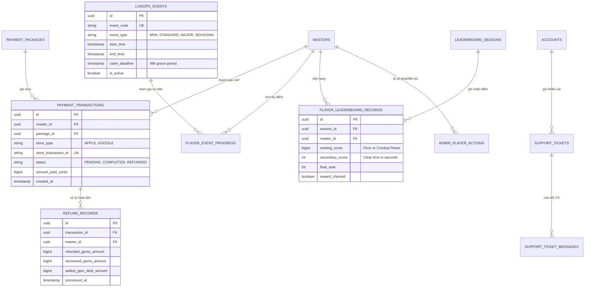

# P2 Data Model & Entity-Relationship Specification

> **L?u tr? thi?t k? l?ch s?.** Checklist v? k?t qu? ki?m tra ph?n ?nh th?i ?i?m vi?t; c?c m? t? Web/Unity, pity v? duplicate c? th? ?? ???c thay th?. Xem [README hi?n h?nh](../../README.md) v? [backlog Godot](../../GODOT_BACKLOG.md), c?p nh?t 22/11/2026 (UTC+7).

| Field | Value |
|---|---|
| Document ID | IG-TECH-ERD-P2-001 |
| Version | 0.1 Draft |
| Project | Infinite Gacha (Hero Management & Survival Strategy RPG) |
| Source Baseline | BRD_P2_Draft.md, Use_Case_Spec_P2_Draft.md, Data_Model_P1_Draft.md |
| Status | Draft for Review |

---

## 1. Tổng quan Kiến trúc Dữ liệu Giai đoạn P2

Tài liệu này đặc tả các bảng thực thể mới, lược đồ quan hệ và các ràng buộc toàn vẹn phục vụ cho **40 Chức năng** và **8 Use Cases** của **Phase P2: Economy & Live Operations**.

### Các nguyên tắc cốt lõi:
1. **Quản lý Nợ Ngọc (`masters.gem_debt`)**: Cột `gem_debt` kiểu `BIGINT` theo dõi số nợ khi người chơi hoàn tiền (refund) sau khi đã tiêu Gems.
2. **Xác thực Biên lai IAP Chống Gian lận**: Bảng `payment_transactions` lưu mã biên lai `receipt_token` kèm ràng buộc chống lặp (`UNIQUE(store_type, store_transaction_id)`).
3. **Cơ chế Refund Minh bạch (`refund_records`)**: Phân rã rành mạch số Gems thu hồi được từ ví và số Gems chuyển thành nợ `added_gem_debt_amount`.
4. **Vòng đời Sự kiện LiveOps Độc lập**: Bảng `liveops_events` kiểm soát chặt chẽ mốc `start_time`, `end_time` và `claim_deadline` (thời gian ân hạn 48h).
5. **Xếp hạng Đôi PVE (`leaderboard_seasons`)**: Tách biệt rõ ràng 2 bảng điểm: Tiến độ Dungeon (`DUNGEON_PROGRESS`) và Lực chiến tổng thể (`COMBAT_POWER`).
6. **Hệ thống Khiếu nại Khách hàng (`support_tickets`)**: Quản lý ticket, tin nhắn trao đổi hai chiều và nhật ký đền bù của CS.
7. **Kho Dữ liệu Phân tích Tổng hợp (`analytics_daily_aggregates`)**: Lưu trữ các chỉ số DAU, MAU, Lạm phát tiền tệ, Tỷ lệ rớt Gacha và Cohort Retention.

---

## 2. Sơ đồ Thực thể Mở rộng P2 (Mermaid ERD)

---

## 3. Danh mục Bảng Dữ liệu Chi tiết P2 (Data Dictionary)

### 3.1. Phân hệ Thanh toán IAP & Quản lý Nợ Gems (MOD-11-03)

#### Cập nhật bảng `masters` (Bổ sung trường Gem Debt)
| Cột bổ sung | Kiểu | Ràng buộc | Mô tả |
|---|---|---|---|
| `gem_debt` | BIGINT | NOT NULL, DEFAULT 0, CHECK (gem_debt >= 0) | Số lượng Ngọc nợ cần cấn trừ trước khi nhận Gems mới |

#### `payment_packages`
Danh mục các gói nạp tiền IAP được niêm yết trong trò chơi.
| Cột | Kiểu | Ràng buộc | Mô tả |
|---|---|---|---|
| `id` | UUID | PK, DEFAULT gen_random_uuid() | Khóa chính gói nạp |
| `package_code` | VARCHAR(50) | NOT NULL, UNIQUE | Mã gói (e.g. `PKG_GEMS_TIER_1`, `PKG_MONTHLY_PASS`) |
| `title` | VARCHAR(100) | NOT NULL | Tên hiển thị gói mua |
| `apple_product_id` | VARCHAR(100) | NOT NULL | Product ID đăng ký trên Apple App Store |
| `google_product_id`| VARCHAR(100) | NOT NULL | Product ID đăng ký trên Google Play Console |
| `price_usd_cents` | INT | NOT NULL | Giá tiền tính bằng cents (e.g. 99 = $0.99, 499 = $4.99) |
| `gems_amount` | BIGINT | NOT NULL | Lượng Gems gốc nhận được |
| `bonus_items` | JSONB | NOT NULL, DEFAULT '{}' | Vật phẩm thưởng thêm (Vé quay, Thể lực) |
| `is_active` | BOOLEAN | NOT NULL, DEFAULT TRUE | Trạng thái hiển thị trong cửa hàng |

#### `payment_transactions`
Ghi nhận toàn bộ các giao dịch nạp thẻ IAP và trạng thái xác thực biên lai máy chủ.
| Cột | Kiểu | Ràng buộc | Mô tả |
|---|---|---|---|
| `id` | UUID | PK, DEFAULT gen_random_uuid() | Khóa chính giao dịch |
| `master_id` | UUID | NOT NULL, FK -> `masters(id)` | Master thực hiện giao dịch |
| `package_id` | UUID | NOT NULL, FK -> `payment_packages(id)`| Gói hàng đã mua |
| `store_type` | VARCHAR(20) | NOT NULL | `APPLE`, `GOOGLE` |
| `store_transaction_id`| VARCHAR(128)| NOT NULL | ID giao dịch từ Store (chống nạp lậu) |
| `receipt_payload` | TEXT | NOT NULL | Chuỗi biên lai mã hóa Base64 gửi từ client |
| `amount_paid_cents`| INT | NOT NULL | Số tiền thực trả |
| `currency_code` | VARCHAR(10) | NOT NULL, DEFAULT 'USD' | Đơn vị tiền tệ (USD, VND, EUR) |
| `status` | VARCHAR(20) | NOT NULL, DEFAULT 'PENDING' | `PENDING`, `COMPLETED`, `FAILED`, `REFUNDED` |
| `created_at` | TIMESTAMP WITH TIME ZONE | NOT NULL, DEFAULT NOW() | Thời điểm tạo lệnh |
| `validated_at` | TIMESTAMP WITH TIME ZONE | NULL | Thời điểm máy chủ Store xác thực thành công |
| *Ràng buộc* | UNIQUE (`store_type`, `store_transaction_id`) | Chặn tái sử dụng biên lai (Replay Attack) |

#### `refund_records`
Lưu trữ chi tiết các vụ hoàn tiền và số liệu cấn trừ Nợ Gems.
| Cột | Kiểu | Ràng buộc | Mô tả |
|---|---|---|---|
| `id` | UUID | PK, DEFAULT gen_random_uuid() | Khóa chính |
| `transaction_id` | UUID | NOT NULL, UNIQUE, FK -> `payment_transactions(id)` | Giao dịch bị hoàn |
| `master_id` | UUID | NOT NULL, FK -> `masters(id)` | Master chịu trách nhiệm |
| `refunded_gems_amount` | BIGINT | NOT NULL | Tổng số Gems phải thu hồi theo gói đã hoàn |
| `recovered_gems_amount`| BIGINT | NOT NULL | Số Gems thực tế thu hồi được từ ví sẵn có |
| `added_gem_debt_amount`| BIGINT | NOT NULL | Số Gems ghi nhận thành Nợ Ngọc mới |
| `refund_reason` | VARCHAR(255)| NULL | Lý do hoàn tiền từ cổng thanh toán |
| `processed_at` | TIMESTAMP WITH TIME ZONE | NOT NULL, DEFAULT NOW() | Thời điểm hệ thống xử lý xong |

---

### 3.2. Phân hệ Quản lý Sự kiện LiveOps (MOD-12-04)

#### `liveops_events`
Lịch trình và thông số các sự kiện vận hành trong game.
| Cột | Kiểu | Ràng buộc | Mô tả |
|---|---|---|---|
| `id` | UUID | PK, DEFAULT gen_random_uuid() | Khóa chính sự kiện |
| `event_code` | VARCHAR(50) | NOT NULL, UNIQUE | Mã sự kiện (e.g. `EVT_STD_GOBLIN_INVASION_01`) |
| `event_type` | VARCHAR(20) | NOT NULL | `MINI` (3-5d), `STANDARD` (14d), `MAJOR` (14-21d), `SEASONAL` (28-35d) |
| `title` | VARCHAR(100) | NOT NULL | Tên sự kiện hiển thị |
| `description` | TEXT | NULL | Mô tả thể lệ |
| `start_time` | TIMESTAMP WITH TIME ZONE | NOT NULL | Thời điểm bắt đầu sự kiện |
| `end_time` | TIMESTAMP WITH TIME ZONE | NOT NULL | Thời điểm đóng nhiệm vụ |
| `claim_deadline` | TIMESTAMP WITH TIME ZONE | NOT NULL | Hết hạn nhận quà (end_time + 48 giờ) |
| `is_active` | BOOLEAN | NOT NULL, DEFAULT FALSE | Trạng thái kích hoạt runtime |
| `event_config` | JSONB | NOT NULL, DEFAULT '{}' | Danh sách nhiệm vụ, tỷ lệ rớt token, shop sự kiện |

#### `player_event_progress`
Tiến độ cày cuốc sự kiện của từng người chơi.
| Cột | Kiểu | Ràng buộc | Mô tả |
|---|---|---|---|
| `id` | UUID | PK, DEFAULT gen_random_uuid() | Khóa chính |
| `master_id` | UUID | NOT NULL, FK -> `masters(id)` | Master tham gia |
| `event_id` | UUID | NOT NULL, FK -> `liveops_events(id)` | Sự kiện tương ứng |
| `event_tokens` | BIGINT | NOT NULL, DEFAULT 0 | Tiền tệ sự kiện dùng để đổi đồ trong shop sự kiện |
| `event_points` | BIGINT | NOT NULL, DEFAULT 0 | Điểm tích lũy để mở các mốc quà |
| `claimed_milestones`| JSONB | NOT NULL, DEFAULT '[]' | Mảng các mốc quà đã nhận |
| `updated_at` | TIMESTAMP WITH TIME ZONE | NOT NULL, DEFAULT NOW() | Cập nhật cuối |
| *Ràng buộc* | UNIQUE (`master_id`, `event_id`) | Mỗi người chơi có 1 hồ sơ tiến độ trên mỗi sự kiện |

---

### 3.3. Phân hệ Bảng xếp hạng Người chơi (MOD-12-05)

#### `leaderboard_seasons`
Mùa giải bảng xếp hạng và cơ chế phát thưởng.
| Cột | Kiểu | Ràng buộc | Mô tả |
|---|---|---|---|
| `id` | UUID | PK, DEFAULT gen_random_uuid() | Khóa chính mùa giải |
| `season_code` | VARCHAR(50) | NOT NULL, UNIQUE | Mã mùa (e.g. `SEASON_DUNGEON_2026_S1`) |
| `season_type` | VARCHAR(30) | NOT NULL | `DUNGEON_PROGRESS`, `COMBAT_POWER` |
| `start_time` | TIMESTAMP WITH TIME ZONE | NOT NULL | Mở mùa |
| `end_time` | TIMESTAMP WITH TIME ZONE | NOT NULL | Đóng mùa và chốt top |
| `is_active` | BOOLEAN | NOT NULL, DEFAULT FALSE | Mùa giải đang mở |
| `reward_tiers` | JSONB | NOT NULL | Cấu trúc thưởng Top 1, Top 10, Top 100, Top 10% |

#### `player_leaderboard_records`
Thành tích xếp hạng cá nhân trong từng mùa giải.
| Cột | Kiểu | Ràng buộc | Mô tả |
|---|---|---|---|
| `id` | UUID | PK, DEFAULT gen_random_uuid() | Khóa chính |
| `season_id` | UUID | NOT NULL, FK -> `leaderboard_seasons(id)` | Mùa giải tương ứng |
| `master_id` | UUID | NOT NULL, FK -> `masters(id)` | Master xếp hạng |
| `ranking_score` | BIGINT | NOT NULL | Điểm chính (Tầng Dungeon hoặc Tổng Combat Power) |
| `secondary_score` | INT | NOT NULL, DEFAULT 0 | Điểm phụ phân định hòa (Thời gian vượt tầng tính bằng giây) |
| `final_rank` | INT | NULL | Thứ hạng chính thức sau khi chốt mùa (1, 2, 3...) |
| `is_reward_claimed`| BOOLEAN | NOT NULL, DEFAULT FALSE | Đã nhận quà tổng kết mùa qua thư |
| `updated_at` | TIMESTAMP WITH TIME ZONE | NOT NULL, DEFAULT NOW() | Thời điểm ghi nhận thành tích cuối |
| *Ràng buộc* | UNIQUE (`season_id`, `master_id`) | Mỗi người chơi chỉ chiếm 1 vị trí trong 1 mùa giải |

---

### 3.4. Phân hệ Hỗ trợ Khách hàng & Quản trị (MOD-14-01 & MOD-14-06)

#### `support_tickets`
Phiếu khiếu nại và yêu cầu hỗ trợ từ người chơi.
| Cột | Kiểu | Ràng buộc | Mô tả |
|---|---|---|---|
| `id` | UUID | PK, DEFAULT gen_random_uuid() | Khóa chính ticket |
| `account_id` | UUID | NOT NULL, FK -> `accounts(id)` | Tài khoản khiếu nại |
| `master_id` | UUID | NOT NULL, FK -> `masters(id)` | Master tương ứng |
| `category` | VARCHAR(30) | NOT NULL | `PAYMENT_ISSUE`, `BUG_REPORT`, `ACCOUNT_ISSUE`, `OTHER` |
| `subject` | VARCHAR(255)| NOT NULL | Tiêu đề khiếu nại |
| `status` | VARCHAR(20) | NOT NULL, DEFAULT 'OPEN' | `OPEN`, `IN_REVIEW`, `RESOLVED`, `CLOSED` |
| `created_at` | TIMESTAMP WITH TIME ZONE | NOT NULL, DEFAULT NOW() | Thời điểm gửi |
| `closed_at` | TIMESTAMP WITH TIME ZONE | NULL | Thời điểm đóng ticket |

#### `support_ticket_messages`
Trao đổi tin nhắn giữa người chơi và nhân viên hỗ trợ.
| Cột | Kiểu | Ràng buộc | Mô tả |
|---|---|---|---|
| `id` | UUID | PK, DEFAULT gen_random_uuid() | Khóa chính tin nhắn |
| `ticket_id` | UUID | NOT NULL, FK -> `support_tickets(id)` ON DELETE CASCADE | Thuộc ticket |
| `sender_type` | VARCHAR(20) | NOT NULL | `PLAYER`, `AGENT`, `SYSTEM` |
| `message_text` | TEXT | NOT NULL | Nội dung trao đổi |
| `attachment_urls`| JSONB | NOT NULL, DEFAULT '[]' | Danh sách ảnh đính kèm minh họa |
| `sent_at` | TIMESTAMP WITH TIME ZONE | NOT NULL, DEFAULT NOW() | Thời gian gửi |

#### `admin_player_actions`
Ghi nhận các lệnh xử phạt hoặc đền bù can thiệp từ quản trị viên.
| Cột | Kiểu | Ràng buộc | Mô tả |
|---|---|---|---|
| `id` | UUID | PK, DEFAULT gen_random_uuid() | Khóa chính |
| `admin_actor_id` | VARCHAR(64) | NOT NULL | Mã định danh Admin / CS thực hiện |
| `target_master_id`| UUID | NOT NULL, FK -> `masters(id)` | Master nhận tác động |
| `action_type` | VARCHAR(30) | NOT NULL | `BAN`, `UNBAN`, `MUTE`, `COMPENSATE_GIFT`, `RESET_PASSWORD` |
| `reason` | VARCHAR(255)| NOT NULL | Lý do can thiệp |
| `details` | JSONB | NOT NULL, DEFAULT '{}' | Chi tiết phần quà đền bù hoặc thời hạn ban |
| `created_at` | TIMESTAMP WITH TIME ZONE | NOT NULL, DEFAULT NOW() | Thời gian thực thi |

---

### 3.5. Phân hệ Phân tích Dữ liệu Hệ thống (MOD-14-05)

#### `analytics_daily_aggregates`
Lưu trữ các chỉ số vĩ mô hàng ngày cho Business Intelligence.
| Cột | Kiểu | Ràng buộc | Mô tả |
|---|---|---|---|
| `id` | UUID | PK, DEFAULT gen_random_uuid() | Khóa chính |
| `metric_date` | DATE | NOT NULL | Ngày thống kê |
| `metric_name` | VARCHAR(50) | NOT NULL | `DAU`, `MAU`, `PEAK_CCU`, `TOTAL_REVENUE_USD`, `GEMS_SINK`, `GEMS_MINT` |
| `metric_value` | NUMERIC(16,2)| NOT NULL | Giá trị số đo lường được |
| `dimensions` | JSONB | NOT NULL, DEFAULT '{}' | Phân rã theo quốc gia, phiên bản, kênh cài đặt |
| *Ràng buộc* | UNIQUE (`metric_date`, `metric_name`) | Mỗi chỉ số chỉ tổng kết 1 dòng mỗi ngày |

#### `analytics_retention_cohorts`
Theo dõi tỷ lệ giữ chân người chơi mới.
| Cột | Kiểu | Ràng buộc | Mô tả |
|---|---|---|---|
| `cohort_date` | DATE | PK | Ngày cài đặt / đăng ký tài khoản |
| `install_count` | INT | NOT NULL | Tổng số người chơi mới trong ngày |
| `day_1_retained` | INT | NOT NULL, DEFAULT 0 | Số người quay lại vào Ngày 1 |
| `day_7_retained` | INT | NOT NULL, DEFAULT 0 | Số người quay lại vào Ngày 7 |
| `day_30_retained`| INT | NOT NULL, DEFAULT 0 | Số người quay lại vào Ngày 30 |
| `updated_at` | TIMESTAMP WITH TIME ZONE | NOT NULL, DEFAULT NOW() | Cập nhật định kỳ |
