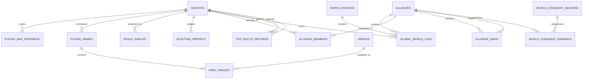

# Data Model Specification – Phase P3: Multiplayer & World Conquest

> **L?u tr? thi?t k? l?ch s?.** Checklist v? k?t qu? ki?m tra ph?n ?nh th?i ?i?m vi?t; c?c m? t? Web/Unity, pity v? duplicate c? th? ?? ???c thay th?. Xem [README hi?n h?nh](../../README.md) v? [backlog Godot](../../GODOT_BACKLOG.md), c?p nh?t 22/11/2026 (UTC+7).

| Field | Value |
|---|---|
| Document ID | IG-BA-DMD-P3-001 |
| Version | 0.1 Draft |
| Project | Infinite Gacha (Hero Management & Survival Strategy RPG) |
| Source of Truth | BRD_P3_Draft.md, Use_Case_Spec_P3_Draft.md, Phase_Scope_Matrix_P3.csv |
| Total New Tables | 13 Tables |

---

## 1. Sơ đồ Thực thể Quan hệ (Mermaid ERD)

---

## 2. Chi tiết Cấu trúc Bảng CSDL (Table Schemas)

### 2.1. Nhóm Bản đồ Thế giới & Lãnh thổ (World Map & Territory)

#### Bảng `world_regions` (Phân vùng thế giới)
| Tên cột | Kiểu dữ liệu | Ràng buộc | Mô tả |
|---|---|---|---|
| `region_id` | VARCHAR(36) | PRIMARY KEY | Định danh vùng lãnh thổ |
| `name` | VARCHAR(100) | NOT NULL | Tên vùng (Vùng Rìa, Thảo Nguyên, Rừng Rậm, Trung Tâm) |
| `min_x` | INT | NOT NULL | Tọa độ X nhỏ nhất |
| `max_x` | INT | NOT NULL | Tọa độ X lớn nhất |
| `min_y` | INT | NOT NULL | Tọa độ Y nhỏ nhất |
| `max_y` | INT | NOT NULL | Tọa độ Y lớn nhất |
| `recommended_level` | INT | NOT NULL DEFAULT 1 | Cấp độ khuyến nghị |
| `controlling_alliance_id` | VARCHAR(36) | NULL, FK(`alliances`) | Liên minh đang kiểm soát phần lớn |

#### Bảng `global_world_tiles` (Lưới ô đất bản đồ thế giới)
| Tên cột | Kiểu dữ liệu | Ràng buộc | Mô tả |
|---|---|---|---|
| `tile_id` | VARCHAR(36) | PRIMARY KEY | Định danh ô đất |
| `pos_x` | INT | NOT NULL | Tọa độ X ($0 \le X \le 1000$) |
| `pos_y` | INT | NOT NULL | Tọa độ Y ($0 \le Y \le 1000$) |
| `region_id` | VARCHAR(36) | NOT NULL, FK(`world_regions`) | Thuộc phân vùng |
| `tile_type` | VARCHAR(30) | NOT NULL | `WILDERNESS`, `RESOURCE_MINE`, `RUINS`, `WONDER`, `PLAYER_BASE` |
| `owner_master_id` | VARCHAR(36) | NULL, FK(`masters`) | Master đang sở hữu |
| `owner_alliance_id` | VARCHAR(36) | NULL, FK(`alliances`) | Liên minh sở hữu |
| `resource_type` | VARCHAR(30) | NULL | `SILVER`, `WOOD`, `STONE`, `IRON`, `FOOD` |
| `production_rate_per_hour` | INT | NOT NULL DEFAULT 0 | Sản lượng tài nguyên mỗi giờ |
| `outpost_level` | INT | NOT NULL DEFAULT 0 | Cấp tiền đồn/trạm thu hoạch (0-10) |
| `protection_expires_at` | TIMESTAMP | NULL | Hết hạn khiên bảo hộ chiếm đóng |
| `is_abandoning` | BOOLEAN | NOT NULL DEFAULT FALSE | Đang trong tiến trình từ bỏ ô đất |
| `abandon_completes_at` | TIMESTAMP | NULL | Thời điểm hoàn tất từ bỏ (đếm ngược 10p) |
| `updated_at` | TIMESTAMP | NOT NULL | Thời điểm cập nhật |

*Ràng buộc duy nhất*: `UNIQUE(pos_x, pos_y)` để đảm bảo mỗi tọa độ là độc nhất.

#### Bảng `player_map_progress` (Tiến trình khám phá của người chơi)
| Tên cột | Kiểu dữ liệu | Ràng buộc | Mô tả |
|---|---|---|---|
| `progress_id` | VARCHAR(36) | PRIMARY KEY | Định danh tiến trình |
| `master_id` | VARCHAR(36) | NOT NULL, UNIQUE, FK(`masters`) | Thuộc Master nào |
| `unlocked_at` | TIMESTAMP | NOT NULL | Thời điểm mở khóa Global World |
| `base_x` | INT | NOT NULL | Tọa độ X căn cứ trên bản đồ |
| `base_y` | INT | NOT NULL | Tọa độ Y căn cứ trên bản đồ |
| `territory_cap` | INT | NOT NULL DEFAULT 10 | Hạn mức ô đất tối đa được chiếm |
| `current_territory_count` | INT | NOT NULL DEFAULT 0 | Số ô đất đang sở hữu |
| `explored_tiles_count` | INT | NOT NULL DEFAULT 25 | Số ô đã giải tỏa sương mù |

---

### 2.2. Nhóm Quân đoàn & Do thám (Army & Intelligence)

#### Bảng `player_armies` (Quân đoàn xuất chinh)
| Tên cột | Kiểu dữ liệu | Ràng buộc | Mô tả |
|---|---|---|---|
| `army_id` | VARCHAR(36) | PRIMARY KEY | Định danh quân đoàn |
| `master_id` | VARCHAR(36) | NOT NULL, FK(`masters`) | Thuộc Master |
| `army_name` | VARCHAR(50) | NOT NULL | Tên đạo quân (Quân đoàn 1, Tiên phong...) |
| `commander_hero_id` | VARCHAR(36) | NOT NULL, FK(`heroes`) | Chủ tướng thống lĩnh |
| `status` | VARCHAR(30) | NOT NULL | `IDLE`, `MARCHING`, `ENGAGING`, `RETURNING`, `GARRISONED` |
| `origin_x` | INT | NOT NULL | Tọa độ xuất phát X |
| `origin_y` | INT | NOT NULL | Tọa độ xuất phát Y |
| `current_x` | FLOAT | NOT NULL | Vị trí hiện tại X theo thời gian thực |
| `current_y` | FLOAT | NOT NULL | Vị trí hiện tại Y theo thời gian thực |
| `target_x` | INT | NOT NULL | Tọa độ đích đến X |
| `target_y` | INT | NOT NULL | Tọa độ đích đến Y |
| `departure_time` | TIMESTAMP | NOT NULL | Thời điểm xuất phát |
| `eta_time` | TIMESTAMP | NOT NULL | Thời điểm dự kiến đến đích |
| `carrying_resources_json`| JSON | NULL | Tài nguyên quân đoàn đang mang theo |

#### Bảng `army_heroes` (Danh sách Hero trong quân đoàn)
| Tên cột | Kiểu dữ liệu | Ràng buộc | Mô tả |
|---|---|---|---|
| `id` | VARCHAR(36) | PRIMARY KEY | Định danh bản ghi |
| `army_id` | VARCHAR(36) | NOT NULL, FK(`player_armies`) | Thuộc quân đoàn |
| `hero_id` | VARCHAR(36) | NOT NULL, FK(`heroes`) | Hero tham chiến |
| `slot_index` | INT | NOT NULL | Vị trí trong đội hình (1 = Commander, 2-5 = Sub) |

*Ràng buộc*: `UNIQUE(army_id, slot_index)`, `UNIQUE(hero_id)`.

#### Bảng `scouting_reports` (Báo cáo trinh sát)
| Tên cột | Kiểu dữ liệu | Ràng buộc | Mô tả |
|---|---|---|---|
| `report_id` | VARCHAR(36) | PRIMARY KEY | Định danh báo cáo |
| `master_id` | VARCHAR(36) | NOT NULL, FK(`masters`) | Người phái trinh sát |
| `target_master_id` | VARCHAR(36) | NULL, FK(`masters`) | Người bị do thám (nếu là căn cứ) |
| `target_x` | INT | NOT NULL | Tọa độ mục tiêu X |
| `target_y` | INT | NOT NULL | Tọa độ mục tiêu Y |
| `intel_level` | INT | NOT NULL DEFAULT 1 | Cấp độ tình báo thu thập (1, 2, 3) |
| `report_data_json` | JSON | NOT NULL | Chi tiết tài nguyên, quân lực, bẫy do thám được |
| `created_at` | TIMESTAMP | NOT NULL | Thời điểm tạo báo cáo |

---

### 2.3. Nhóm Chiến đấu PvP & Bảo vệ (PvP & Peace Shield)

#### Bảng `pvp_battle_records` (Nhật ký giao tranh PvP)
| Tên cột | Kiểu dữ liệu | Ràng buộc | Mô tả |
|---|---|---|---|
| `battle_id` | VARCHAR(36) | PRIMARY KEY | Định danh trận chiến |
| `attacker_master_id` | VARCHAR(36) | NOT NULL, FK(`masters`) | Master tấn công |
| `defender_master_id` | VARCHAR(36) | NOT NULL, FK(`masters`) | Master phòng thủ |
| `battle_type` | VARCHAR(30) | NOT NULL | `BASE_SIEGE`, `TILE_SKIRMISH`, `WONDER_WAR` |
| `target_x` | INT | NOT NULL | Vị trí chiến trận X |
| `target_y` | INT | NOT NULL | Vị trí chiến trận Y |
| `winner_master_id` | VARCHAR(36) | NOT NULL, FK(`masters`) | Master chiến thắng |
| `battle_log_json` | JSON | NOT NULL | Diễn biến trận đánh, số lượt, sát thương |
| `attacker_casualties_json`| JSON | NOT NULL | Danh sách Hero tấn công bị `CRITICALLY_INJURED` |
| `defender_casualties_json`| JSON | NOT NULL | Danh sách Hero phòng thủ bị `CRITICALLY_INJURED` |
| `plundered_resources_json`| JSON | NOT NULL | Tài nguyên bên thắng cướp được |
| `created_at` | TIMESTAMP | NOT NULL | Thời điểm diễn ra trận đấu |

#### Bảng `peace_shields` (Khiên hòa bình bảo hộ người chơi)
| Tên cột | Kiểu dữ liệu | Ràng buộc | Mô tả |
|---|---|---|---|
| `shield_id` | VARCHAR(36) | PRIMARY KEY | Định danh khiên |
| `master_id` | VARCHAR(36) | NOT NULL, FK(`masters`) | Master được bảo vệ |
| `shield_type` | VARCHAR(30) | NOT NULL | `NOVICE_48H`, `EMERGENCY_8H`, `ITEM_24H` |
| `activated_at` | TIMESTAMP | NOT NULL | Thời điểm kích hoạt |
| `expires_at` | TIMESTAMP | NOT NULL | Thời điểm hết hạn |
| `is_active` | BOOLEAN | NOT NULL DEFAULT TRUE | Trạng thái hiệu lực (bị tắt nếu chủ động tấn công) |

---

### 2.4. Nhóm Liên minh & Chiến tranh Thế giới (Alliance & World Conquest)

#### Bảng `alliances` (Liên minh bang hội)
| Tên cột | Kiểu dữ liệu | Ràng buộc | Mô tả |
|---|---|---|---|
| `alliance_id` | VARCHAR(36) | PRIMARY KEY | Định danh liên minh |
| `name` | VARCHAR(50) | NOT NULL, UNIQUE | Tên liên minh duy nhất |
| `tag` | VARCHAR(10) | NOT NULL, UNIQUE | Tên viết tắt hiển thị trước tên người chơi |
| `emblem_icon` | VARCHAR(100) | NOT NULL | Biểu tượng cờ bang |
| `leader_master_id` | VARCHAR(36) | NOT NULL, FK(`masters`) | Chủ bang |
| `member_count` | INT | NOT NULL DEFAULT 1 | Số thành viên hiện tại |
| `max_members` | INT | NOT NULL DEFAULT 30 | Giới hạn thành viên |
| `alliance_level` | INT | NOT NULL DEFAULT 1 | Cấp độ liên minh |
| `notice_board` | TEXT | NULL | Bảng thông báo toàn bang |
| `created_at` | TIMESTAMP | NOT NULL | Thời điểm thành lập |

#### Bảng `alliance_members` (Thành viên liên minh)
| Tên cột | Kiểu dữ liệu | Ràng buộc | Mô tả |
|---|---|---|---|
| `id` | VARCHAR(36) | PRIMARY KEY | Định danh bản ghi |
| `alliance_id` | VARCHAR(36) | NOT NULL, FK(`alliances`) | Thuộc liên minh |
| `master_id` | VARCHAR(36) | NOT NULL, UNIQUE, FK(`masters`) | Master thành viên |
| `role` | VARCHAR(20) | NOT NULL DEFAULT 'MEMBER' | `LEADER`, `OFFICER`, `MEMBER` |
| `contribution_points` | BIGINT | NOT NULL DEFAULT 0 | Điểm cống hiến bang hội |
| `joined_at` | TIMESTAMP | NOT NULL | Thời điểm gia nhập |
| `cooldown_expires_at` | TIMESTAMP | NULL | Hạn cooldown 24h sau khi rời bang |

#### Bảng `alliance_wars` (Chiến dịch chiến tranh bang hội)
| Tên cột | Kiểu dữ liệu | Ràng buộc | Mô tả |
|---|---|---|---|
| `war_id` | VARCHAR(36) | PRIMARY KEY | Định danh cuộc chiến |
| `declaring_alliance_id` | VARCHAR(36) | NOT NULL, FK(`alliances`) | Liên minh tuyên chiến |
| `target_alliance_id` | VARCHAR(36) | NOT NULL, FK(`alliances`) | Liên minh mục tiêu |
| `status` | VARCHAR(20) | NOT NULL DEFAULT 'ACTIVE' | `ACTIVE`, `RESOLVED`, `CANCELLED` |
| `started_at` | TIMESTAMP | NOT NULL | Thời điểm tuyên chiến |
| `ended_at` | TIMESTAMP | NOT NULL | Thời điểm kết thúc (24h sau) |
| `declaring_points` | BIGINT | NOT NULL DEFAULT 0 | Điểm chiến tranh bên tuyên chiến |
| `target_points` | BIGINT | NOT NULL DEFAULT 0 | Điểm chiến tranh bên phòng ngự |
| `winner_alliance_id` | VARCHAR(36) | NULL, FK(`alliances`) | Liên minh giành chiến thắng |

#### Bảng `world_conquest_seasons` (Mùa giải thế giới)
| Tên cột | Kiểu dữ liệu | Ràng buộc | Mô tả |
|---|---|---|---|
| `season_id` | VARCHAR(36) | PRIMARY KEY | Định danh mùa giải |
| `season_number` | INT | NOT NULL, UNIQUE | Thứ tự mùa giải (Mùa 1, 2...) |
| `start_time` | TIMESTAMP | NOT NULL | Bắt đầu mùa giải (30 ngày) |
| `end_time` | TIMESTAMP | NOT NULL | Kết thúc mùa giải |
| `status` | VARCHAR(20) | NOT NULL DEFAULT 'ACTIVE' | `UPCOMING`, `ACTIVE`, `CONCLUDED` |
| `conquering_alliance_id`| VARCHAR(36) | NULL, FK(`alliances`) | Liên minh bá chủ mùa giải |

#### Bảng `world_conquest_rankings` (Bảng xếp hạng mùa giải)
| Tên cột | Kiểu dữ liệu | Ràng buộc | Mô tả |
|---|---|---|---|
| `id` | VARCHAR(36) | PRIMARY KEY | Định danh bản ghi |
| `season_id` | VARCHAR(36) | NOT NULL, FK(`world_conquest_seasons`) | Thuộc mùa giải |
| `alliance_id` | VARCHAR(36) | NOT NULL, FK(`alliances`) | Liên minh xếp hạng |
| `final_rank` | INT | NOT NULL | Thứ hạng chung cuộc |
| `total_conquest_points` | BIGINT | NOT NULL DEFAULT 0 | Tổng điểm chinh phục |
| `reward_claimed` | BOOLEAN | NOT NULL DEFAULT FALSE | Đã nhận phần thưởng mùa giải |
| `updated_at` | TIMESTAMP | NOT NULL | Thời điểm cập nhật |

*Ràng buộc*: `UNIQUE(season_id, alliance_id)`.
