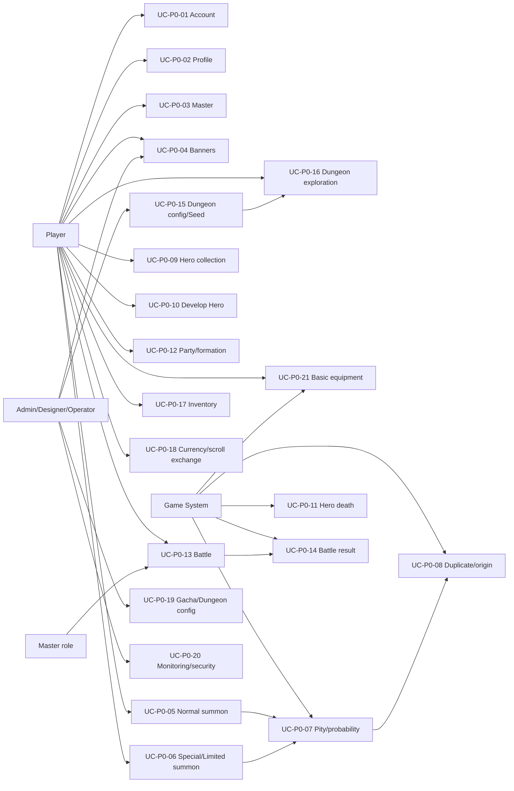

> Updated contract (2026-11-22): [Hero Chronicle, mortality and 1-7 star rarity](../HERO_CHRONICLE.md) supersedes the legacy origin-based death/duplicate rules and Divine Grace sections below. All Heroes die as DEAD and drop equipped gear; one RESURRECTION_GEM_7 revives to full HP with no Silver fee or escalating cycle. NORMAL/SPECIAL/LIMITED remain payment/banner types only.

# Use Case Specifications - P0 Draft

> **L?u tr? thi?t k? l?ch s?.** Checklist v? k?t qu? ki?m tra ph?n ?nh th?i ?i?m vi?t; c?c m? t? Web/Unity, pity v? duplicate c? th? ?? ???c thay th?. Xem [README hi?n h?nh](../../README.md) v? [backlog Godot](../../GODOT_BACKLOG.md), c?p nh?t 22/11/2026 (UTC+7).

| Field | Value |
|---|---|
| Document ID | IG-BA-UC-P0-001 |
| Version | 0.2 Draft |
| Status | Draft for review |
| Source | BRD_P0_Draft.md; Phase_Scope_Matrix_P0.csv; MBFL.docx |

> These use cases describe the current P0 draft. Unapproved rules and failure handling remain TBD. Function IDs provide traceability.

## 1. Use case diagram

## 2. Shared conventions

- A Dependency is a prerequisite that must be satisfied before a function runs. ?Any one of? indicates alternatives.
- TBD means the business or technical detail is not yet approved.
- Admin/configuration use requires authorized access; detailed permission rules are TBD.

## UC-P0-01 - Create and access account

- **Primary/supporting actors:** Player; source actor assignments: Player, Game System.
- **Preconditions:** No authenticated session exists.
- **Trigger:** Player registers or logs in.
- **Main flow:**
  1. Validate account details.
  2. Create or restore an authenticated session.
  3. Load the account's single Master if one exists.
- **Postconditions:** An authenticated session is available.
- **Alternate/exception paths:** Account Linking and Account Recovery are P1; account credential/security exceptions are TBD.
- **Covered Functions:**

| Function ID | Function | Actor | Priority | Dependency |
|---|---|---|---|---|
| FUN-01-01-001 | Register Account – Đăng ký tài khoản | ACT-01, ACT-03 | Must | — |
| FUN-01-01-002 | Login – Đăng nhập | ACT-01, ACT-03 | Must | FUN-01-01-001 |
| FUN-01-01-003 | Logout – Đăng xuất | ACT-01, ACT-03 | Must | FUN-01-01-002 |
| FUN-01-01-006 | Account Security – Bảo mật tài khoản | ACT-01, ACT-03 | Must | FUN-01-01-002 |

## UC-P0-02 - View and update player profile

- **Primary/supporting actors:** Player; source actor assignments: Player, Game System.
- **Preconditions:** Player is authenticated.
- **Trigger:** Player opens or edits profile.
- **Main flow:**
  1. Load profile data.
  2. Validate permitted edits.
  3. Save changes.
- **Postconditions:** Profile is displayed or updated.
- **Alternate/exception paths:** Editable fields and validation rules are TBD.
- **Covered Functions:**

| Function ID | Function | Actor | Priority | Dependency |
|---|---|---|---|---|
| FUN-01-02-001 | View Player Profile – Xem hồ sơ | ACT-01 | Must | FUN-01-01-002 |
| FUN-01-02-002 | Update Player Profile – Cập nhật hồ sơ | ACT-01 | Should | FUN-01-01-002 |
| FUN-01-02-003 | Player Settings – Cài đặt người chơi | ACT-01 | Should | FUN-01-02-002 |
| FUN-01-02-004 | Player Progress – Tiến trình người chơi | ACT-01, ACT-03 | Must | FUN-01-02-001 |

## UC-P0-03 - Initialize and progress Master

- **Primary/supporting actors:** Player; Game System; source actor assignments: Player, Game System.
- **Preconditions:** Player is authenticated.
- **Trigger:** Game starts Master setup or processes progression.
- **Main flow:**
  1. Initialize the account's unique Master.
  2. Track EXP and evaluate level-up conditions.
  3. Apply approved level-up and feature-unlock changes.
  4. Initialize the minimum World needed for Dungeon access.
- **Postconditions:** Exactly one Master and the minimum P0 World are initialized; Master progression is recorded.
- **Alternate/exception paths:** Initial attributes, EXP thresholds, skill costs, and unlock conditions are TBD.
- **Covered Functions:**

| Function ID | Function | Actor | Priority | Dependency |
|---|---|---|---|---|
| FUN-01-03-001 | Initialize Master – Khởi tạo Master | ACT-03 | Must | FUN-01-01-002 |
| FUN-01-03-002 | View Master Profile – Xem hồ sơ Master | ACT-01 | Must | FUN-01-03-001 |
| FUN-01-03-003 | Master EXP – Quản lý kinh nghiệm | ACT-03 | Must | FUN-01-03-001 |
| FUN-01-03-004 | Master Level Up – Tăng cấp Master | ACT-03 | Must | FUN-01-03-003 |
| FUN-01-03-005 | Master Skill Management – Quản lý kỹ năng | ACT-01, ACT-03 | Should | FUN-01-03-004 |
| FUN-01-03-006 | Feature Unlock – Mở khóa tính năng | ACT-03 | Must | FUN-01-03-004 |
| FUN-08-01-001 | Initialize Private World – Khởi tạo thế giới riêng | ACT-03 | Must | FUN-01-03-001 |

## UC-P0-04 - Configure and view summon banners

- **Primary/supporting actors:** Player; Game Operator; Game Designer; Game Admin; source actor assignments: Player, Game System, Game Admin, Game Operator, Game Designer.
- **Preconditions:** Banner configuration exists or an authorized operator is preparing it.
- **Trigger:** Player views banners or an operator configures one.
- **Main flow:**
  1. Configure banner and Hero pool.
  2. Set schedule and activate the banner.
  3. Show active banner details and published rates.
- **Postconditions:** An active banner is available for summoning and can be inspected.
- **Alternate/exception paths:** Banner schedules may overlap, including multiple banners of the same type. Configuration rejects incomplete or inconsistent data; the banner detail response discloses the active pool, probability, and pity.
- **Covered Functions:**

| Function ID | Function | Actor | Priority | Dependency |
|---|---|---|---|---|
| FUN-02-01-001 | View Banner List – Danh sách banner | ACT-01 | Must | — |
| FUN-02-01-002 | View Banner Detail – Chi tiết banner | ACT-01 | Must | FUN-02-01-001 |
| FUN-02-01-003 | Configure Banner – Cấu hình banner | ACT-04, ACT-05 | Must | — |
| FUN-02-01-004 | Configure Hero Pool – Cấu hình Hero Pool | ACT-04, ACT-06 | Must | FUN-02-01-003 |
| FUN-02-01-005 | Banner Schedule – Lịch banner | ACT-05 | Must | FUN-02-01-003 |
| FUN-02-01-006 | Activate Banner – Kích hoạt banner | ACT-03, ACT-05 | Must | FUN-02-01-005 |

## UC-P0-05 - Perform a Normal summon

- **Primary/supporting actors:** Player; Game System; source actor assignments: Player, Game System.
- **Preconditions:** Player is authenticated; normal pool is available; required white Heavenly Scrolls are available (1 scroll for Single, 10 scrolls for Multi).
- **Trigger:** Player requests a Normal single or multi summon.
- **Main flow:**
  1. Validate banner/pool and consume Heavenly Scrolls (1 for Single, 10 for Multi-10).
  2. Resolve each roll using the active pool (0.4% 5★, 49.6% 1-4★, 50% Materials on rolls 1-60) and Pity counter.
  3. Create a new independent Hero instance with Combat v2 dynamically rolled base stats (STR/INT/STA/AGI), class, and element affinities (available for specialized builds or Star Promotion fodder).
  4. Record summon items/Heroes and update history.
- **Postconditions:** Summon results/history and resulting Hero/Item instances are recorded.
- **Alternate/exception paths:** Insufficient scrolls halts action; no roll-backs of consumed items once transaction commits.
- **Covered Functions:**

| Function ID | Function | Actor | Priority | Dependency |
|---|---|---|---|---|
| FUN-02-02-001 | Normal Single Summon – Triệu hồi thường 1 lần | ACT-01, ACT-03 | Must | FUN-02-01-006 |
| FUN-02-02-002 | Normal Multi Summon – Triệu hồi thường nhiều lần | ACT-01, ACT-03 | Must | FUN-02-02-001 |
| FUN-02-02-003 | Normal Summon Result – Kết quả triệu hồi thường | ACT-03 | Must | FUN-02-02-001 |
| FUN-02-02-004 | Normal Summon History – Lịch sử triệu hồi | ACT-01 | Should | FUN-02-02-003 |

## UC-P0-06 - Perform a Special or Limited summon

- **Primary/supporting actors:** Player; Game System; source actor assignments: Player, Game System.
- **Preconditions:** Player is authenticated; corresponding banner is active; required scroll is available (1 scroll for Single, 10 scrolls for Multi).
- **Trigger:** Player requests a Special or Limited summon.
- **Main flow:**
  1. Validate banner and consume Heavenly Scrolls (red for Limited, seven-color for Special).
  2. Resolve rolls using the shared Pity curve and this banner's counter.
  3. If a 5★+ duplicate Hero is drawn on this Special/Limited banner and already owned, convert 1 copy into 1 Thiên Mệnh on that owned Hero. Other Heroes generate new independent instances.
  4. Record results and update banner Pity counter.
- **Postconditions:** Results, Pity state, and Hero origin are recorded.
- **Alternate/exception paths:** Acquisition of red/seven-color scrolls is deferred to later scope; summons require pre-existing scrolls in inventory.
- **Covered Functions:**

| Function ID | Function | Actor | Priority | Dependency |
|---|---|---|---|---|
| FUN-02-03-001 | Special Single Summon – Triệu hồi đặc biệt 1 lần | ACT-01, ACT-03 | Must | FUN-02-01-006 |
| FUN-02-03-002 | Special Multi Summon – Triệu hồi đặc biệt nhiều lần | ACT-01, ACT-03 | Should | FUN-02-03-001 |
| FUN-02-03-003 | Limited Single Summon – Triệu hồi giới hạn 1 lần | ACT-01, ACT-03 | Should | FUN-02-03-001 |
| FUN-02-03-004 | Limited Multi Summon – Triệu hồi giới hạn nhiều lần | ACT-01, ACT-03 | Should | FUN-02-03-001 |
| FUN-02-03-005 | Special Summon Result – Kết quả đặc biệt | ACT-03 | Must | FUN-02-03-001 |
| FUN-02-03-006 | Limited Summon Result – Kết quả giới hạn | ACT-03 | Should | FUN-02-03-003 |

## UC-P0-07 - Calculate summon probability and Pity

- **Primary/supporting actors:** Game System; source actor assignments: Player, Game System, Game Admin, Game Designer.
- **Preconditions:** A valid summon request identifies its banner.
- **Trigger:** System resolves a summon roll.
- **Main flow:**
  1. Base distribution on rolls 1-60: 5-star Hero = 0.4%, 1-to-4-star Heroes = 49.6%, Materials/Items = 50.0%.
  2. For n=60..70 use P_n = 0.4% + (100% - 0.4%) * ((n - 60) / 10)^4.
  3. When the five-star rate rises, divide the remaining probability between 1-to-4-star Heroes and Materials/Items using the base ratio 49.6:50.
  4. At roll 70 guarantee any five-star in the active banner pool.
  5. Reset this banner's counter after any five-star; do not carry counters between banners.
- **Postconditions:** Result and banner-specific counter are persisted.
- **Alternate/exception paths:** This does not guarantee a Limited/Featured Hero.
- **Covered Functions:**

| Function ID | Function | Actor | Priority | Dependency |
|---|---|---|---|---|
| FUN-02-04-001 | Configure Drop Rate – Cấu hình tỷ lệ | ACT-04, ACT-06 | Must | FUN-02-01-004 |
| FUN-02-04-002 | Calculate Summon Probability – Tính xác suất | ACT-03 | Must | FUN-02-04-001 |
| FUN-02-04-003 | Update Pity Counter – Cập nhật Pity | ACT-03 | Must | FUN-02-04-001 |
| FUN-02-04-004 | Guaranteed Reward – Bảo đảm phần thưởng | ACT-03 | Must | FUN-02-04-003 |
| FUN-02-04-005 | Pity Isolation – Tách bộ đếm Pity theo banner | ACT-03, ACT-04 | Should | FUN-02-04-003 |
| FUN-02-04-006 | View Pity Progress – Xem tiến trình Pity | ACT-01 | Should | FUN-02-04-003 |

## UC-P0-08 - Convert duplicates and record summon origin

- **Primary/supporting actors:** Game System; source actor assignments: Player, Game System.
- **Preconditions:** A summon result and current Hero collection are available.
- **Trigger:** A Hero result is generated.
- **Main flow:**
  1. Check whether the summoned Hero is 5★+ on a Special/Limited banner and already owned in player's collection.
  2. If duplicate 5★+ on Special/Limited banner:
     - Grant 1 "Thiên Mệnh" to that owned Hero; do not create a duplicate instance.
  3. Otherwise (Normal banner summons, all 1★–4★ Heroes, or new 5★):
     - Generate a new independent Hero Instance with dynamically rolled Combat v2 base stats (STR/INT/STA/AGI) and immutable Summon Origin (Normal, Special, or Limited).
- **Postconditions:** Hero instance with dynamically rolled stats or Thiên Mệnh duplicate conversion and immutable origin are recorded.
- **Alternate/exception paths:** None.
- **Covered Functions:**

| Function ID | Function | Actor | Priority | Dependency |
|---|---|---|---|---|
| FUN-02-05-001 | Duplicate Detection – Phát hiện Hero trùng | ACT-03 | Must | FUN-02-05-003 |
| FUN-02-05-002 | Duplicate Conversion – Chuyển đổi Hero trùng | ACT-03 | Should | FUN-02-05-001 |
| FUN-02-05-003 | Assign Summon Origin – Gán nguồn gốc | ACT-03 | Must | Any one of: FUN-02-02-003; FUN-02-03-005; FUN-02-03-006 |
| FUN-02-05-004 | View Summon History – Xem lịch sử | ACT-01 | Should | FUN-02-05-003 |

## UC-P0-09 - View and organize Hero collection

- **Primary/supporting actors:** Player; source actor assignments: Player.
- **Preconditions:** Player is authenticated and has an initialized Master.
- **Trigger:** Player opens the collection.
- **Main flow:**
  1. Retrieve owned Heroes.
  2. Show details/history.
  3. Apply requested filter, sort, or lock operation.
- **Postconditions:** Collection reflects current Hero instances and statuses.
- **Alternate/exception paths:** Default sort, filter combinations, and lock restrictions are TBD.
- **Covered Functions:**

| Function ID | Function | Actor | Priority | Dependency |
|---|---|---|---|---|
| FUN-03-01-001 | View Hero List – Danh sách Hero | ACT-01 | Must | FUN-02-02-003 |
| FUN-03-01-002 | View Hero Detail – Chi tiết Hero | ACT-01 | Must | FUN-03-01-001 |
| FUN-03-01-003 | Filter Hero – Lọc Hero | ACT-01 | Should | FUN-03-01-001 |
| FUN-03-01-004 | Sort Hero – Sắp xếp Hero | ACT-01 | Should | FUN-03-01-001 |
| FUN-03-01-005 | Lock Hero – Khóa Hero | ACT-01 | Should | FUN-03-01-001 |
| FUN-03-01-006 | View Hero History – Lịch sử Hero | ACT-01 | Could | FUN-03-01-002 |

## UC-P0-10 - Develop Hero attributes and skills

- **Primary/supporting actors:** Player; Game System; source actor assignments: Player, Game System.
- **Preconditions:** Target Hero is owned and eligible.
- **Trigger:** Player selects a development or skill action.
- **Main flow:**
  1. Validate eligibility and required resources.
  2. Apply level/EXP, promotion, awakening, evolution, or skill change.
  3. Persist the updated Hero state.
- **Postconditions:** Hero attributes or skills reflect the accepted action.
- **Alternate/exception paths:** Progression curves, costs, caps, and effects are TBD.
- **Covered Functions:**

| Function ID | Function | Actor | Priority | Dependency |
|---|---|---|---|---|
| FUN-03-02-001 | View Hero Stats – Xem chỉ số | ACT-01 | Must | FUN-03-01-002 |
| FUN-03-02-002 | Level Up Hero – Tăng cấp | ACT-01, ACT-03 | Must | FUN-03-02-001 |
| FUN-03-02-003 | Hero EXP Management – Quản lý EXP | ACT-03 | Must | FUN-03-02-002 |
| FUN-03-02-004 | Hero Promotion – Thăng cấp bậc | ACT-01, ACT-03 | Should | FUN-03-02-002 |
| FUN-03-02-005 | Hero Awakening – Thức tỉnh | ACT-01, ACT-03 | Should | FUN-03-02-004 |
| FUN-03-02-006 | Hero Evolution – Tiến hóa | ACT-01, ACT-03 | Could | FUN-03-02-004 |
| FUN-03-03-001 | View Hero Skills – Xem kỹ năng | ACT-01 | Must | FUN-03-01-002 |
| FUN-03-03-002 | Unlock Hero Skill – Mở khóa kỹ năng | ACT-03 | Should | FUN-03-03-001 |
| FUN-03-03-003 | Upgrade Hero Skill – Nâng cấp kỹ năng | ACT-01, ACT-03 | Should | FUN-03-03-002 |
| FUN-03-03-004 | Configure Skill Behavior – Cấu hình hành vi kỹ năng | ACT-01 | Could | FUN-03-03-001 |

## UC-P0-11 - Resolve Hero death

- **Primary/supporting actors:** Game System; source actor assignments: Game System.
- **Preconditions:** Battle result identifies a dead Hero with a recorded origin.
- **Trigger:** Battle result is finalized.
- **Main flow:**
  1. Read immutable Summon Origin.
  2. For Normal origin, permanently kill Hero, drop equipped gear, and do not refund upgrade/training resources.
  3. For Special/Limited origin, set Hero to Disabled.
  4. Record the death outcome.
- **Postconditions:** Hero state and applicable item/resource outcomes are recorded.
- **Alternate/exception paths:** Normal Hero gear remains as a World floor drop until the Master picks it up. Special/Limited Heroes become Disabled and retain equipped gear. The floor drop can be collected later from the Master's own World. Equipment stat values are sample configuration; advanced gear progression remains later scope.
- **Covered Functions:**

| Function ID | Function | Actor | Priority | Dependency |
|---|---|---|---|---|
| FUN-04-01-001 | Detect Hero Death – Phát hiện tử trận | ACT-03 | Must | FUN-06-02-001 |
| FUN-04-01-002 | Determine Death Rule – Xác định quy tắc tử trận | ACT-03 | Must | FUN-04-01-001, FUN-02-05-003 |
| FUN-04-01-003 | Process Permadeath – Xử lý chết vĩnh viễn | ACT-03 | Must | FUN-04-01-002 |
| FUN-04-01-004 | Process Disabled State – Vô hiệu hóa Hero | ACT-03 | Must | FUN-04-01-002 |
| FUN-04-01-005 | Create Death Record – Lưu hồ sơ tử trận | ACT-03 | Must | FUN-04-01-003, FUN-04-01-004 |
| FUN-04-01-006 | Update Hero Availability – Cập nhật khả năng sử dụng | ACT-03 | Must | FUN-04-01-003, FUN-04-01-004 |

## UC-P0-12 - Create a party and formation

- **Primary/supporting actors:** Player; Game System; source actor assignments: Player, Game System.
- **Preconditions:** Player is authenticated; selected Heroes are available.
- **Trigger:** Player creates or edits a party.
- **Main flow:**
  1. Select Heroes.
  2. Validate availability and duplicates.
  3. Assign formation positions and save the party/preset.
- **Postconditions:** A valid party/formation is saved.
- **Alternate/exception paths:** Party size, position constraints, and unavailable-Hero handling are TBD.
- **Covered Functions:**

| Function ID | Function | Actor | Priority | Dependency |
|---|---|---|---|---|
| FUN-05-01-001 | Create Party – Tạo đội hình | ACT-01 | Must | FUN-03-01-001 |
| FUN-05-01-002 | Edit Party – Chỉnh sửa đội hình | ACT-01 | Must | FUN-05-01-001 |
| FUN-05-01-003 | Delete Party – Xóa đội hình | ACT-01 | Should | FUN-05-01-001 |
| FUN-05-01-004 | View Party – Xem đội hình | ACT-01 | Must | FUN-05-01-001 |
| FUN-05-01-005 | Set Default Party – Đặt đội hình mặc định | ACT-01 | Should | FUN-05-01-001 |
| FUN-05-02-001 | Add Hero to Party – Thêm Hero | ACT-01 | Must | FUN-05-01-001 |
| FUN-05-02-002 | Remove Hero from Party – Xóa Hero | ACT-01 | Must | FUN-05-02-001 |
| FUN-05-02-003 | Replace Hero – Thay Hero | ACT-01 | Should | FUN-05-02-001 |
| FUN-05-02-004 | Validate Hero Availability – Kiểm tra khả dụng | ACT-03 | Must | FUN-04-01-006 |
| FUN-05-03-001 | Set Hero Position – Đặt vị trí | ACT-01 | Must | FUN-05-02-001 |
| FUN-05-03-002 | Change Hero Position – Đổi vị trí | ACT-01 | Should | FUN-05-03-001 |
| FUN-05-03-003 | Save Formation Preset – Lưu đội hình | ACT-01 | Should | FUN-05-03-001 |
| FUN-05-03-004 | Validate Formation – Kiểm tra đội hình | ACT-03 | Must | FUN-05-03-001 |

## UC-P0-13 - Initialize and execute auto battle

- **Primary/supporting actors:** Player; Master; Game System; source actor assignments: Master, Game System.
- **Preconditions:** A valid party and encounter exist.
- **Trigger:** Player enters battle.
- **Main flow:**
  1. Player selects and saves up to five active owned Heroes.
  2. Initialize the selected Heroes and editable sample enemy templates using World difficulty and Floor scaling.
  3. Resolve one automatic round at a time in descending Speed order; each actor attacks a deterministic randomly selected living target using the existing defense damage formula.
  4. Apply the active Tactical Buff to Hero combat stats; enforce the server-side 15-second change cooldown.
- **Postconditions:** Every round is persisted; terminal results and turn logs are saved. Victory grants sample-configured Silver and distributes sample EXP across surviving Heroes. All casualties become DEAD and drop equipped gear; one seven-star gem can revive any existing deceased instance.
- **Alternate/exception paths:** Skills, critical hits, status effects, production enemy/reward balance, Hero EXP thresholds, and equipment drops remain unimplemented/TBD.
- **Covered Functions:**

| Function ID | Function | Actor | Priority | Dependency |
|---|---|---|---|---|
| FUN-06-01-001 | Create Battle – Khởi tạo trận đấu | ACT-03 | Must | FUN-07-05-001 |
| FUN-06-01-002 | Assign Combatants – Phân bổ chiến binh | ACT-03 | Must | FUN-06-01-001 |
| FUN-06-01-003 | Initialize Battle State – Khởi tạo trạng thái | ACT-03 | Must | FUN-06-01-002 |
| FUN-06-01-004 | Initialize Battle Strategy – Khởi tạo chiến thuật | ACT-03 | Should | FUN-06-01-003 |
| FUN-06-02-001 | Execute Auto Battle – Thực hiện chiến đấu tự động | ACT-03 | Must | FUN-06-01-003 |
| FUN-06-02-002 | AI Target Selection – Chọn mục tiêu | ACT-03 | Must | FUN-06-02-001 |
| FUN-06-02-003 | AI Action Selection – Chọn hành động | ACT-03 | Must | FUN-06-02-001 |
| FUN-06-02-004 | AI Skill Execution – Sử dụng kỹ năng | ACT-03 | Must | FUN-06-02-003 |
| FUN-06-02-005 | AI Personality Influence – Ảnh hưởng tính cách | ACT-03 | Should | FUN-03-04-003 |
| FUN-06-02-006 | AI Relationship Influence – Ảnh hưởng quan hệ | ACT-03 | Could | FUN-03-05-002 |
| FUN-06-03-001 | Damage Calculation – Tính sát thương | ACT-03 | Must | FUN-06-02-001 |
| FUN-06-03-002 | Buff & Debuff – Hiệu ứng | ACT-03 | Must | FUN-06-03-001 |
| FUN-06-03-003 | Status Effect – Trạng thái | ACT-03 | Should | FUN-06-03-001 |
| FUN-06-03-004 | Critical Hit – Chí mạng | ACT-03 | Should | FUN-06-03-001 |
| FUN-06-03-005 | Combat Element – Thuộc tính | ACT-03 | Could | FUN-06-03-001 |
| FUN-06-04-001 | Configure Combat Strategy – Thiết lập chiến thuật | ACT-02 | Must | FUN-06-01-004 |
| FUN-06-04-002 | Offensive Command – Chỉ thị tấn công | ACT-02 | Should | FUN-06-04-001 |
| FUN-06-04-003 | Defensive Command – Chỉ thị phòng thủ | ACT-02 | Should | FUN-06-04-001 |
| FUN-06-04-004 | Tactical Buff – Buff chiến thuật | ACT-02, ACT-03 | Must | FUN-06-04-001 |
| FUN-06-04-005 | Target Priority – Ưu tiên mục tiêu | ACT-02 | Should | FUN-06-04-001 |
| FUN-06-04-006 | Retreat Policy – Chính sách rút lui | ACT-02, ACT-03 | Could | FUN-06-04-001 |

## UC-P0-14 - Process battle result and report

- **Primary/supporting actors:** Game System; source actor assignments: Player, Game System.
- **Preconditions:** Auto battle has ended.
- **Trigger:** Battle execution completes.
- **Main flow:**
  1. Determine victory/defeat and Hero survival.
  2. Apply death processing.
  3. Distribute eligible EXP/rewards.
  4. Persist battle log/statistics and expose report.
- **Postconditions:** Battle result, Hero states, rewards, and report are recorded.
- **Alternate/exception paths:** Reward amounts, replay support, and rollback are TBD.
- **Covered Functions:**

| Function ID | Function | Actor | Priority | Dependency |
|---|---|---|---|---|
| FUN-06-05-001 | Determine Battle Result – Xác định kết quả | ACT-03 | Must | FUN-06-02-001 |
| FUN-06-05-002 | Process Hero Survival – Xử lý Hero sống sót | ACT-03 | Must | FUN-06-05-001 |
| FUN-06-05-003 | Process Battle Casualties – Xử lý thương vong | ACT-03 | Must | FUN-06-05-001 |
| FUN-06-05-004 | Distribute Battle EXP – Phân phối EXP | ACT-03 | Must | FUN-06-05-001 |
| FUN-06-05-005 | Generate Battle Reward – Phần thưởng trận đấu | ACT-03 | Must | FUN-06-05-001 |
| FUN-06-05-006 | Generate Battle Report – Báo cáo chiến đấu | ACT-03, ACT-01 | Must | FUN-06-05-001 |
| FUN-06-05-007 | Update Hero Condition – Cập nhật thể trạng | ACT-03 | Should | FUN-06-05-001 |

## UC-P0-15 - Configure Dungeon, Seed, and generation

- **Primary/supporting actors:** Game Admin; Game Designer; Game System; source actor assignments: Game System, Game Admin, Game Designer.
- **Preconditions:** The minimum P0 World is initialized or being initialized; authorized Dungeon configuration is available.
- **Trigger:** Authorized actor configures Dungeon or a World is created.
- **Main flow:**
  1. Configure Dungeon template/floor/monster/boss data.
  2. Create one fixed Seed for the World using standard UUID/GUID format.
  3. Ensure Seed is unique across the game and fixed for the World lifetime.
  4. Use Seed to determine difficulty and generate map/encounters procedurally.
- **Postconditions:** World Seed and generated Dungeon state are persisted.
- **Alternate/exception paths:** Minimum World initialization is P0; World/Base progression remains P1. Seed collision probability is effectively zero due to UUID/GUID design.
- **Covered Functions:**

| Function ID | Function | Actor | Priority | Dependency |
|---|---|---|---|---|
| FUN-07-01-001 | Configure Dungeon Template – Cấu hình mẫu Dungeon | ACT-04, ACT-06 | Must | — |
| FUN-07-01-002 | Configure Floor – Cấu hình tầng | ACT-04, ACT-06 | Must | FUN-07-01-001 |
| FUN-07-01-003 | Configure Floor Requirement – Điều kiện tầng | ACT-04 | Must | FUN-07-01-002 |
| FUN-07-01-004 | Configure Dungeon Reward – Cấu hình thưởng | ACT-04, ACT-06 | Must | FUN-07-01-002 |
| FUN-07-02-001 | Generate World Seed – Sinh Seed World | ACT-03 | Must | FUN-08-01-001 |
| FUN-07-02-002 | Save World Seed – Lưu Seed World | ACT-03 | Must | FUN-07-02-001 |
| FUN-07-02-003 | Version Seed Algorithm – Phiên bản thuật toán | ACT-03, ACT-04 | Must | FUN-07-02-001 |
| FUN-07-02-004 | Reconstruct Dungeon – Tái tạo Dungeon | ACT-03 | Should | FUN-07-02-002, FUN-07-02-003 |
| FUN-07-02-005 | Manage Seed Lifecycle – Quản lý vòng đời Seed | ACT-03 | Should | FUN-07-02-002 |
| FUN-07-03-001 | Generate Dungeon Map – Sinh bản đồ | ACT-03 | Must | FUN-07-02-001 |
| FUN-07-03-002 | Generate Room Layout – Sinh phòng | ACT-03 | Must | FUN-07-03-001 |
| FUN-07-03-003 | Generate Monster Placement – Bố trí quái vật | ACT-03 | Must | FUN-07-03-001 |
| FUN-07-03-004 | Generate Dungeon Difficulty – Sinh độ khó | ACT-03 | Must | FUN-07-03-001 |
| FUN-07-03-005 | Generate Environment Event – Sinh sự kiện môi trường | ACT-03 | Should | FUN-07-03-001 |

## UC-P0-16 - Progress through Dungeon and claim rewards

- **Primary/supporting actors:** Player; Game System; source actor assignments: Player, Game System.
- **Preconditions:** Player has an accessible P0 World/Seed and a floor is available.
- **Trigger:** Player enters a floor or explores.
- **Main flow:**
  1. Validate floor access.
  2. Generate/load the sample encounter and weighted sample event deterministically from the fixed World Seed and current floor.
  3. Resolve the sample encounter and event effects.
  4. On victory, record rewards and advance the World current floor by one; on defeat, keep the same floor.
- **Postconditions:** The floor result, event, and rewards are recorded; the World Seed remains fixed for the World lifetime.
- **Alternate/exception paths:** Event weights/effects and enemy stats are editable sample configuration; production floor unlocks and reward balance remain TBD.
- **Covered Functions:**

| Function ID | Function | Actor | Priority | Dependency |
|---|---|---|---|---|
| FUN-07-04-001 | View Floor List – Danh sách tầng | ACT-01 | Must | FUN-07-01-002 |
| FUN-07-04-002 | Unlock Floor – Mở khóa tầng | ACT-03 | Must | FUN-07-01-003 |
| FUN-07-04-003 | Enter Floor – Vào tầng | ACT-01, ACT-03 | Must | FUN-07-04-002 |
| FUN-07-04-004 | Track Floor Progress – Theo dõi tiến trình | ACT-03 | Must | FUN-07-04-003 |
| FUN-07-04-005 | Complete Floor – Hoàn thành tầng | ACT-03 | Must | FUN-07-04-004 |
| FUN-07-04-006 | Handle Floor Failure – Xử lý thất bại | ACT-03 | Must | FUN-07-04-004 |
| FUN-07-05-001 | Initialize Dungeon Instance – Khởi tạo Dungeon | ACT-03 | Must | FUN-07-03-001 |
| FUN-07-05-002 | Explore Dungeon – Khám phá Dungeon | ACT-01, ACT-03 | Must | FUN-07-05-001 |
| FUN-07-05-003 | Trigger Encounter – Kích hoạt chạm trán | ACT-03 | Must | FUN-07-05-002 |
| FUN-07-05-004 | Spawn Monster – Sinh quái vật | ACT-03 | Must | FUN-07-05-003 |
| FUN-07-05-005 | Trigger Boss Encounter – Chạm trán Boss | ACT-03 | Must | FUN-07-05-003 |
| FUN-07-05-006 | Complete Dungeon – Hoàn thành Dungeon | ACT-03 | Must | FUN-07-05-005 |
| FUN-07-06-001 | Calculate Floor Reward – Tính thưởng tầng | ACT-03 | Must | FUN-07-04-005 |
| FUN-07-06-002 | Calculate Boss Reward – Tính thưởng Boss | ACT-03 | Must | FUN-07-05-005 |
| FUN-07-06-003 | First Clear Reward – Thưởng lần đầu | ACT-03 | Should | FUN-07-06-001 |
| FUN-07-06-004 | Distribute Dungeon Reward – Phân phối thưởng | ACT-03 | Must | FUN-07-06-001 |

## UC-P0-17 - Manage basic inventory

- **Primary/supporting actors:** Player; Game System; source actor assignments: Player, Game System.
- **Preconditions:** Player is authenticated.
- **Trigger:** Player opens inventory or uses an item.
- **Main flow:**
  1. Display and sort/filter items.
  2. Add, remove, use, or sell item when allowed.
- **Postconditions:** Inventory reflects accepted item operations.
- **Alternate/exception paths:** Capacity, stack limits, sell prices, and item effects are TBD.
- **Covered Functions:**

| Function ID | Function | Actor | Priority | Dependency |
|---|---|---|---|---|
| FUN-10-01-001 | View Inventory – Xem túi đồ | ACT-01 | Must | FUN-01-03-001 |
| FUN-10-01-002 | Filter Inventory – Lọc vật phẩm | ACT-01 | Should | FUN-10-01-001 |
| FUN-10-01-003 | Sort Inventory – Sắp xếp vật phẩm | ACT-01 | Should | FUN-10-01-001 |
| FUN-10-01-004 | Add Item – Thêm vật phẩm | ACT-03 | Must | FUN-10-01-001 |
| FUN-10-01-005 | Remove Item – Xóa vật phẩm | ACT-03 | Must | FUN-10-01-001 |
| FUN-10-01-006 | Use Item – Sử dụng vật phẩm | ACT-01, ACT-03 | Must | FUN-10-01-001 |
| FUN-10-01-007 | Sell Item – Bán vật phẩm | ACT-01, ACT-03 | Should | FUN-10-01-001 |

## UC-P0-18 - Manage currency and exchange Normal scrolls

- **Primary/supporting actors:** Player; Game System; source actor assignments: Player, Game System, Game Admin.
- **Preconditions:** Player is authenticated and has a Silver Coin balance.
- **Trigger:** Player views balance or exchanges for a white scroll.
- **Main flow:**
  1. Validate 10,000 Silver Coins and remaining weekly allowance.
  2. Deduct 10,000 coins and grant one white Normal Heavenly Scroll.
  3. Record transaction.
  4. Reset 50-scroll allowance Thursday 00:00 UTC+7.
- **Postconditions:** Balance, scroll inventory, history, and weekly allowance are consistent.
- **Alternate/exception paths:** Silver Coin reward sources and transaction recovery are TBD; Gems and other scroll acquisition are later configuration.
- **Covered Functions:**

| Function ID | Function | Actor | Priority | Dependency |
|---|---|---|---|---|
| FUN-11-01-001 | View Currency – Xem tiền tệ | ACT-01 | Must | FUN-01-03-001 |
| FUN-11-01-002 | Add Currency – Cộng tiền | ACT-03 | Must | FUN-11-01-001 |
| FUN-11-01-003 | Deduct Currency – Trừ tiền | ACT-03 | Must | FUN-11-01-001 |
| FUN-11-01-004 | Validate Balance – Kiểm tra số dư | ACT-03 | Must | FUN-11-01-001 |
| FUN-11-01-005 | Currency Transaction – Giao dịch tiền tệ | ACT-03 | Must | FUN-11-01-002, FUN-11-01-003 |
| FUN-11-01-006 | Currency Limit – Giới hạn tiền tệ | ACT-03, ACT-04 | Should | FUN-11-01-001 |
| FUN-11-01-007 | Exchange Silver for Normal Summon Ticket – Đổi Xu Bạc lấy Thiên Thư thường | ACT-01, ACT-03 | Must | FUN-11-01-003, FUN-11-01-006 |

## UC-P0-19 - Configure Gacha and Dungeon rules

- **Primary/supporting actors:** Game Admin; Game Designer; Game Operator; source actor assignments: Game Admin, Game Designer.
- **Preconditions:** Actor has authorized configuration access.
- **Trigger:** Authorized actor edits Gacha/Dungeon configuration.
- **Main flow:**
  1. Configure approved banner, rate, Pity, death, Dungeon, Seed, and battle rules.
  2. Version configuration and publish active version to Game System.
- **Postconditions:** Configuration is versioned and auditable.
- **Alternate/exception paths:** Approval, rollback, and activation timing are TBD.
- **Covered Functions:**

| Function ID | Function | Actor | Priority | Dependency |
|---|---|---|---|---|
| FUN-14-03-001 | Gacha Rule Configuration – Cấu hình Gacha | ACT-04, ACT-06 | Must | DM-02 |
| FUN-14-03-002 | Pity Configuration – Cấu hình Pity | ACT-04, ACT-06 | Must | FUN-14-03-001 |
| FUN-14-03-003 | Death Rule Configuration – Cấu hình tử trận | ACT-04, ACT-06 | Must | DM-04 |
| FUN-14-03-004 | Dungeon Rule Configuration – Cấu hình Dungeon | ACT-04, ACT-06 | Must | DM-07 |
| FUN-14-03-005 | Seed Algorithm Configuration – Cấu hình Seed | ACT-04, ACT-06 | Must | FUN-14-03-004 |
| FUN-14-03-006 | Battle Rule Configuration – Cấu hình chiến đấu | ACT-04, ACT-06 | Must | DM-06 |

## UC-P0-20 - Monitor and protect the game

- **Primary/supporting actors:** Game System; Game Admin; Game Operator; Game Designer; source actor assignments: Game System, Game Admin, Game Designer.
- **Preconditions:** Core services and audit/security configuration are available.
- **Trigger:** System event occurs or authorized user reviews operations/security.
- **Main flow:**
  1. Monitor system health.
  2. Record significant actions in audit log.
  3. Detect anti-cheat/abuse signals.
  4. Version configuration for authorized review.
- **Postconditions:** Operational/security events are available to authorized actors.
- **Alternate/exception paths:** Detection thresholds, incident workflow, retention, and alert routing are TBD.
- **Covered Functions:**

| Function ID | Function | Actor | Priority | Dependency |
|---|---|---|---|---|
| FUN-14-05-006 | System Monitoring – Giám sát hệ thống | ACT-03, ACT-04 | Must | — |
| FUN-14-06-003 | Audit Log – Nhật ký hệ thống | ACT-03, ACT-04 | Must | — |
| FUN-14-06-004 | Anti-cheat Monitoring – Giám sát gian lận | ACT-03, ACT-04 | Must | — |
| FUN-14-06-005 | Abuse Detection – Phát hiện lạm dụng | ACT-03, ACT-04 | Should | FUN-14-06-004 |
| FUN-14-06-006 | Configuration Versioning – Quản lý phiên bản cấu hình | ACT-04, ACT-06 | Must | — |

## UC-P0-21 - Manage basic equipped items

- **Primary/supporting actors:** Player and Game System.
- **Preconditions:** Player owns the Hero and item; the item can be equipped under the current rule set.
- **Trigger:** Player views, equips, or removes a piece of equipment.
- **Main flow:**
  1. Display current equipment and available items.
  2. Validate the selected equipment against the Hero and slot rules.
  3. Equip or unequip the item.
  4. Recalculate the Hero's equipment stats.
- **Postconditions:** The Hero's equipped state and derived equipment stats are updated; equipped items can be processed by P0 death rules.
- **Alternate/exception paths:** A new item replaces the current item in the same slot and returns the old item to inventory. Items are limited to the owning Master; detailed class restrictions and production stat balance remain TBD.
- **Covered Functions:**

| Function ID | Function | Actor | Priority | Dependency |
|---|---|---|---|---|
| FUN-10-02-001 | View Equipment – Xem trang bị | ACT-01 | Should | FUN-10-01-001 |
| FUN-10-02-002 | Equip Item – Trang bị | ACT-01, ACT-03 | Should | FUN-10-02-001, FUN-10-02-004 |
| FUN-10-02-003 | Unequip Item – Tháo trang bị | ACT-01 | Should | FUN-10-02-002 |
| FUN-10-02-004 | Validate Equipment – Kiểm tra trang bị | ACT-03 | Should | FUN-10-02-001 |
| FUN-10-02-005 | Calculate Equipment Stats – Tính chỉ số | ACT-03 | Should | FUN-10-02-002 |

## 3. Scope items for review

- **Special/Limited scroll availability:** their summon processing stays in P0, while acquisition setup is deferred. A summon can proceed only when the matching scroll is present; no grant/source mechanism is assumed here.
- **Account Linking and Account Recovery:** deferred to P1 and excluded from P0 Use Cases.
- **Acceptance criteria:** defined in full detail across all 21 Use Cases in [Acceptance_Criteria_P0_Draft.md](file:///f:/infiniti_gacha/Acceptance_Criteria_P0_Draft.md).

## 4. Open details carried forward

- Full rarity/Hero pool distribution and Featured allocation beyond the confirmed Pity curve.
- Resource amounts and progression curves for Hero development, skills, duplicate conversion, combat, and Dungeon generation.
- Acquisition sources for Limited/Special scrolls and Gem monetization.
- Admin permission matrix and security thresholds.

## 5. Traceability

- These specifications cover 164 unique P0 Functions across 33 Modules.
- Use Case IDs are draft identifiers. Resolve scope gaps before freezing the BRD/Use Case baseline.
