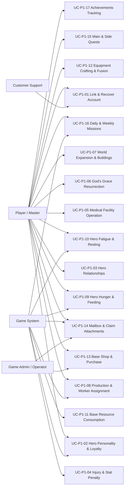

# Use Case Specifications — Phase P1

> **L?u tr? thi?t k? l?ch s?.** Checklist v? k?t qu? ki?m tra ph?n ?nh th?i ?i?m vi?t; c?c m? t? Web/Unity, pity v? duplicate c? th? ?? ???c thay th?. Xem [README hi?n h?nh](../../README.md) v? [backlog Godot](../../GODOT_BACKLOG.md), c?p nh?t 22/11/2026 (UTC+7).

| Field | Value |
|---|---|
| Document ID | IG-BA-UC-P1-001 |
| Version | 0.1 Draft |
| Project | Infinite Gacha (Hero Management & Survival Strategy RPG) |
| Source Baseline | BRD_P1_Draft.md, Phase_Scope_Matrix_P1.csv, MBFL.docx |
| Status | Draft for Review |

---

## 1. Sơ đồ Use Case tổng thể P1 (Use Case Diagram)

---

## 2. Quy ước chung (Conventions)

- **Dependency**: Điều kiện tiên quyết phải hoàn thành trước khi chức năng chạy.
- **Thang đo Sinh tồn (Hunger & Fatigue)**: Thang đo chuẩn 0–100.
- **Nguyên tắc Loyalty**: Hero không bao giờ rời bỏ Master dưới mọi hình thức; Loyalty < 20 chỉ suy giảm chỉ số và gây nguy cơ từ chối lệnh.
- **Sản xuất Căn cứ Offline**: Chạy liên tục cho đến khi đầy dung lượng kho chứa (Storage Capacity).
- **Hồi sinh Thần Cứu Trợ (God's Grace)**: Chi phí lũy tiến và tự động reset chu kỳ sau 30 ngày.

---

## 3. Đặc tả chi tiết 17 Use Cases Phase P1

### UC-P1-01: Link and Recover Account
- **Primary / Supporting Actors:** Player (ACT-01), Customer Support (ACT-08), Game System (ACT-03).
- **Preconditions:** Player is authenticated with a guest or local account.
- **Trigger:** Player requests third-party linking or account recovery.
- **Main Flow:**
  1. Player selects authentication provider (Google Play Games, Apple Game Center).
  2. System validates external OAuth token and links external identity to `accounts.id`.
  3. If account access is lost, Player supplies recovery token or contacts CS with proof of ownership.
  4. System verifies identity and re-issues authenticated session.
- **Postconditions:** Account is permanently linked or access is restored.
- **Alternate / Exception Paths:** If third-party account is already linked to another master, return `ERR_AUTH_ALREADY_LINKED`.
- **Covered Functions:**
  - `FUN-01-01-004`: Account Linking – Liên kết tài khoản
  - `FUN-01-01-005`: Account Recovery – Khôi phục tài khoản

---

### UC-P1-02: Manage Hero Personality and Loyalty
- **Primary / Supporting Actors:** Player (ACT-01), Game System (ACT-03).
- **Preconditions:** Hero instance exists in player's collection.
- **Trigger:** Hero performs actions, completes battles, eats food, or undergoes bonding.
- **Main Flow:**
  1. Upon summon, system assigns 4 structured traits: Core, Social, Behavioral, Special (`FUN-03-04-001`).
  2. Player inspects Hero personality profile and current Loyalty rating (0–100) (`FUN-03-04-002`, `FUN-03-04-005`).
  3. Hero AI uses Behavioral & Core traits to influence targeting, aggressiveness, and fear resistance in combat (`FUN-03-04-003`).
  4. Actions modify Loyalty: successful expeditions and favorite meals increase Loyalty; starvation, overwork, or repeated party wipes decrease it (`FUN-03-04-004`).
  5. If Loyalty drops below 20 (Danger threshold), system applies 20%–50% combat stat debuffs and rolls a chance for Hero to refuse combat dispatch (`FUN-03-04-006`).
- **Postconditions:** Personality profile and Loyalty score are persisted; Hero never leaves Master under any condition.
- **Alternate / Exception Paths:** If Loyalty is above 80, Hero receives a minor stat bonus and morale synergy.
- **Covered Functions:**
  - `FUN-03-04-001`: Assign Personality – Gán tính cách
  - `FUN-03-04-002`: View Personality – Xem tính cách
  - `FUN-03-04-003`: Personality Behavior – Xử lý hành vi
  - `FUN-03-04-004`: Calculate Loyalty – Tính Loyalty
  - `FUN-03-04-005`: View Loyalty – Xem Loyalty
  - `FUN-03-04-006`: Loyalty State Change – Thay đổi trạng thái

---

### UC-P1-03: Manage Hero Relationships and Bonding Events
- **Primary / Supporting Actors:** Player (ACT-01), Game System (ACT-03).
- **Preconditions:** At least two alive Heroes reside in the same base.
- **Trigger:** Heroes co-participate in battles, shared dormitories, or base production.
- **Main Flow:**
  1. System initializes baseline relationship matrix between owned Heroes (`FUN-03-05-001`).
  2. Performing shared tasks or fighting side-by-side increases affinity score between pairings (`FUN-03-05-002`).
  3. Player inspects the social network graph and relationship tiers (Stranger, Comrade, Trusted Ally, Rival) (`FUN-03-05-003`).
  4. High affinity triggers unique bonding dialogue and unlocks combat resonance buffs when placed in the same squad (`FUN-03-05-004`).
- **Postconditions:** Affinity ratings and unlocked relationship buffs are saved.
- **Covered Functions:**
  - `FUN-03-05-001`: Initialize Relationship – Khởi tạo quan hệ
  - `FUN-03-05-002`: Update Relationship – Cập nhật quan hệ
  - `FUN-03-05-003`: View Relationship – Xem quan hệ
  - `FUN-03-05-004`: Relationship Event – Sự kiện quan hệ

---

### UC-P1-04: Process Hero Injury and Temporary Stat Reduction
- **Primary / Supporting Actors:** Game System (ACT-03), Player (ACT-01).
- **Preconditions:** Hero survives a brutal battle with remaining HP < 20% or suffered critical status effects.
- **Trigger:** Combat resolves and casualties/injuries are calculated.
- **Main Flow:**
  1. System evaluates injury severity based on remaining HP, damage taken, and death avoidance triggers (`FUN-04-02-001`).
  2. Applies temporary stat penalties (-10% to -30% ATK/DEF/SPD) (`FUN-04-02-002`).
  3. Calculates healing duration required based on Hero Constitution and injury grade (`FUN-04-02-003`).
  4. Player reviews injury diagnosis and natural countdown timer (`FUN-04-02-004`).
  5. When timer expires or medical treatment finishes, full attributes are restored (`FUN-04-02-005`).
- **Postconditions:** Injury status, debuffs, and recovery timers are maintained.
- **Covered Functions:**
  - `FUN-04-02-001`: Classify Injury – Phân loại thương tích
  - `FUN-04-02-002`: Apply Temporary Reduction – Giảm chỉ số tạm thời
  - `FUN-04-02-003`: Calculate Recovery Duration – Tính thời gian hồi phục
  - `FUN-04-02-004`: View Injury Status – Xem thương tích
  - `FUN-04-02-005`: Restore Hero Stats – Khôi phục chỉ số

---

### UC-P1-05: Construct and Operate Medical Facility
- **Primary / Supporting Actors:** Player (ACT-01), Game System (ACT-03).
- **Preconditions:** Master has unlocked base construction in Private World.
- **Trigger:** Player builds, upgrades, or admits injured Heroes into Medical Facility.
- **Main Flow:**
  1. Player constructs Medical Facility using base materials (Wood, Stone, Silver) (`FUN-04-03-001`).
  2. Upgrades facility to unlock additional sickbays and faster treatment speeds (`FUN-04-03-002`, `FUN-04-03-003`).
  3. Inspects facility occupancy and treatment queues (`FUN-04-03-004`, `FUN-04-04-002`).
  4. Player admits injured or fatigued Heroes into available beds (`FUN-04-04-001`).
  5. Player can expend rare medicine for Emergency Treatment (instant recovery) (`FUN-04-04-003`).
  6. On timer completion, Hero is discharged back to `ALIVE` active status (`FUN-04-04-004`).
  7. System records recovery log in history (`FUN-04-04-008`).
- **Postconditions:** Bed occupancy, active timers, and hospital records are persisted.
- **Alternate / Exception Paths:** If hospital capacity is full, injured Heroes enter a waiting queue without passive healing speedup.
- **Covered Functions:**
  - `FUN-04-03-001`: Construct Medical Facility – Xây cơ sở chữa trị
  - `FUN-04-03-002`: Upgrade Medical Facility – Nâng cấp cơ sở
  - `FUN-04-03-003`: Manage Treatment Capacity – Quản lý công suất
  - `FUN-04-03-004`: View Medical Facility – Xem cơ sở
  - `FUN-04-04-001`: Start Treatment – Bắt đầu chữa trị
  - `FUN-04-04-002`: Treatment Queue – Hàng đợi điều trị
  - `FUN-04-04-003`: Emergency Treatment – Chữa trị khẩn cấp
  - `FUN-04-04-004`: Treatment Completion – Hoàn tất chữa trị
  - `FUN-04-04-008`: Recovery History – Lịch sử phục hồi

---

### UC-P1-06: Resurrect Disabled Hero via Divine Grace
- **Primary / Supporting Actors:** Player (ACT-01), Game System (ACT-03).
- **Preconditions:** Special or Limited Hero was defeated in combat, protected by God's Grace, and rests in Medical Facility as `status = 'DISABLED'`.
- **Trigger:** Player requests resurrection of the Disabled Hero.
- **Main Flow:**
  1. Player opens resurrection altar in Medical Facility (`FUN-04-04-005`).
  2. System verifies required special divine materials and computes current progressive cost multiplier (`FUN-04-04-006`).
  3. System checks if 30 days have elapsed since the first resurrection in this cycle; if so, resets cost multiplier to base 1.0x.
  4. Player confirms and consumes divine materials and Silver Coins.
  5. Hero is revived to `status = 'ALIVE'` with 50% HP and moderate fatigue (`FUN-04-04-007`).
  6. Resurrection counter increments and timestamp is recorded in `hero_death_records` and `audit_logs` (`FUN-04-04-008`).
- **Postconditions:** Hero is returned to active roster; progressive cost counter is updated.
- **Alternate / Exception Paths:** Normal Heroes with Permadeath cannot be resurrected and are rejected with `ERR_RESURRECTION_NORMAL_PERMADEATH`.
- **Covered Functions:**
  - `FUN-04-04-005`: Resurrection Request – Yêu cầu hồi sinh
  - `FUN-04-04-006`: Resurrection Validation – Kiểm tra hồi sinh
  - `FUN-04-04-007`: Process Resurrection – Xử lý hồi sinh
  - `FUN-04-04-008`: Recovery History – Lịch sử phục hồi

---

### UC-P1-07: Expand Private World and Manage Base Buildings
- **Primary / Supporting Actors:** Player (ACT-01), Game System (ACT-03).
- **Preconditions:** Master possesses an initialized Private World.
- **Trigger:** Player surveys world overview, clears new zones, or erects structures.
- **Main Flow:**
  1. Player views base overview map showing building plots, terrain, and expansion borders (`FUN-08-01-002`).
  2. World level and milestone progress unlock new zones (`FUN-08-01-003`, `FUN-08-01-005`).
  3. Player clears mist/obstacles to expand base footprint (`FUN-08-01-004`).
  4. Player selects unlocked blueprint and constructs new building (Farm, Mine, Dormitory, Smithy) (`FUN-08-02-001`, `FUN-08-02-003`).
  5. Upgrades existing buildings to improve tier, durability, and functionality (`FUN-08-02-002`, `FUN-08-02-005`).
  6. Player may demolish obsolete buildings, recovering partial materials (`FUN-08-02-004`).
- **Postconditions:** Base topology and building registry are persisted.
- **Covered Functions:**
  - `FUN-08-01-002`: View World Overview – Xem tổng quan thế giới
  - `FUN-08-01-003`: Manage World Progress – Quản lý tiến trình
  - `FUN-08-01-004`: Expand Private World – Mở rộng thế giới
  - `FUN-08-01-005`: World Feature Unlock – Mở khóa tính năng thế giới
  - `FUN-08-02-001`: Construct Building – Xây dựng công trình
  - `FUN-08-02-002`: Upgrade Building – Nâng cấp công trình
  - `FUN-08-02-003`: Unlock Building – Mở khóa công trình
  - `FUN-08-02-004`: Demolish Building – Phá dỡ công trình
  - `FUN-08-02-005`: View Building Status – Xem trạng thái

---

### UC-P1-08: Produce Base Resources and Assign Hero Workers
- **Primary / Supporting Actors:** Player (ACT-01), Game System (ACT-03).
- **Preconditions:** Production building (Lumber Mill, Stone Quarry, Mana Well, Kitchen) is built.
- **Trigger:** Building is configured or Hero is assigned to labor.
- **Main Flow:**
  1. Player configures target resource recipe in facility (`FUN-08-03-001`).
  2. Player assigns eligible alive Hero to the facility (`FUN-08-04-001`).
  3. System computes work efficiency multiplier based on Hero Class, Personality traits, and Energy (`FUN-08-04-003`).
  4. Building generates resources continuously over time, including during player offline periods (`FUN-08-03-002`).
  5. Working Hero gradually incurs Hunger (+3 to +8) and Fatigue (+5 to +10) per shift (`FUN-08-04-004`).
  6. Production runs until reaching the facility's max Storage Capacity; then production automatically pauses until collected (`FUN-08-03-005`).
  7. Player collects accumulated resources, transferring them to Master warehouse (`FUN-08-03-003`).
  8. Player may reassign or remove Hero from labor at will (`FUN-08-04-002`).
- **Postconditions:** Inventory balances increase; Hero energy drains; building storage resets.
- **Alternate / Exception Paths:** If working Hero reaches 100 Fatigue (Overexhausted), system auto-ejects Hero from work slot to avoid collapse.
- **Covered Functions:**
  - `FUN-08-03-001`: Configure Production – Cấu hình sản xuất
  - `FUN-08-03-002`: Generate Resources – Sản xuất tài nguyên
  - `FUN-08-03-003`: Collect Resources – Thu thập tài nguyên
  - `FUN-08-03-004`: Upgrade Production – Nâng cấp sản xuất
  - `FUN-08-03-005`: Manage Production Capacity – Quản lý công suất
  - `FUN-08-04-001`: Assign Hero to Building – Phân công Hero
  - `FUN-08-04-002`: Remove Hero from Building – Thu hồi Hero
  - `FUN-08-04-003`: Calculate Work Efficiency – Tính hiệu suất
  - `FUN-08-04-004`: Monitor Hero Assignment – Theo dõi phân công

---

### UC-P1-09: Manage Hero Hunger, Food Distribution, and Starvation
- **Primary / Supporting Actors:** Player (ACT-01), Game System (ACT-03).
- **Preconditions:** Hero is owned; food items exist in base storage.
- **Trigger:** Periodic tick, battle completion, labor shift, or player feeding action.
- **Main Flow:**
  1. System continuously tracks Hunger rating (0–100) for every Hero (`FUN-09-01-001`).
  2. Hunger increases: +1/hr passive, +5–10 per battle, +3–5 per travel, +3–8 per labor shift (`FUN-09-01-002`).
  3. Player checks Hero hunger gauge and status penalties (Full, Satisfied, Hungry, Very Hungry, Starving, Critical) (`FUN-09-01-005`).
  4. Player feeds Hero:
     - Standard Food: restores hunger points.
     - Favorite Food: restores hunger points and increases Loyalty.
     - Premium Food / Special Meal: restores hunger points and grants temporary stat buffs. (`FUN-09-01-003`).
  5. If Hunger reaches 60–99, severe combat stat penalties apply; at 100 (Critical), Hero is immobilized from high-intensity tasks (`FUN-09-01-004`).
- **Postconditions:** Hunger gauge decreases; consumed food is deducted from warehouse.
- **Covered Functions:**
  - `FUN-09-01-001`: Track Hero Hunger – Theo dõi đói
  - `FUN-09-01-002`: Calculate Hunger Consumption – Tính tiêu hao
  - `FUN-09-01-003`: Distribute Food – Phân phối thức ăn
  - `FUN-09-01-004`: Process Starvation – Xử lý thiếu đói
  - `FUN-09-01-005`: View Hunger Status – Xem trạng thái đói

---

### UC-P1-10: Manage Hero Fatigue, Resting Quarters, and Overexertion
- **Primary / Supporting Actors:** Player (ACT-01), Game System (ACT-03).
- **Preconditions:** Dormitory or resting quarters are built in base.
- **Trigger:** Hero exerts energy in combat/labor or enters resting area.
- **Main Flow:**
  1. System tracks Fatigue (0–100) per Hero (`FUN-09-02-001`).
  2. Fatigue increases: +2/hr awake, +10–15 per battle, +5–8 per travel, +5–10 per labor shift (`FUN-09-02-002`).
  3. Player inspects fatigue tiers (Rested, Normal, Tired, Exhausted, Critical Fatigue, Overexhausted) (`FUN-09-02-005`).
  4. Player dispatches tired Hero to Dormitory bed or Premium Suite for resting (`FUN-09-02-003`).
  5. System steadily drains Fatigue gauge based on room quality (e.g., -10/hr on bed, -25/hr in suite) (`FUN-09-02-004`).
  6. Player can consume Energy Potions / Recovery Items for instant fatigue reduction.
  7. If Fatigue reaches 100, system locks Hero from expedition dispatches (`FUN-09-02-006`).
- **Postconditions:** Fatigue points decrease; resting beds are released upon completion.
- **Covered Functions:**
  - `FUN-09-02-001`: Track Hero Fatigue – Theo dõi mệt mỏi
  - `FUN-09-02-002`: Calculate Fatigue Increase – Tính mức mệt mỏi
  - `FUN-09-02-003`: Start Hero Rest – Bắt đầu nghỉ ngơi
  - `FUN-09-02-004`: Process Fatigue Recovery – Phục hồi mệt mỏi
  - `FUN-09-02-005`: View Fatigue Status – Xem trạng thái mệt mỏi
  - `FUN-09-02-006`: Prevent Overexertion – Ngăn quá sức

---

### UC-P1-11: Manage Food Supply and Resource Consumption
- **Primary / Supporting Actors:** Game System (ACT-03), Player (ACT-01).
- **Preconditions:** Base kitchen, farm, and food silos are operational.
- **Trigger:** Daily/hourly maintenance ticks or expedition launches.
- **Main Flow:**
  1. Kitchen and Farm produce food batches stored in food silos (`FUN-09-03-001`, `FUN-09-03-002`).
  2. System calculates baseline daily food consumption for all resident base Heroes (`FUN-09-03-003`).
  3. When an expedition party deploys into Dungeon, system validates and deducts required travel rations (`FUN-09-03-004`).
  4. If warehouse food reaches 0, all base Heroes begin accumulating Hunger points at accelerated rate.
- **Postconditions:** Food reserves decrement; rations are committed to squads.
- **Covered Functions:**
  - `FUN-09-03-001`: Manage Food Storage – Quản lý kho thức ăn
  - `FUN-09-03-002`: Produce Food – Sản xuất thức ăn
  - `FUN-09-03-003`: Consume Base Resources – Tiêu hao tại căn cứ
  - `FUN-09-03-004`: Consume Dungeon Resources – Tiêu hao Dungeon
  - `FUN-09-03-005`: Consume War Resources – Tiêu hao chiến tranh

---

### UC-P1-12: Craft, Upgrade, and Fuse Equipment
- **Primary / Supporting Actors:** Player (ACT-01), Game System (ACT-03).
- **Preconditions:** Smithy/Forge facility is built; recipes and raw materials are in inventory.
- **Trigger:** Player accesses the Forge.
- **Main Flow:**
  1. Player selects desired weapon/armor recipe (`FUN-10-03-001`).
  2. System validates sufficient ore, monster parts, and Silver Coins (`FUN-10-03-004`).
  3. Forge crafts the equipment item, assigning randomized substats within recipe brackets.
  4. Player can enhance/upgrade item level using enhancement stones and gold (`FUN-10-03-002`).
  5. Player can fuse multiple duplicate items to ascend gear to higher star rarity (`FUN-10-03-003`).
- **Postconditions:** New or enhanced equipment instance appears in inventory; materials are consumed.
- **Covered Functions:**
  - `FUN-10-03-001`: Craft Item – Chế tạo vật phẩm
  - `FUN-10-03-002`: Upgrade Equipment – Nâng cấp trang bị
  - `FUN-10-03-003`: Item Fusion – Hợp thành vật phẩm
  - `FUN-10-03-004`: Material Requirement – Kiểm tra nguyên liệu

---

### UC-P1-13: Manage and Purchase Items from the Base Shop
- **Primary / Supporting Actors:** Player (ACT-01), Game System (ACT-03), Game Admin (ACT-04).
- **Preconditions:** Shop facility is active in base.
- **Trigger:** Player visits shop or admin configures catalog.
- **Main Flow:**
  1. Admin configures product catalogue, pricing, and purchase limits (`FUN-11-02-005`).
  2. Player browses active inventory: basic materials, seeds, potions, gear blueprints (`FUN-11-02-001`, `FUN-11-02-002`).
  3. System rotates shop merchandise on a scheduled daily/weekly basis (`FUN-11-02-004`).
  4. Player purchases items using Silver Coins (`FUN-11-02-003`).
  5. System validates purchase limits per player before deducting coins and adding items (`FUN-11-02-006`).
- **Postconditions:** Player inventory updates; Silver Coin balance decreases; purchase counter increments.
- **Covered Functions:**
  - `FUN-11-02-001`: View Shop – Xem cửa hàng
  - `FUN-11-02-002`: View Product Detail – Chi tiết sản phẩm
  - `FUN-11-02-003`: Purchase Item – Mua vật phẩm
  - `FUN-11-02-004`: Shop Rotation – Luân phiên cửa hàng
  - `FUN-11-02-005`: Configure Shop – Cấu hình cửa hàng
  - `FUN-11-02-006`: Purchase Limit – Giới hạn mua

---

### UC-P1-14: Receive System Mail and Claim Rewards
- **Primary / Supporting Actors:** Player (ACT-01), Game Operator (ACT-05), Game System (ACT-03).
- **Preconditions:** System reward or operator maintenance notice is generated.
- **Trigger:** Operator sends compensation or automated system distributes milestone rewards.
- **Main Flow:**
  1. System/Operator generates reward parcel with message body and attachments (`FUN-11-04-001`, `FUN-11-04-002`, `FUN-11-04-003`).
  2. Player opens Mailbox and views message inbox (`FUN-11-04-004`).
  3. Player selects message and clicks "Claim Attachments" (`FUN-11-04-005`).
  4. Attachments (Silver Coins, Scrolls, Stamina potions) are deposited directly into player wallet/bag.
  5. Unclaimed mails are automatically purged upon reaching expiration date (e.g. 30 days) (`FUN-11-04-006`).
- **Postconditions:** Mail is marked claimed/deleted; rewards are safely transferred.
- **Covered Functions:**
  - `FUN-11-04-001`: Generate Reward – Tạo phần thưởng
  - `FUN-11-04-002`: Distribute Reward – Phân phối thưởng
  - `FUN-11-04-003`: Send Mail – Gửi thư
  - `FUN-11-04-004`: View Mailbox – Xem hộp thư
  - `FUN-11-04-005`: Claim Mail Attachment – Nhận đính kèm
  - `FUN-11-04-006`: Mail Expiration – Hết hạn thư

---

### UC-P1-15: Progress Main and Side Quests
- **Primary / Supporting Actors:** Player (ACT-01), Game System (ACT-03).
- **Preconditions:** Master has active quest entries.
- **Trigger:** Player accepts quests or triggers objective conditions.
- **Main Flow:**
  1. Player views available storyline (Main Quest) and local resident requests (Side Quest) (`FUN-12-01-001`).
  2. Player accepts desired side quest (`FUN-12-01-002`).
  3. System dynamically tracks progress counters (e.g., "Defeat 5 Goblins", "Upgrade Smithy to Lv 2") (`FUN-12-01-003`).
  4. When all criteria are satisfied, quest status updates to Completed (`FUN-12-01-004`).
  5. Player claims quest reward (Master EXP, Silver Coins, blueprints) (`FUN-12-01-005`).
- **Postconditions:** Quest marked completed; next chapter unlocks; rewards granted.
- **Covered Functions:**
  - `FUN-12-01-001`: View Quest List – Danh sách nhiệm vụ
  - `FUN-12-01-002`: Accept Quest – Nhận nhiệm vụ
  - `FUN-12-01-003`: Track Quest Progress – Theo dõi tiến độ
  - `FUN-12-01-004`: Complete Quest – Hoàn thành nhiệm vụ
  - `FUN-12-01-005`: Claim Quest Reward – Nhận thưởng

---

### UC-P1-16: Complete Daily and Weekly Quests
- **Primary / Supporting Actors:** Player (ACT-01), Game System (ACT-03).
- **Preconditions:** Daily or weekly cycle begins.
- **Trigger:** System schedule rolls over or player completes recurring gameplay loops.
- **Main Flow:**
  1. System generates a fresh set of Daily Quests at 00:00 UTC+7 every day (`FUN-12-02-001`, `FUN-12-02-003`).
  2. System generates fresh Weekly Quests every Thursday at 00:00 UTC+7 (synchronized with summon scroll cap) (`FUN-12-02-002`, `FUN-12-02-004`).
  3. Player completes daily routine (e.g. "Feed 3 Heroes", "Clear 2 Dungeon Floors", "Craft 1 Item").
  4. System updates task progress and rewards activity points (`FUN-12-02-005`).
  5. Player unlocks milestone milestone chests containing Silver Coins, White Scrolls, and food.
- **Postconditions:** Mission progress is stored; daily/weekly chests are claimed.
- **Covered Functions:**
  - `FUN-12-02-001`: Generate Daily Quest – Tạo nhiệm vụ ngày
  - `FUN-12-02-002`: Generate Weekly Quest – Tạo nhiệm vụ tuần
  - `FUN-12-02-003`: Reset Daily Quest – Làm mới nhiệm vụ ngày
  - `FUN-12-02-004`: Reset Weekly Quest – Làm mới nhiệm vụ tuần
  - `FUN-12-02-005`: Track Mission Progress – Theo dõi nhiệm vụ

---

### UC-P1-17: Track and Claim Lifetime Achievements
- **Primary / Supporting Actors:** Player (ACT-01), Game System (ACT-03).
- **Preconditions:** Player progresses through various milestones.
- **Trigger:** Game events trigger lifetime milestone counters.
- **Main Flow:**
  1. Player views Achievement codex categorized by Collection, Exploration, Base Building, and Economy (`FUN-12-03-001`).
  2. System continuously evaluates lifetime counters (`FUN-12-03-002`).
  3. Upon reaching milestone target (e.g. "Own 10 Heroes", "Reach World Level 5"), achievement status becomes Unlocked (`FUN-12-03-003`).
  4. Player claims achievement reward (Achievement Points, Titles, Gems) (`FUN-12-03-004`).
- **Postconditions:** Achievement marked claimed; Master achievement score increases.
- **Covered Functions:**
  - `FUN-12-03-001`: View Achievement – Xem thành tựu
  - `FUN-12-03-002`: Track Achievement – Theo dõi thành tựu
  - `FUN-12-03-003`: Unlock Achievement – Mở khóa thành tựu
  - `FUN-12-03-004`: Claim Achievement Reward – Nhận thưởng

---

## 4. Bảng phân bổ 93 Chức năng vào 17 Use Cases

| Use Case ID | Tên Use Case | Số lượng Functions | Danh sách Function IDs |
|---|---|:---:|---|
| `UC-P1-01` | Link & Recover Account | 2 | `FUN-01-01-004`, `005` |
| `UC-P1-02` | Hero Personality & Loyalty | 6 | `FUN-03-04-001` .. `006` |
| `UC-P1-03` | Hero Relationships | 4 | `FUN-03-05-001` .. `004` |
| `UC-P1-04` | Hero Injury & Stat Reduction | 5 | `FUN-04-02-001` .. `005` |
| `UC-P1-05` | Medical Facility Operation | 8 | `FUN-04-03-001` .. `004`, `FUN-04-04-001` .. `004` |
| `UC-P1-06` | God's Grace Resurrection | 4 | `FUN-04-04-005` .. `008` |
| `UC-P1-07` | World Expansion & Buildings | 9 | `FUN-08-01-002` .. `005`, `FUN-08-02-001` .. `005` |
| `UC-P1-08` | Production & Worker Assignment | 9 | `FUN-08-03-001` .. `005`, `FUN-08-04-001` .. `004` |
| `UC-P1-09` | Hero Hunger & Feeding | 5 | `FUN-09-01-001` .. `005` |
| `UC-P1-10` | Hero Fatigue & Resting | 6 | `FUN-09-02-001` .. `006` |
| `UC-P1-11` | Base Food & Consumption | 5 | `FUN-09-03-001` .. `005` |
| `UC-P1-12` | Equipment Crafting & Fusion | 4 | `FUN-10-03-001` .. `004` |
| `UC-P1-13` | Base Shop & Purchase | 6 | `FUN-11-02-001` .. `006` |
| `UC-P1-14` | Mailbox & Claim Attachments | 6 | `FUN-11-04-001` .. `006` |
| `UC-P1-15` | Main & Side Quests | 5 | `FUN-12-01-001` .. `005` |
| `UC-P1-16` | Daily & Weekly Quests | 5 | `FUN-12-02-001` .. `005` |
| `UC-P1-17` | Lifetime Achievements | 4 | `FUN-12-03-001` .. `004` |
| **Tổng cộng** | **17 Use Cases** | **93 Functions** | **100% Khớp với Phase Scope Matrix P1** |
