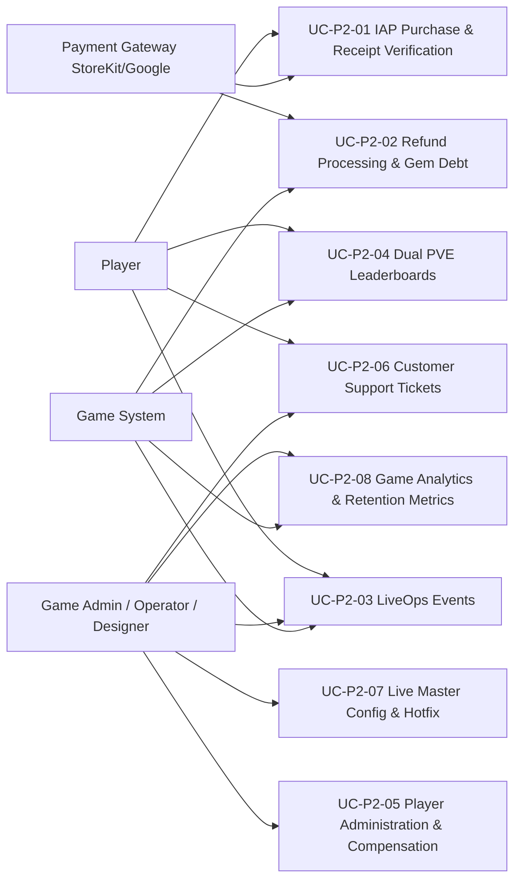

# Use Case Specifications — Phase P2

> **L?u tr? thi?t k? l?ch s?.** Checklist v? k?t qu? ki?m tra ph?n ?nh th?i ?i?m vi?t; c?c m? t? Web/Unity, pity v? duplicate c? th? ?? ???c thay th?. Xem [README hi?n h?nh](../../README.md) v? [backlog Godot](../../GODOT_BACKLOG.md), c?p nh?t 22/11/2026 (UTC+7).

| Field | Value |
|---|---|
| Document ID | IG-BA-UC-P2-001 |
| Version | 0.1 Draft |
| Project | Infinite Gacha (Hero Management & Survival Strategy RPG) |
| Source Baseline | BRD_P2_Draft.md, Phase_Scope_Matrix_P2.csv, MBFL.docx |
| Status | Draft for Review |

---

## 1. Sơ đồ Use Case tổng thể P2 (Use Case Diagram)

---

## 2. Đặc tả chi tiết 8 Use Cases Phase P2

### UC-P2-01: Purchase IAP Packages and Validate Payment Receipts
- **Primary / Supporting Actors:** Player (ACT-01), Payment Gateway (ACT-07), Game System (ACT-03).
- **Preconditions:** Player is authenticated; store catalog is configured.
- **Trigger:** Player selects a premium package (Gems, Monthly Pass, Starter Bundle) in the shop.
- **Main Flow:**
  1. Player views available IAP packages and prices in local currency (`FUN-11-03-001`).
  2. Player initiates purchase; client prompts native Apple StoreKit / Google Play Billing sheet (`FUN-11-03-002`).
  3. Store processes payment and returns an encrypted digital receipt to the client (`FUN-11-03-003`).
  4. Client sends receipt token to the Game Server.
  5. Game Server invokes Apple/Google verification API to validate authenticity, bundle ID, transaction ID, and payment status (`FUN-11-03-004`).
  6. If Master has an active `gem_debt > 0`:
     - System automatically deducts the debt from purchased Gems.
     - Remaining surplus Gems are deposited into `master_currencies.gems`.
  7. If no debt, full Gems/items are granted (`FUN-11-03-005`).
  8. Transaction is logged in `payment_transactions` and `currency_transactions` (`FUN-11-03-006`).
- **Postconditions:** Gems/items are delivered; receipt is invalidated against replay attacks.
- **Alternate / Exception Paths:** If receipt validation fails (fake receipt, revoked token), system halts transaction with error `ERR_IAP_INVALID_RECEIPT` and logs security alert.
- **Covered Functions:**
  - `FUN-11-03-001`: View Purchase Package – Xem gói mua
  - `FUN-11-03-002`: Initiate Payment – Khởi tạo thanh toán
  - `FUN-11-03-003`: Process Payment – Xử lý thanh toán
  - `FUN-11-03-004`: Validate Payment – Xác minh thanh toán
  - `FUN-11-03-005`: Grant Purchase Reward – Cấp vật phẩm
  - `FUN-11-03-006`: Payment History – Lịch sử thanh toán

---

### UC-P2-02: Process Refunds and Manage Gem Debt
- **Primary / Supporting Actors:** Payment Gateway (ACT-07), Game System (ACT-03), Player (ACT-01).
- **Preconditions:** A prior IAP transaction was completed; Store issues a server-to-server refund notification (RTDN / App Store Server Notification).
- **Trigger:** Store confirms refund / chargeback.
- **Main Flow:**
  1. Game Server receives validated refund webhook referencing original `transaction_id` (`FUN-11-03-007`).
  2. System calculates amount of Gems granted in the refunded package ($G_{refund}$).
  3. System inspects player's current Gem wallet ($G_{wallet}$):
     - Case A ($G_{wallet} \ge G_{refund}$): Deduct $G_{refund}$ directly. Wallet remains $\ge 0$.
     - Case B ($G_{wallet} < G_{refund}$):
       - Deduct all available Gems ($G_{wallet} = 0$).
       - Remaining unrecovered Gems are added to `masters.gem_debt`: $\Delta Debt = G_{refund} - G_{wallet}$.
  4. System updates transaction status to `REFUNDED` and records audit log.
  5. Account is **NOT BANNED**; player retains login and access to non-Gem features.
  6. Subsequent Gem awards automatically deduct from `gem_debt` until debt reaches 0.
- **Postconditions:** Gems are reclaimed; debt is tracked; player is notified in-game.
- **Covered Functions:**
  - `FUN-11-03-007`: Refund Processing – Xử lý hoàn tiền

---

### UC-P2-03: Manage and Participate in LiveOps Events
- **Primary / Supporting Actors:** Player (ACT-01), Game Operator (ACT-05), Game Designer (ACT-06), Game System (ACT-03).
- **Preconditions:** Event content and schedule are configured.
- **Trigger:** Event activation time arrives, or player engages with event content.
- **Main Flow:**
  1. Operator/Designer sets up event type (Mini: 3–5d, Standard: 14d, Major: 14–21d, Seasonal: 28–35d) (`FUN-12-04-001`).
  2. System checks overlap policy: enforces maximum 1 Standard Event, up to 2 Mini Events, and verifies 7-day cooldown after Major Events (`FUN-12-04-002`).
  3. System activates the event at scheduled `start_time` (`FUN-12-04-003`).
  4. Player opens Event Center to view missions, storylines, and event shop (`FUN-12-04-004`).
  5. Player completes event objectives (e.g., clear event stages, spend stamina) to earn Event Tokens (`FUN-12-04-005`).
  6. Player exchanges Event Tokens for exclusive Hero shards, scrolls, and equipment (`FUN-12-04-006`).
  7. When `end_time` arrives, event missions close and enter **48-Hour Reward Claim Period** (`FUN-12-04-007`).
  8. After 48 hours, event closes permanently and unused tokens expire.
- **Postconditions:** Event progress and claims are recorded; event transition is completed cleanly.
- **Covered Functions:**
  - `FUN-12-04-001`: Configure Event – Cấu hình sự kiện
  - `FUN-12-04-002`: Schedule Event – Lên lịch sự kiện
  - `FUN-12-04-003`: Activate Event – Kích hoạt sự kiện
  - `FUN-12-04-004`: View Event – Xem sự kiện
  - `FUN-12-04-005`: Event Mission – Nhiệm vụ sự kiện
  - `FUN-12-04-006`: Event Reward – Phần thưởng sự kiện
  - `FUN-12-04-007`: Close Event – Kết thúc sự kiện

---

### UC-P2-04: Compete in Dual PVE Leaderboards and Claim Season Rewards
- **Primary / Supporting Actors:** Player (ACT-01), Game System (ACT-03).
- **Preconditions:** Active leaderboard season is in progress.
- **Trigger:** Player clears a dungeon floor or strengthens their top Heroes.
- **Main Flow:**
  1. When player clears a dungeon floor, system records max floor reached and stage clear time in seconds (`FUN-12-05-001`).
  2. When player levels up or equips Heroes, system updates player's Total Combat Power (Top 5 Heroes CP).
  3. Player inspects Dual Leaderboards:
     - Board A: Dungeon Progression (Ranked by Floor DESC, Clear Time ASC).
     - Board B: Total Combat Power (Ranked by Total CP DESC). (`FUN-12-05-002`).
  4. When season timer expires, system locks rankings and computes reward tiers (Top 1, Top 10, Top 100, Top 10%).
  5. System sends exclusive season rewards (Titles, Avatar Frames, Heavenly Scrolls, Silver) to player Mailbox (`FUN-12-05-003`).
- **Postconditions:** Leaderboard snapshots are archived; season rewards are distributed.
- **Covered Functions:**
  - `FUN-12-05-001`: Calculate Ranking – Tính xếp hạng
  - `FUN-12-05-002`: View Leaderboard – Xem bảng xếp hạng
  - `FUN-12-05-003`: Distribute Ranking Reward – Thưởng xếp hạng

---

### UC-P2-05: Administer Player Accounts and Issue Compensations
- **Primary / Supporting Actors:** Game Admin (ACT-04), Customer Support (ACT-08), Game System (ACT-03).
- **Preconditions:** Admin/CS possesses authorized administrative credentials.
- **Trigger:** Admin investigates reported account or executes emergency compensation.
- **Main Flow:**
  1. Admin searches player via Account ID, Username, or Master Name (`FUN-14-01-001`).
  2. Admin inspects player profile, current currencies, Gem Debt status, Hero roster, and combat history (`FUN-14-01-002`).
  3. If cheating/abuse is detected, Admin applies sanctions: temporary suspension (e.g. 7 days) or permanent ban (`FUN-14-01-003`).
  4. If player proves innocence, Admin restores account to active standing (`FUN-14-01-004`).
  5. In case of system outage, Admin issues compensation parcels directly to specific players or all active players via Mailbox (`FUN-14-01-005`).
- **Postconditions:** Account status updates; compensation items are dispatched; actions are logged in audit trail.
- **Covered Functions:**
  - `FUN-14-01-001`: Search Player – Tìm người chơi
  - `FUN-14-01-002`: View Player Data – Xem dữ liệu
  - `FUN-14-01-003`: Restrict Account – Hạn chế tài khoản
  - `FUN-14-01-004`: Restore Account – Khôi phục tài khoản
  - `FUN-14-01-005`: Player Compensation – Bồi thường

---

### UC-P2-06: Submit and Handle Customer Support Tickets
- **Primary / Supporting Actors:** Player (ACT-01), Customer Support (ACT-08), Game System (ACT-03).
- **Preconditions:** Player is authenticated in-game.
- **Trigger:** Player encounters a bug, missing item, or purchase failure.
- **Main Flow:**
  1. Player opens Support portal in game settings and submits a support ticket with category, description, and attached screenshot (`FUN-14-06-001`).
  2. System routes ticket to CS dashboard with player telemetry attached.
  3. CS agent reviews ticket, checks payment/inventory logs, and composes reply (`FUN-14-06-002`).
  4. CS can trigger direct in-game compensation if issue was validated.
  5. Player receives notification and inspects CS resolution.
  6. Ticket is marked closed upon player confirmation or after 72 hours of inactivity.
- **Postconditions:** Ticket is archived; resolution and satisfaction rating are stored.
- **Covered Functions:**
  - `FUN-14-06-001`: Support Ticket – Yêu cầu hỗ trợ
  - `FUN-14-06-002`: Handle Support Request – Xử lý hỗ trợ

---

### UC-P2-07: Configure Live Game Content and Hotfix Parameters
- **Primary / Supporting Actors:** Game Admin (ACT-04), Game Designer (ACT-06), Game System (ACT-03).
- **Preconditions:** Designer has authorized access to LiveOps CMS.
- **Trigger:** Balance patch, economic adjustment, or new banner configuration is required.
- **Main Flow:**
  1. Designer updates Hero templates, base stats, and skill formulas (`FUN-14-02-001`, `002`, `003`).
  2. Designer configures Dungeon monster parameters, boss mechanics, and drop tables (`FUN-14-02-004`, `005`, `006`).
  3. Designer adjusts currency values, shop price points, and reward bundles (`FUN-14-04-001`, `002`, `003`).
  4. Operator schedules event parameters and Gacha banner rotation dates (`FUN-14-04-004`, `005`).
  5. System validates data integrity and increments configuration version in `system_configs`.
  6. New configuration is published dynamically to client apps via Over-The-Air (OTA) cache.
- **Postconditions:** Game runs on updated versioned rules without requiring a new client binary build.
- **Covered Functions:**
  - `FUN-14-02-001`: Hero Template Configuration – Cấu hình Hero
  - `FUN-14-02-002`: Hero Stats Configuration – Cấu hình chỉ số
  - `FUN-14-02-003`: Hero Skill Configuration – Cấu hình kỹ năng
  - `FUN-14-02-004`: Monster Configuration – Cấu hình quái vật
  - `FUN-14-02-005`: Boss Configuration – Cấu hình Boss
  - `FUN-14-02-006`: Item Configuration – Cấu hình vật phẩm
  - `FUN-14-04-001`: Currency Configuration – Cấu hình tiền tệ
  - `FUN-14-04-002`: Shop Configuration – Cấu hình cửa hàng
  - `FUN-14-04-003`: Reward Configuration – Cấu hình thưởng
  - `FUN-14-04-004`: Event Configuration – Cấu hình sự kiện
  - `FUN-14-04-005`: Banner Configuration – Cấu hình banner

---

### UC-P2-08: Monitor Game Analytics, Economy Health, and Player Retention
- **Primary / Supporting Actors:** Game Admin (ACT-04), Game System (ACT-03).
- **Preconditions:** Telemetry events are being recorded across player sessions.
- **Trigger:** Periodic analytics aggregation (hourly/daily batch jobs) or admin dashboard inquiry.
- **Main Flow:**
  1. System aggregates active user counts (DAU, WAU, MAU, peak CCU) (`FUN-14-05-001`).
  2. System analyzes Gacha summon counts, Pity distribution, and actual vs theoretical drop rates (`FUN-14-05-002`).
  3. System tracks economy liquidity: total Silver Coins and Gems minted vs sinked, inflation velocity (`FUN-14-05-003`).
  4. System compiles battle statistics: victory rates, dungeon clear times, and casualty heatmaps (`FUN-14-05-004`).
  5. System tracks player cohort retention curves (Day 1, Day 7, Day 30) (`FUN-14-05-005`).
  6. Admin inspects visualizations to identify balance anomalies or churn spikes.
- **Postconditions:** Analytics metrics and cohort reports are stored for business intelligence.
- **Covered Functions:**
  - `FUN-14-05-001`: Player Analytics – Phân tích người chơi
  - `FUN-14-05-002`: Gacha Analytics – Phân tích Gacha
  - `FUN-14-05-003`: Economy Analytics – Phân tích kinh tế
  - `FUN-14-05-004`: Battle Analytics – Phân tích chiến đấu
  - `FUN-14-05-005`: Retention Analytics – Phân tích duy trì

---

## 3. Bảng phân bổ 40 Chức năng vào 8 Use Cases

| Use Case ID | Tên Use Case | Số lượng Functions | Danh sách Function IDs |
|---|---|:---:|---|
| `UC-P2-01` | IAP Purchase & Receipt Verification | 6 | `FUN-11-03-001` .. `FUN-11-03-006` |
| `UC-P2-02` | Refund Processing & Gem Debt | 1 | `FUN-11-03-007` |
| `UC-P2-03` | LiveOps Events Management | 7 | `FUN-12-04-001` .. `FUN-12-04-007` |
| `UC-P2-04` | Dual PVE Leaderboards | 3 | `FUN-12-05-001` .. `FUN-12-05-003` |
| `UC-P2-05` | Player Administration & Compensation | 5 | `FUN-14-01-001` .. `FUN-14-01-005` |
| `UC-P2-06` | Customer Support Tickets | 2 | `FUN-14-06-001`, `FUN-14-06-002` |
| `UC-P2-07` | Live Master Config & Hotfix | 11 | `FUN-14-02-001` .. `006`, `FUN-14-04-001` .. `005` |
| `UC-P2-08` | Game Analytics & Metrics Retention | 5 | `FUN-14-05-001` .. `FUN-14-05-005` |
| **Tổng cộng** | **8 Use Cases** | **40 Functions** | **100% Khớp với Phase Scope Matrix P2** |
